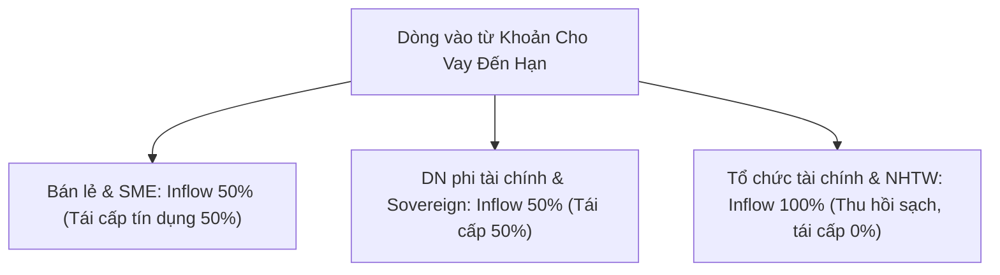

## Định nghĩa

**Contractual cash inflows** (Dòng tiền vào theo hợp đồng) là thành phần giảm trừ trong mẫu số của tỷ lệ [[lcr]], đại diện cho tổng các dòng tiền mặt mà ngân hàng kỳ vọng thu hồi được từ các khoản phải thu theo hợp đồng trong kịch bản kiểm tra sức chịu tải thanh khoản 30 ngày [[src-bcbs-lcr#^lcr40-1]].

Khác với dòng tiền ra được xác định dựa trên tỷ lệ rút vốn ([[run-off-rate]]) của người gửi tiền và nhà đầu tư, dòng tiền vào được xác định dựa trên **tỷ lệ thu hồi dòng vào (*inflow rate*)** áp dụng cho từng nhóm đối tác và từng cấu trúc giao dịch [[src-bcbs-lcr#^lcr40-78]] [[src-bcbs-lcr#^lcr40-83]].

Toàn bộ dòng tiền vào chịu sự khống chế của **trần bù trừ 75% (*75% Aggregate Cap*)**, đảm bảo ngân hàng luôn phải duy trì một lượng [[hqla]] tối thiểu bằng ít nhất 25% tổng dòng tiền ra gộp [[src-bcbs-lcr#^lcr40-77]].

---

## Công thức & tham số

### Cơ chế Trần Bù trừ Dòng vào 75% (The 75% Inflow Cap)

#### 1. Công thức và Cơ chế kích hoạt
Theo chuẩn mực LCR40.77:
$$
\text{Total Expected Inflows Recognised} = \min\Big(\text{Total Contractual Inflows},\; 0.75 \times \text{Total Cash Outflows}\Big)
$$

Trần 75% bị kích hoạt khi:
$$
\frac{\text{Total Contractual Inflows}}{\text{Total Cash Outflows}} > 75\%
$$

## Diễn giải

### Các nguyên tắc nền tảng của Dòng tiền vào

Chuẩn mực Basel LCR40 thiết lập 5 nguyên tắc nghiêm ngặt chi phối việc ghi nhận dòng tiền vào:

#### 1. Nguyên tắc nợ hoạt động tốt (*Fully Performing Only*)
Ngân hàng chỉ được ghi nhận dòng tiền vào từ các khoản phơi nhiễm đang hoạt động bình thường (*fully performing*) và ngân hàng không có bất kỳ lý do nào để dự kiến sẽ phát sinh vỡ nợ trong vòng 30 ngày [[src-bcbs-lcr#^lcr40-75]]. Mọi khoản nợ quá hạn, nợ cơ cấu hoặc nợ có rủi ro suy giảm chất lượng tín dụng đều bị loại trừ hoàn toàn khỏi dòng vào.

#### 2. Tuyệt đối không ghi nhận dòng vào tiềm tàng (*Exclusion of Contingent Inflows*)
Các cam kết cấp vốn, hạn mức tín dụng (*credit facilities*) hoặc hạn mức thanh khoản (*liquidity facilities*) mà ngân hàng được cấp bởi định chế tài chính khác hoặc NHTW đều nhận **tỷ lệ dòng vào bằng 0%** [[src-bcbs-lcr#^lcr40-75]] [[src-bcbs-lcr#^lcr40-82]]. 
> *Lý do kinh tế*: Tránh rủi ro lây lan hệ thống (*contagion risk*). Trong stress toàn thị trường, các ngân hàng đối tác sẽ ưu tiên bảo tồn thanh khoản của chính họ và có thể không thể giải ngân hoặc sẵn sàng chịu rủi ro pháp lý/uy tín để hủy cam kết [[src-bcbs-lcr#^lcr40-82]].

#### 3. Nguyên tắc ngày thanh toán muộn nhất (*Latest Possible Date Rule*)
Dòng tiền vào chỉ được tính tại thời điểm muộn nhất mà đối tác có quyền hợp pháp để thanh toán theo hợp đồng [[src-bcbs-lcr#^lcr40-84]]. Nếu đối tác có quyền chọn gia hạn hoặc trì hoãn trả nợ trong khuôn khổ hợp đồng, ngân hàng phải giả định đối tác sẽ tận dụng tối đa quyền chọn đó.

#### 4. Loại trừ các khoản vay không xác định kỳ hạn (*Open Maturity Loans*)
Các khoản cho vay không có kỳ hạn đáo hạn cụ thể (*non-defined or open maturity*) hoặc các khoản vay có thể bị ngân hàng đơn phương chấm dứt hợp đồng trong vòng 30 ngày đều bị loại trừ khỏi dòng vào [[src-bcbs-lcr#^lcr40-85]]. 
*Ngoại lệ duy nhất*: Ngân hàng chỉ được ghi nhận các khoản thanh toán tối thiểu theo hợp đồng (tiền gốc, lãi, phí định kỳ) đến hạn phải trả trong 30 ngày [[src-bcbs-lcr#^lcr40-85]].

#### 5. Nguyên tắc chống đếm trùng với HQLA (*No Double-Counting Principle*)
Tài sản Level 1 và Level 2 đáo hạn trong vòng 30 ngày đã được tính vào kho tài sản thanh khoản cao [[hqla]] (tử số), do đó dòng tiền thu hồi từ các tài sản này **không được phép tính thêm vào dòng tiền vào** (mẫu số) [[src-bcbs-lcr#^lcr40-4]] [[src-bcbs-lcr#^lcr40-88]]. Ngược lại, chứng khoán đáo hạn trong 30 ngày không nằm trong HQLA (ví dụ trái phiếu doanh nghiệp không đủ tiêu chuẩn) được tính dòng vào 100% [[src-bcbs-lcr#^lcr40-88]].

---

### Chi tiết các Danh mục Dòng tiền vào

#### 1. Cho vay có bảo đảm: Reverse Repo & Mượn chứng khoán (LCR40.78 - 40.81)

Trong các giao dịch repo đảo (*reverse repurchase*) và cho vay chứng khoán (*securities borrowing*) đáo hạn trong vòng 30 ngày, dòng tiền vào được giả định dựa trên khả năng đối tác tái cấp vốn cho tài sản bảo đảm:

| Tài sản bảo đảm nhận về | Inflow rate (Bình thường) | Inflow rate (Dùng bù vị thế bán khống) | Căn cứ chuẩn mực |
|---|---|---|---|
| **Level 1 assets** | **0%** | **0%** | [[src-bcbs-lcr#^lcr40-78]] [[src-bcbs-lcr#^lcr40-79]] |
| **Level 2A assets** | **15%** | **0%** | [[src-bcbs-lcr#^lcr40-78]] [[src-bcbs-lcr#^lcr40-79]] |
| **Level 2B RMBS đủ điều kiện** | **25%** | **0%** | [[src-bcbs-lcr#^lcr40-78]] [[src-bcbs-lcr#^lcr40-79]] |
| **Level 2B khác** | **50%** | **0%** | [[src-bcbs-lcr#^lcr40-78]] [[src-bcbs-lcr#^lcr40-79]] |
| **Margin loans bảo đảm bằng non-HQLA** | **50%** | **0%** | [[src-bcbs-lcr#^lcr40-78]] [[src-bcbs-lcr#^lcr40-79]] |
| **Tài sản khác (Non-HQLA)** | **100%** | **0%** | [[src-bcbs-lcr#^lcr40-78]] [[src-bcbs-lcr#^lcr40-79]] |

> [!IMPORTANT]
> **Ngoại lệ Tái sử dụng TSBĐ để Bù đắp Vị thế Bán khống (*Short Positions Rehypothecation*)**:
> Nếu tài sản bảo đảm nhận được từ reverse repo hoặc securities borrowing được ngân hàng tái sử dụng (*rehypothecated*) để bù đắp các vị thế bán khống có thể kéo dài quá 30 ngày (cả *firm shorts* và *customer shorts*), ngân hàng bắt buộc phải giả định giao dịch reverse repo này sẽ được gia hạn liên tục và **không tạo ra bất kỳ dòng tiền vào nào (inflow 0%)** [[src-bcbs-lcr#^lcr40-79]]. Đổi lại, vị thế bán khống được xử lý đối xứng và không phát sinh dòng ra [[src-bcbs-lcr#^lcr40-79]].

#### 2. Thu hồi nợ theo phân loại Đối tác & Nguyên tắc Bảo tồn Thương quyền (LCR40.83 - 40.87)

Chuẩn mực Basel đặt ra các giới hạn dòng tiền vào theo loại đối tác để phản ánh nhu cầu duy trì kinh doanh liên tục ngay cả trong giai đoạn khủng hoảng:

- **Khách hàng bán lẻ và SME (Inflow 50%)**: Ngân hàng được giả định phải tiếp tục gia hạn hoặc cấp mới ít nhất 50% quy mô các khoản vay đến hạn cho khách hàng cá nhân và SME nhằm bảo vệ thương quyền và tránh gây sốc kinh tế xã hội [[src-bcbs-lcr#^lcr40-86]]. Dòng tiền vào thực tế ghi nhận là 50% số dư nợ gốc và lãi đến hạn.
- **Doanh nghiệp phi tài chính, Sovereign, PSE, MDB (Inflow 50%)**: Tương tự như bán lẻ, ngân hàng duy trì 50% hạn mức tài trợ cho khu vực sản xuất kinh doanh và các thực thể công quyền, dẫn đến dòng vào ghi nhận là 50% [[src-bcbs-lcr#^lcr40-87]].
- **Định chế tài chính và Ngân hàng Trung ương (Inflow 100%)**: Ngân hàng giả định sẽ dừng toàn bộ việc gia hạn tín dụng cho các ngân hàng đối thủ và thu hồi 100% nợ gốc, lãi, tiền gửi không kỳ hạn và tiền gửi có kỳ hạn liên ngân hàng đáo hạn trong 30 ngày [[src-bcbs-lcr#^lcr40-87]].

#### 3. Tiền gửi phục vụ hoạt động đặt tại nơi khác (LCR40.89 - 40.90)
- Tiền gửi của ngân hàng đặt tại các định chế tài chính khác phục vụ mục đích vận hành (*clearing, custody, cash management*) hoặc đặt tại định chế trung ương của mạng lưới ngân hàng hợp tác xã chịu **tỷ lệ dòng vào 0%** [[src-bcbs-lcr#^lcr40-31]] [[src-bcbs-lcr#^lcr40-89]] [[src-bcbs-lcr#^lcr40-90]].
- *Lý do*: Đây là dòng tiền bắt buộc phải duy trì để duy trì kết nối hệ thống thanh toán quốc tế và trong nước. Nếu ngân hàng rút số dư này, toàn bộ dịch vụ thanh toán bù trừ sẽ tê liệt.
- *Ngoại lệ*: Chỉ phần số dư được xác định rõ là thặng dư (*excess balance*) không gắn với nhu cầu vận hành mới được hưởng dòng vào 100% [[src-bcbs-lcr#^lcr40-89]].

#### 4. Dòng vào phái sinh ròng (LCR40.91 - 40.92)
- Tổng các dòng tiền vào phái sinh ròng theo hợp đồng được tính hệ số **100%** [[src-bcbs-lcr#^lcr40-91]].
- Dòng tiền vào được tính bù trừ (*net basis*) theo từng đối tác nếu tồn tại thỏa thuận bù trừ song phương (*master netting agreement*) hợp pháp [[src-bcbs-lcr#^lcr40-49]].
- Các quyền chọn mà ngân hàng nắm giữ đang ở trạng thái có lãi (*in the money*) được giả định thực hiện và tạo ra dòng tiền vào theo giá trị thanh khoản của tài sản hoặc tiền thanh toán [[src-bcbs-lcr#^lcr40-49]].
- Đối với phái sinh bảo đảm bằng HQLA, dòng tiền vào phải tính ròng với các nghĩa vụ giao tài sản bảo đảm làm giảm kho HQLA (chống đếm trùng) [[src-bcbs-lcr#^lcr40-92]].

#### 5. Dòng vào hợp đồng khác & Giao dịch chưa thanh toán (LCR40.93)
- Thu hồi từ các hợp đồng kỳ hạn (*forward repos/swaps*) bắt đầu trước và đáo hạn trong vòng 30 ngày được xử lý tương đương repo/reverse repo thông thường.
- Đối với giao dịch mua bán chứng khoán chưa thanh toán (*unsettled trades*) đáo hạn trong 30 ngày: các giao dịch bán chứng khoán non-HQLA đã khớp lệnh nhưng chưa quyết toán tiền được tính vào dòng tiền vào khác (theo quyết định của supervisor), trong khi các giao dịch HQLA chưa thanh toán được bỏ qua trong tính toán dòng tiền [[src-bcbs-lcr#^lcr40-93]].
- Các dòng tiền vào từ doanh thu hoạt động phi tài chính (ví dụ thu tiền bán tài sản cố định, doanh thu dịch vụ phi ngân hàng) **không được đưa vào tính toán dòng vào LCR** [[src-bcbs-lcr#^lcr40-93]].

---

## Ứng dụng trong ALM

### 2. Tác động kinh tế và Quản trị ALM
1. **Khái niệm "Tổn thất giá trị thanh khoản biên" (*Marginal Inflow Deadweight*)**:
   - Khi dòng tiền vào theo hợp đồng đã vượt quá 75% tổng dòng ra, bất kỳ dòng thu tiền nào phát sinh thêm trong vòng 30 ngày đều có **giá trị biên bằng 0** đối với việc cải thiện tỷ lệ LCR!
   - Ví dụ: Ngân hàng có dòng ra 100 tỷ VND, dòng vào hợp đồng 90 tỷ VND. Trần 75% giới hạn dòng vào được công nhận là 75 tỷ VND. Dòng tiền ra ròng $\text{TNCO} = 100 - 75 = 25$ tỷ VND. Dù ngân hàng có thu thêm 10 tỷ VND tiền nợ ngắn hạn (nâng dòng vào lên 100 tỷ), TNCO vẫn giữ nguyên ở mức 25 tỷ VND.
2. **Chiến lược tái cơ cấu kỳ hạn của Treasury**:
   - Khi tiệm cận hoặc vượt trần 75%, Treasury không nên tiếp tục duy trì tài sản sinh lời ở kỳ hạn ngắn $< 30$ ngày. Thay vào đó, ngân hàng nên:
     - Kéo dài kỳ hạn cho vay ra ngoài 30 ngày (ví dụ 3 đến 6 tháng) để hưởng biên lãi ròng (*NIM*) cao hơn mà không làm tổn hại LCR.
     - Hoặc chuyển đổi danh mục cho vay ngắn hạn sang mua các tài sản [[level-1-assets]] hoặc [[level-2-assets]]. Mỗi đồng tiền chuyển sang HQLA sẽ làm tăng trực tiếp tử số 1:1, trong khi để ở dòng vào ngắn hạn bị trần 75% triệt tiêu giá trị biên.

---

### Giám sát Mức độ Tập trung Dòng vào (Inflow Concentration)

Chuẩn mực LCR40.76 yêu cầu các ngân hàng và cơ quan thanh tra giám sát phải chủ động theo dõi **mức độ tập trung của dòng tiền vào kỳ vọng giữa các đối tác bán buôn**.

Nếu một ngân hàng có vị thế thanh khoản phụ thuộc quá mức vào dòng tiền đến hạn từ một hoặc một nhóm rất nhỏ các định chế tài chính bán buôn, ngân hàng đó đối mặt với rủi ro thanh khoản nghiêm trọng nếu đối tác gặp trục trặc kỹ thuật thanh toán hoặc vỡ nợ bất ngờ. Do đó, ALM phải thiết lập các hạn mức tập trung dòng vào (*counterparty inflow concentration limits*) theo từng đối tác và nhóm đối tác liên kết.

---

## Nhầm lẫn thường gặp

- ❌ **Coi hạn mức thấu chi / tín dụng được cấp là dòng vào**: Ký hợp đồng hạn mức tín dụng dự phòng với ngân hàng mẹ hoặc đối tác quốc tế không mang lại bất kỳ giá trị dòng vào nào cho LCR (inflow 0% theo LCR40.82).
- ❌ **Ghi nhận 100% dòng thu hồi nợ từ doanh nghiệp**: LCR giả định ngân hàng phải tái cấp 50% tín dụng cho doanh nghiệp phi tài chính để duy trì hoạt động kinh doanh, do đó chỉ được ghi nhận tối đa 50% dòng vào theo LCR40.87.
- ❌ **Bỏ quên ngoại lệ bán khống**: Nghĩ rằng mọi reverse repo bảo đảm bằng Level 2 hoặc non-HQLA đều đem lại dòng vào theo bảng chuẩn, bỏ qua việc tài sản nhận về đã được dùng để bù vị thế bán khống (khi đó dòng vào bị hạ về 0% theo LCR40.79).
- ❌ **Bù trừ dòng vào với nợ không liên quan**: Bù trừ khoản cho vay liên ngân hàng với tiền gửi của chính ngân hàng đó mà không có hợp đồng bù trừ pháp lý hợp lệ.
