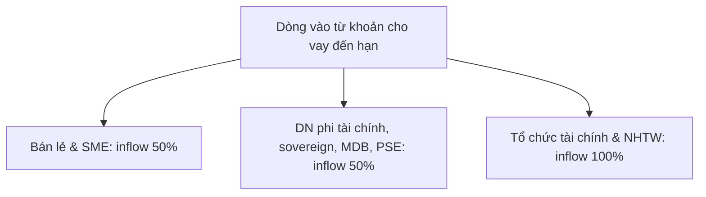

## Định nghĩa

**Contractual cash inflows** (Dòng tiền vào theo hợp đồng) là thành phần giảm trừ trong mẫu số của tỷ lệ [[lcr]], gồm các dòng tiền mà ngân hàng kỳ vọng thu từ khoản phải thu theo hợp đồng trong kịch bản stress thanh khoản 30 ngày [[src-bcbs-lcr#^lcr40-1]].

Khác với dòng tiền ra (xác định bằng [[run-off-rate]]), dòng tiền vào được xác định bằng **inflow rate** theo nhóm đối tác và cấu trúc giao dịch [[src-bcbs-lcr#^lcr40-78]] [[src-bcbs-lcr#^lcr40-83]].

Tổng dòng tiền vào được khấu trừ tối đa 75% tổng dòng tiền ra, nên ngân hàng phải duy trì HQLA tối thiểu bằng 25% tổng dòng tiền ra [[src-bcbs-lcr#^lcr40-77]].

Theo [[tt50-2026|TT50/2026]], tổng dòng tiền vào bằng số dư các loại tài sản và cam kết ngoại bảng nhân với hệ số thu tiền, nhưng không vượt quá 75% tổng dòng tiền ra [[src-tt50-2026-nhnn#^d21-2]]. LCR áp dụng từ 01/10/2028 [[src-tt50-2026-nhnn#^d13-1]].

---

## Công thức & tham số

### Trần dòng vào 75%

Theo LCR40.77:
$$
\text{Total Expected Inflows Recognised} = \min\Big(\text{Total Contractual Inflows},\; 0.75 \times \text{Total Cash Outflows}\Big)
$$
[[src-bcbs-lcr#^lcr40-77]]

TT50/2026 Đ21.2.b dùng cùng trần: tổng dòng tiền vào không vượt quá 75% tổng dòng tiền ra [[src-tt50-2026-nhnn#^d21-2]].

*Diễn giải:* trần bị kích hoạt khi tỷ số dưới đây vượt 75%:
$$
\frac{\text{Total Contractual Inflows}}{\text{Total Cash Outflows}} > 75\%
$$

## Diễn giải

### Nguyên tắc ghi nhận dòng tiền vào theo Basel

LCR40.75–40.93 quy định các nguyên tắc sau.

#### 1. Chỉ tính khoản phải thu đang performing (*Fully Performing Only*)
Ngân hàng chỉ được tính dòng tiền vào theo hợp đồng (kể cả lãi) từ khoản phơi nhiễm đang performing và không có lý do dự kiến vỡ nợ trong 30 ngày [[src-bcbs-lcr#^lcr40-75]].

#### 2. Không tính dòng vào tiềm tàng (*Exclusion of Contingent Inflows*)
Dòng vào tiềm tàng, kể cả hạn mức nhận từ NHTW hay bên khác, không được tính [[src-bcbs-lcr#^lcr40-75]]. Hạn mức tín dụng và hạn mức thanh khoản ngân hàng được cấp có inflow rate 0% [[src-bcbs-lcr#^lcr40-82]]. Quyền theo hợp đồng được thay TSBĐ HQLA bằng tài sản kém chất lượng hơn hoặc non-HQLA cũng là dòng vào tiềm tàng, không tính [[src-bcbs-lcr#^lcr40-55-faq]]. Ngoại lệ: dòng vào từ quyền chọn phái sinh in the money mà ngân hàng nắm giữ được tính [[src-bcbs-lcr#^lcr40-49-faq]].

*Diễn giải:* trong stress toàn thị trường, bên cấp hạn mức có thể ưu tiên giữ thanh khoản cho chính mình, nên cam kết nhận được không phải nguồn thanh khoản chắc chắn.

#### 3. Ngày thanh toán muộn nhất (*Latest Possible Date Rule*)
Chỉ tính khoản vay performing, và dòng vào lấy tại ngày muộn nhất mà đối tác có quyền theo hợp đồng [[src-bcbs-lcr#^lcr40-84]].

*Diễn giải:* nếu đối tác có quyền gia hạn hoặc hoãn trả trong khuôn khổ hợp đồng, ngân hàng giả định đối tác dùng hết quyền đó.

#### 4. Khoản vay không kỳ hạn, có thể chấm dứt và hạn mức quay vòng
- Khoản vay không có kỳ hạn xác định (*open maturity*) bị loại khỏi dòng vào [[src-bcbs-lcr#^lcr40-85]]. Cách xử lý này áp cả cho khoản vay có thể chấm dứt theo hợp đồng trong 30 ngày [[src-bcbs-lcr#^lcr40-85b]].
- Ngoại lệ: ngân hàng có thể tính khoản thanh toán tối thiểu (gốc, phí, lãi) của khoản vay không kỳ hạn nếu đến hạn theo hợp đồng trong 30 ngày [[src-bcbs-lcr#^lcr40-85b]].
- Hạn mức tín dụng quay vòng: ngân hàng phải giả định khoản vay hiện hữu được roll-over, phần chưa giải ngân xử lý như hạn mức cam kết [[src-bcbs-lcr#^lcr40-84b]].

#### 5. Không đếm trùng với HQLA (*No Double-Counting*)
Tài sản Level 1 và Level 2 đáo hạn trong 30 ngày phải tính trong kho HQLA, không tính là dòng vào, nếu đáp ứng mọi yêu cầu vận hành và định nghĩa; khoản không đáp ứng yêu cầu vận hành có thể tính là dòng vào [[src-bcbs-lcr#^lcr40-88b]]. Chứng khoán đáo hạn trong 30 ngày không nằm trong HQLA có thể tính inflow 100% [[src-bcbs-lcr#^lcr40-88]].

---

### Danh mục dòng tiền vào theo Basel

#### 1. Reverse repo và securities borrowing (LCR40.78–40.81)

| Tài sản bảo đảm nhận về | Inflow rate (thông thường) | Inflow rate (tài sản dùng bù vị thế bán khống) | Căn cứ |
|---|---|---|---|
| Level 1 | 0% | 0% | [[src-bcbs-lcr#^lcr40-78]] [[src-bcbs-lcr#^lcr40-79]] |
| Level 2A | 15% | 0% | [[src-bcbs-lcr#^lcr40-78]] [[src-bcbs-lcr#^lcr40-79]] |
| Level 2B RMBS đủ điều kiện | 25% | 0% | [[src-bcbs-lcr#^lcr40-78]] [[src-bcbs-lcr#^lcr40-79]] |
| Level 2B khác | 50% | 0% | [[src-bcbs-lcr#^lcr40-78]] [[src-bcbs-lcr#^lcr40-79]] |
| Margin loans bảo đảm bằng non-HQLA | 50% | 0% | [[src-bcbs-lcr#^lcr40-78]] [[src-bcbs-lcr#^lcr40-79]] |
| Tài sản khác (non-HQLA) | 100% | 0% | [[src-bcbs-lcr#^lcr40-78]] [[src-bcbs-lcr#^lcr40-79]] |

> [!IMPORTANT]
> **Ngoại lệ bù vị thế bán khống**: nếu tài sản bảo đảm nhận từ reverse repo hoặc securities borrowing được tái sử dụng (*rehypothecated*) để bù vị thế bán khống có thể kéo dài quá 30 ngày, ngân hàng phải giả định giao dịch được roll-over và không tạo dòng vào (0%) [[src-bcbs-lcr#^lcr40-79]]. Vị thế bán khống khi đó được xử lý đối xứng, không phát sinh dòng ra [[src-bcbs-lcr#^lcr40-79]].

LCR40.78 và bảng LCR40.79 chỉ áp cho khoản cho vay có bảo đảm có kỳ hạn hợp đồng đến 30 ngày; margin loan có điều khoản cho khách hàng trả sau hơn 30 ngày không tạo dòng vào [[src-bcbs-lcr#^lcr40-78-faq]]. Inflow 0% của cột bán khống áp cho mọi giao dịch có TSBĐ dùng bù vị thế bán khống, kể cả vị thế có kỳ hạn còn lại đến 30 ngày [[src-bcbs-lcr#^lcr40-79-faq]].

Ngân hàng nên quản trị tài sản bảo đảm để có thể hoàn trả khi đối tác không roll-over reverse repo hoặc cho vay chứng khoán, nhất là với non-HQLA [[src-bcbs-lcr#^lcr40-81]].

#### 2. Dòng vào theo đối tác (LCR40.83–40.87)

Với các giao dịch khác (có hoặc không có bảo đảm), inflow rate xác định theo đối tác, phản ánh nhu cầu tiếp tục cho vay hoặc roll-over ngay cả trong stress [[src-bcbs-lcr#^lcr40-83]].

- **Bán lẻ và small business (50%)**: ngân hàng phải giả định tiếp tục cho vay 50% số đến hạn, nên inflow là 50% số theo hợp đồng [[src-bcbs-lcr#^lcr40-86]].
- **Bán buôn phi tài chính (50%)**: gồm doanh nghiệp phi tài chính, sovereign, MDB và PSE [[src-bcbs-lcr#^lcr40-87]] [[src-bcbs-lcr#^lcr40-87b]].
- **Tổ chức tài chính và NHTW (100%)**: ngân hàng giả định tiếp tục cho vay 0%, nên inflow 100% [[src-bcbs-lcr#^lcr40-87]]. Ngân hàng nói chung có thể giả định thu hồi toàn bộ thanh khoản từ tổ chức tài chính, trừ khoản phục vụ hoạt động vận hành [[src-bcbs-lcr#^lcr40-83]].
- **Chứng khoán non-HQLA đáo hạn trong 30 ngày (100%)** [[src-bcbs-lcr#^lcr40-88]]. Dòng vào từ giải tỏa số dư trên tài khoản tách biệt (bảo vệ tài sản giao dịch của khách hàng) có thể tính vào nhóm này nếu số dư được giữ bằng HQLA [[src-bcbs-lcr#^lcr40-88b]].

#### 3. Tiền gửi operational đặt tại nơi khác (LCR40.89–40.90)
- Tiền gửi ngân hàng đặt tại tổ chức tài chính khác cho mục đích vận hành (clearing, custody, cash management) phải tính inflow 0% [[src-bcbs-lcr#^lcr40-89]]. Tiền gửi tại tổ chức trung ương của mạng lưới ngân hàng hợp tác xã cũng 0% [[src-bcbs-lcr#^lcr40-90]].
- Ngân hàng nhận tiền gửi phân loại là operational thì ngân hàng gửi cũng nên phân loại như vậy. Tiền gửi cho mục đích ngân hàng đại lý (*correspondent banking*) phải tính inflow 0% [[src-bcbs-lcr#^lcr40-89b]].
- Phần ngân hàng xác định được là *excess balances* có thể tính inflow 100% [[src-bcbs-lcr#^lcr40-89b]].

*Diễn giải:* số dư operational là điều kiện để duy trì dịch vụ thanh toán bù trừ, nên LCR không coi đó là nguồn thanh khoản rút được trong stress.

#### 4. Dòng vào phái sinh ròng (LCR40.91–40.92)
- Tổng dòng vào phái sinh ròng tính hệ số 100%, theo phương pháp LCR40.49 [[src-bcbs-lcr#^lcr40-91]].
- Dòng tiền phái sinh chỉ được tính ròng theo đối tác khi có master netting agreement hợp lệ [[src-bcbs-lcr#^lcr40-49b]].
- Quyền chọn thực hiện được trong 30 ngày được giả định thực hiện khi *in the money* với bên mua [[src-bcbs-lcr#^lcr40-49]].
- Phái sinh bảo đảm bằng HQLA: dòng vào tính ròng với nghĩa vụ giao tài sản bảo đảm theo hợp đồng, vì nghĩa vụ đó làm giảm kho HQLA [[src-bcbs-lcr#^lcr40-92]].

#### 5. Dòng vào hợp đồng khác, giao dịch kỳ hạn và chưa thanh toán (LCR40.93)
- Dòng vào hợp đồng khác do quốc gia quyết định; supervisor xác định inflow rate cho từng loại [[src-bcbs-lcr#^lcr40-93]].
- Forward repo, forward reverse repo và forward collateral swap bắt đầu trước và đáo hạn trong 30 ngày được xử lý như repo, reverse repo, collateral swap thông thường [[src-bcbs-lcr#^lcr40-93-faq1]].
- Giao dịch mua bán HQLA chưa thanh toán có thể bỏ qua. Dòng tiền từ mua bán non-HQLA đã khớp nhưng chưa thanh toán tại ngày báo cáo tính vào "other cash inflows" và "other cash outflows" [[src-bcbs-lcr#^lcr40-93-faq1]].
- Dòng vào liên quan đến doanh thu phi tài chính không được tính [[src-bcbs-lcr#^lcr40-93]].

---

### Khung Pháp lý Dòng tiền vào theo TT50/2026/TT-NHNN (Phần C Phụ lục I)

TT50/2026 hiệu lực từ 01/10/2026 [[src-tt50-2026-nhnn#^d37-1]]; LCR áp dụng từ 01/10/2028 [[src-tt50-2026-nhnn#^d13-1]]. Tổng dòng tiền vào xác định theo Phần C Phụ lục I [[src-tt50-2026-nhnn#^d21-2]].

#### Danh mục dòng tiền vào theo Bảng 8 TT50

Bảng 8 là biểu mẫu tính dòng tiền vào: mỗi đầu mục phân theo 4 khung thời gian đến hạn (ngày tiếp theo; ngày 2–7; ngày 8–14; ngày 15–30), giá trị theo mức độ rủi ro bằng tổng số dư nhân hệ số thu tiền [[src-tt50-2026-nhnn#^pl1-c7]].

| Mục | Đầu mục | Hệ số thu tiền | Điều kiện chính | Căn cứ |
|---|---|---|---|---|
| 1.1 | Reverse repo / cấp tín dụng bảo đảm bằng tài sản cấp 1 | 0% | Thời hạn còn lại đến 30 ngày | [[src-tt50-2026-nhnn#^pl1-c2]] [[src-tt50-2026-nhnn#^pl1-c2-4]] |
| 1.2 | Bảo đảm bằng tài sản cấp 2A | 15% | | [[src-tt50-2026-nhnn#^pl1-c2-2]] [[src-tt50-2026-nhnn#^pl1-c2-4]] |
| 1.3.1 | Bảo đảm bằng RMBS đủ điều kiện | 25% | | [[src-tt50-2026-nhnn#^pl1-c2-4]] |
| 1.3.2 | Bảo đảm bằng tài sản cấp 2B khác | 50% | | [[src-tt50-2026-nhnn#^pl1-c2-4]] |
| 1.4 | Khoản cho vay ký quỹ (margin loans) | 50% | Coi là cấp tín dụng có bảo đảm bằng tài sản tài chính | [[src-tt50-2026-nhnn#^pl1-c2]] [[src-tt50-2026-nhnn#^pl1-c2-4]] |
| 1.5 | Bảo đảm bằng tài sản tài chính khác (không thuộc HQLA) | 100% | | [[src-tt50-2026-nhnn#^pl1-c2-2]] [[src-tt50-2026-nhnn#^pl1-c2-4]] |
| 2 | Hạn mức tín dụng, thanh khoản tổ chức khác cấp cho ngân hàng | 0% | | [[src-tt50-2026-nhnn#^pl1-c3]] |
| 3.1 | Tiền gửi hoạt động tại tổ chức tài chính khác | 0% | Thanh toán bù trừ, lưu ký, quản lý tiền mặt; không xác định được mức tối thiểu thì 0% toàn bộ số dư | [[src-tt50-2026-nhnn#^pl1-c4-8a]] |
| 3.2 | Phần tiền gửi dư thừa đủ điều kiện | 100% | "Số dư vượt mức yêu cầu" theo thỏa thuận, rút được trong 30 ngày, không hạn chế rút | [[src-tt50-2026-nhnn#^pl1-c4-8b]] |
| 4.1 | Tiền gửi từ hoạt động ngân hàng đại lý | 0% | Coi là tiền gửi hoạt động đối với ngân hàng gửi tiền | [[src-tt50-2026-nhnn#^pl1-c4-9]] |
| 4.2 | Phần tiền gửi đại lý dư thừa đủ điều kiện | 100% | Theo điểm b khoản 8 Mục IV | [[src-tt50-2026-nhnn#^pl1-c4-9]] [[src-tt50-2026-nhnn#^pl1-c7]] |
| 5.1 | Phải thu từ khách hàng bán lẻ và DNNVV đủ điều kiện | 50% | Kể cả lãi và trả góp | [[src-tt50-2026-nhnn#^pl1-c4-5]] |
| 5.2.1 | Phải thu từ doanh nghiệp không phải tổ chức tài chính | 50% | | [[src-tt50-2026-nhnn#^pl1-c4-6b]] |
| 5.2.2 | Phải thu từ Chính phủ, KBNN, UBND cấp tỉnh, BHTG Việt Nam | 50% | Khoản 6.b(ii) còn gồm Chính phủ nước ngoài | [[src-tt50-2026-nhnn#^pl1-c4-6b]] [[src-tt50-2026-nhnn#^pl1-c7]] |
| 5.2.3 | Phải thu từ tổ chức khác (tổ chức tài chính quốc tế, tổ chức công lập của Chính phủ nước ngoài, tổ chức khác) | 50% | | [[src-tt50-2026-nhnn#^pl1-c4-6b]] |
| 5.3 | Phải thu từ tổ chức tài chính và NHNN | 100% | | [[src-tt50-2026-nhnn#^pl1-c4-6a]] |
| 6 | Dòng tiền vào ròng từ công cụ phái sinh | 100% | Tính theo khoản 1 Mục IV Phần B | [[src-tt50-2026-nhnn#^pl1-c5-1]] |
| 7 | Chứng khoán đáo hạn trong 30 ngày không thuộc HQLA đủ tiêu chuẩn | 100% | Kể cả số dư phong tỏa được giải tỏa | [[src-tt50-2026-nhnn#^pl1-c4-7]] |

#### 1. Nguyên tắc ghi nhận (Mục I Phần C)
- Ngân hàng phải ghi nhận dòng tiền vào của khoản phải đòi theo thỏa thuận (kể cả lãi) trong 30 ngày tiếp theo, khi khoản phải đòi là nợ nhóm 1 sau điều chỉnh theo thông tin CIC. Khoản phải đòi ngoài phạm vi phân loại nợ thì khách hàng phải đã thanh toán đủ nghĩa vụ đến hạn và không phải trích lập dự phòng [[src-tt50-2026-nhnn#^pl1-c1-1]].
- Khoản phải đòi không được thuộc trường hợp vỡ nợ theo TT14/2025 [[src-tt50-2026-nhnn#^pl1-c1]].
- Dòng vào mang tính điều kiện, kể cả cam kết từ NHNN hoặc đối tác khác, không được tính [[src-tt50-2026-nhnn#^pl1-c1]]. Trường hợp có quyền thay thế tài sản bảo đảm là HQLA bằng HQLA có hệ số thấp hơn hoặc tài sản không phải HQLA cũng coi là dòng vào điều kiện [[src-tt50-2026-nhnn#^pl1-c1-2]].
- Ngân hàng không có đủ căn cứ xác định số tiền có khả năng thu được thì không được tính số đó [[src-tt50-2026-nhnn#^pl1-c1-4]].
- Khoản phải đòi có nhiều kỳ trả nợ: xác định hệ số thu tiền theo thời hạn thực tế từng kỳ [[src-tt50-2026-nhnn#^pl1-c1-5]].
- Theo dõi dòng tiền vào tập trung của khách hàng không phải bán lẻ để trạng thái thanh khoản không quá phụ thuộc vào một hoặc một số khách hàng [[src-tt50-2026-nhnn#^pl1-c1-3]].
- Dòng tiền vào từ tài sản đã tính vào HQLA đủ điều kiện không được tính là dòng tiền vào [[src-tt50-2026-nhnn#^d21-3]].

#### 2. Cấp tín dụng có bảo đảm bằng tài sản tài chính và reverse repo (Mục II, Bảng 7)
- Áp dụng cho giao dịch có thời hạn còn lại đến 30 ngày. Với cấp tín dụng có bảo đảm, ngân hàng phải có quyền thế chấp lại và chủ sở hữu tài sản không có quyền rút tài sản trong 30 ngày [[src-tt50-2026-nhnn#^pl1-c2-1]].
- Giao dịch cho phép khách hàng hoàn trả sau 30 ngày không được tính vào dòng tiền vào [[src-tt50-2026-nhnn#^pl1-c2-1]].
- Hệ số theo Bảng 7: tài sản cấp 1 0%, cấp 2A 15%, RMBS 25%, cấp 2B khác 50%, cho vay ký quỹ 50%, tài sản tài chính khác 100% [[src-tt50-2026-nhnn#^pl1-c2-4]].

#### 3. Hạn mức cam kết (Mục III)
Hạn mức tín dụng, hạn mức thanh khoản tổ chức khác cấp cho ngân hàng có hệ số thu tiền 0% [[src-tt50-2026-nhnn#^pl1-c3]].

#### 4. Dòng vào theo đối tác (Mục IV)
- Giao dịch có bảo đảm ngoài Mục II và giao dịch không có bảo đảm xác định hệ số theo Mục IV, V, VI. Dòng vào chỉ được ghi nhận vào ngày muộn nhất theo thỏa thuận với khách hàng, đối tác [[src-tt50-2026-nhnn#^pl1-c4-1]].
- Khoản cho vay có thể bị hủy bỏ theo thỏa thuận trong 30 ngày không được tính [[src-tt50-2026-nhnn#^pl1-c4-3]].
- Dư nợ hạn mức tín dụng quay vòng không được tính vào dòng tiền vào; hạn mức chưa sử dụng tính vào dòng tiền ra. Khoản thanh toán đã thỏa thuận đến hạn trong 30 ngày được ghi nhận dòng vào theo hệ số khoản 5, 6 [[src-tt50-2026-nhnn#^pl1-c4-4]].
- Hệ số theo đối tác: bán lẻ và DNNVV 50% [[src-tt50-2026-nhnn#^pl1-c4-5]]; tổ chức tài chính và NHNN 100% [[src-tt50-2026-nhnn#^pl1-c4-6a]]; khách hàng bán buôn khác 50% [[src-tt50-2026-nhnn#^pl1-c4-6b]].
- Chứng khoán đáo hạn trong 30 ngày không thuộc HQLA đủ tiêu chuẩn 100%; ngân hàng được ghi nhận dòng vào đối với số dư phong tỏa được giải tỏa theo quy định pháp lý và theo thỏa thuận [[src-tt50-2026-nhnn#^pl1-c4-7]].

#### 5. Phái sinh (Mục V)
- Tổng dòng tiền vào ròng từ công cụ phái sinh: hệ số 100% [[src-tt50-2026-nhnn#^pl1-c5-1]].
- Phái sinh được bảo đảm bằng HQLA của ngân hàng: dòng vào phải tính sau khi trừ dòng ra từ nghĩa vụ bảo đảm bổ sung [[src-tt50-2026-nhnn#^pl1-c5-2]].

#### 6. Dòng tiền vào khác (Mục VI)
Dòng tiền vào liên quan đến doanh thu phi tài chính không được tính. TT50 định nghĩa doanh thu phi tài chính là khoản thu không từ cung cấp sản phẩm, dịch vụ của ngân hàng và không thường xuyên (thanh lý tài sản, chuyển nhượng mảng kinh doanh…), cùng các khoản thu khác trên khoản mục thu nhập khác [[src-tt50-2026-nhnn#^pl1-c6]].

---

## Basel vs VN

| Tham số | Basel | VN ([[tt50-2026\|TT50/2026]]) | Điều khoản |
|---|---|---|---|
| Hiệu lực | — | LCR áp dụng từ 01/10/2028 [[src-tt50-2026-nhnn#^d13-1]] | TT50 Đ13.1 |
| Trần dòng vào | 75% tổng dòng ra [[src-bcbs-lcr#^lcr40-77]] | 75% tổng dòng tiền ra [[src-tt50-2026-nhnn#^d21-2]] | LCR40.77 / Đ21.2.b |
| Điều kiện ghi nhận | Khoản phơi nhiễm performing, không có lý do dự kiến vỡ nợ trong 30 ngày [[src-bcbs-lcr#^lcr40-75]] | Nợ nhóm 1 sau điều chỉnh CIC, hoặc đã thanh toán đủ và không phải trích dự phòng [[src-tt50-2026-nhnn#^pl1-c1-1]]; không vỡ nợ theo TT14/2025 [[src-tt50-2026-nhnn#^pl1-c1]] | LCR40.75 / PL1.C.I.1 |
| Dòng vào tiềm tàng | Không tính, kể cả hạn mức từ NHTW [[src-bcbs-lcr#^lcr40-75]]; quyền thay TSBĐ HQLA bằng tài sản kém hơn là dòng vào tiềm tàng [[src-bcbs-lcr#^lcr40-55-faq]] | Không tính, kể cả cam kết từ NHNN [[src-tt50-2026-nhnn#^pl1-c1]]; quyền thay thế TSBĐ bằng tài sản kém thanh khoản hơn cũng coi là điều kiện [[src-tt50-2026-nhnn#^pl1-c1-2]] | LCR40.75 / PL1.C.I.2 |
| Hạn mức được cấp | 0% [[src-bcbs-lcr#^lcr40-82]] | 0% [[src-tt50-2026-nhnn#^pl1-c3]] | LCR40.82 / PL1.C.III |
| Ngày ghi nhận | Ngày muộn nhất theo quyền hợp đồng của đối tác [[src-bcbs-lcr#^lcr40-84]] | Ngày muộn nhất theo thỏa thuận với khách hàng, đối tác [[src-tt50-2026-nhnn#^pl1-c4-1]] | LCR40.84 / PL1.C.IV.2 |
| Khoản vay có thể chấm dứt trong 30 ngày | Loại khỏi dòng vào [[src-bcbs-lcr#^lcr40-85b]] | Không được tính [[src-tt50-2026-nhnn#^pl1-c4-3]] | LCR40.85 / PL1.C.IV.3 |
| Khoản vay không kỳ hạn | Loại, trừ thanh toán tối thiểu đến hạn trong 30 ngày [[src-bcbs-lcr#^lcr40-85]] [[src-bcbs-lcr#^lcr40-85b]] | [cần nguồn] | LCR40.85 |
| Hạn mức quay vòng | Khoản vay hiện hữu giả định roll-over; phần chưa giải ngân như hạn mức cam kết [[src-bcbs-lcr#^lcr40-84b]] | Dư nợ không tính dòng vào; chưa sử dụng tính dòng ra; khoản thanh toán thỏa thuận đến hạn trong 30 ngày tính theo khoản 5, 6 [[src-tt50-2026-nhnn#^pl1-c4-4]] | LCR40.84 / PL1.C.IV.4 |
| Reverse repo: hệ số | 0% / 15% / 25% / 50% / 50% margin loans / 100% [[src-bcbs-lcr#^lcr40-78]] | 0% / 15% / 25% / 50% / 50% / 100% [[src-tt50-2026-nhnn#^pl1-c2-4]] | LCR40.78 / PL1.C.II.4 |
| Reverse repo: phạm vi | Giao dịch đáo hạn [[src-bcbs-lcr#^lcr40-78]]; chỉ khoản kỳ hạn hợp đồng đến 30 ngày, margin loan cho trả sau 30 ngày không tính [[src-bcbs-lcr#^lcr40-78-faq]] | Thời hạn còn lại đến 30 ngày; phải có quyền thế chấp lại; hoàn trả sau 30 ngày thì không tính [[src-tt50-2026-nhnn#^pl1-c2-1]] | PL1.C.II.1 |
| TSBĐ dùng bù vị thế bán khống | Inflow 0% [[src-bcbs-lcr#^lcr40-79]] | Không có đầu mục riêng trong Bảng 8 [[src-tt50-2026-nhnn#^pl1-c7]] | LCR40.79 |
| Bán lẻ, SME | 50% [[src-bcbs-lcr#^lcr40-86]] | 50% (bán lẻ, DNNVV đủ điều kiện) [[src-tt50-2026-nhnn#^pl1-c4-5]] | LCR40.86 / PL1.C.IV.5 |
| Tổ chức tài chính, NHTW | 100% [[src-bcbs-lcr#^lcr40-87]] | 100% (tổ chức tài chính và NHNN) [[src-tt50-2026-nhnn#^pl1-c4-6a]] | LCR40.87 / PL1.C.IV.6.a |
| Bán buôn khác | 50%: DN phi tài chính, sovereign, MDB, PSE [[src-bcbs-lcr#^lcr40-87b]] | 50%: DN không phải tổ chức tài chính; Chính phủ, Chính phủ nước ngoài, KBNN, UBND cấp tỉnh, BHTG; tổ chức tài chính quốc tế; tổ chức công lập của Chính phủ nước ngoài; tổ chức khác [[src-tt50-2026-nhnn#^pl1-c4-6b]] | LCR40.87 / PL1.C.IV.6.b |
| Chứng khoán non-HQLA đáo hạn ≤ 30 ngày | 100% (có thể) [[src-bcbs-lcr#^lcr40-88]] | 100% [[src-tt50-2026-nhnn#^pl1-c4-7]] | LCR40.88 / PL1.C.IV.7 |
| Số dư tách biệt / phong tỏa được giải tỏa | Có thể tính nếu số dư giữ bằng HQLA [[src-bcbs-lcr#^lcr40-88b]] | Được ghi nhận theo quy định pháp lý và theo thỏa thuận [[src-tt50-2026-nhnn#^pl1-c4-7]] | LCR40.88 / PL1.C.IV.7 |
| HQLA đáo hạn | Không tính là dòng vào nếu đáp ứng yêu cầu vận hành [[src-bcbs-lcr#^lcr40-88b]] | Không tính dòng vào từ tài sản đã tính vào HQLA đủ điều kiện [[src-tt50-2026-nhnn#^d21-3]] | LCR40.88 / Đ21.3 |
| Tiền gửi operational tại nơi khác | 0% [[src-bcbs-lcr#^lcr40-89]] | 0%; không xác định được mức tối thiểu thì 0% toàn bộ số dư [[src-tt50-2026-nhnn#^pl1-c4-8a]] | LCR40.89 / PL1.C.IV.8.a |
| Tiền gửi ngân hàng đại lý | 0% [[src-bcbs-lcr#^lcr40-89b]] | 0% [[src-tt50-2026-nhnn#^pl1-c4-9]] | LCR40.89 / PL1.C.IV.9 |
| Phần dư thừa (excess balances) | Có thể 100% [[src-bcbs-lcr#^lcr40-89b]] | 100% [[src-tt50-2026-nhnn#^pl1-c4-8b]] | LCR40.89 / PL1.C.IV.8.b |
| Mạng lưới ngân hàng hợp tác xã | 0% [[src-bcbs-lcr#^lcr40-90]] | Không có đầu mục riêng trong Bảng 8 [[src-tt50-2026-nhnn#^pl1-c7]] | LCR40.90 |
| Phái sinh ròng | 100% [[src-bcbs-lcr#^lcr40-91]] | 100% [[src-tt50-2026-nhnn#^pl1-c5-1]] | LCR40.91 / PL1.C.V.1 |
| Phái sinh bảo đảm bằng HQLA | Tính ròng với nghĩa vụ giao TSBĐ [[src-bcbs-lcr#^lcr40-92]] | Trừ dòng ra từ nghĩa vụ bảo đảm bổ sung [[src-tt50-2026-nhnn#^pl1-c5-2]] | LCR40.92 / PL1.C.V.2 |
| Dòng vào hợp đồng khác | National discretion [[src-bcbs-lcr#^lcr40-93]] | Bảng 8 không có dòng "dòng vào khác" [[src-tt50-2026-nhnn#^pl1-c7]] | LCR40.93 |
| Doanh thu phi tài chính | Không tính [[src-bcbs-lcr#^lcr40-93]] | Không tính; có định nghĩa [[src-tt50-2026-nhnn#^pl1-c6]] | LCR40.93 / PL1.C.VI |
| Tập trung dòng vào | Ngân hàng và supervisor nên theo dõi tập trung theo đối tác bán buôn [[src-bcbs-lcr#^lcr40-76]] | Theo dõi tập trung của khách hàng không phải bán lẻ [[src-tt50-2026-nhnn#^pl1-c1-3]] | LCR40.76 / PL1.C.I.3 |

*Diễn giải — khác biệt:*
- Hệ số thu tiền của TT50 trùng inflow rate Basel ở mọi đầu mục so được.
- Điều kiện "performing" của Basel được TT50 cụ thể hoá thành nợ nhóm 1 và không vỡ nợ theo TT14/2025.
- TT50 thêm hai quy tắc không có câu tương ứng trong các claim Basel đã ingest: không đủ căn cứ thì không tính, tính theo từng kỳ trả nợ. Quy tắc quyền thay thế TSBĐ là dòng vào điều kiện (PL1.C.I.2) khớp FAQ1 LCR40.55; quy tắc không tính giao dịch cho hoàn trả sau 30 ngày (PL1.C.II.1.2) khớp FAQ1 LCR40.78.
- Bảng 8 không có đầu mục cho ngoại lệ bán khống (LCR40.79), mạng lưới hợp tác xã (LCR40.90) và dòng vào hợp đồng khác (LCR40.93). Phần C chưa thấy quy định riêng cho khoản vay không kỳ hạn; ô VN để `[cần nguồn]`.
- Nhóm 50% của TT50 liệt kê theo đối tượng VN (KBNN, UBND cấp tỉnh, BHTG); Bảng 8 mục 5.2.2 không ghi "Chính phủ nước ngoài" dù khoản 6.b(ii) có.

---

## Ứng dụng trong ALM

### Tác động kinh tế và quản trị ALM

*Diễn giải:*
1. **Giá trị biên của dòng vào vượt trần bằng 0.** Khi dòng tiền vào theo hợp đồng đã vượt 75% tổng dòng ra, dòng thu thêm trong 30 ngày không cải thiện LCR.
   - Ví dụ: dòng ra 100 tỷ VND, dòng vào hợp đồng 90 tỷ VND. Trần 75% giới hạn dòng vào được công nhận ở 75 tỷ VND, nên $\text{TNCO} = 100 - 75 = 25$ tỷ VND. Thu thêm 10 tỷ VND nợ ngắn hạn (dòng vào lên 100 tỷ) thì TNCO vẫn là 25 tỷ VND.
2. **Tái cơ cấu kỳ hạn.** Khi tiệm cận hoặc vượt trần 75%, Treasury có thể:
   - kéo dài kỳ hạn cho vay ra ngoài 30 ngày để hưởng NIM cao hơn mà không làm giảm LCR;
   - chuyển cho vay ngắn hạn sang [[level-1-assets]] hoặc [[level-2-assets]]: tiền chuyển sang HQLA tăng tử số (sau haircut), còn dòng vào vượt trần không có giá trị.
3. **Tại VN**, hệ số 50% cho phải thu từ bán lẻ, DNNVV và doanh nghiệp [[src-tt50-2026-nhnn#^pl1-c4-5]] [[src-tt50-2026-nhnn#^pl1-c4-6b]] cùng điều kiện nợ nhóm 1 [[src-tt50-2026-nhnn#^pl1-c1-1]] làm dòng vào từ cho vay khách hàng phụ thuộc vào chất lượng phân loại nợ.

---

### Giám sát mức độ tập trung dòng vào

Ngân hàng và supervisor nên theo dõi mức độ tập trung của dòng vào kỳ vọng giữa các đối tác bán buôn, để vị thế thanh khoản không quá phụ thuộc vào dòng tiền từ một hoặc một số ít đối tác [[src-bcbs-lcr#^lcr40-76]]. TT50 yêu cầu theo dõi dòng tiền vào tập trung của khách hàng không phải bán lẻ với mục đích tương tự [[src-tt50-2026-nhnn#^pl1-c1-3]].

*Diễn giải:* ALM có thể đặt hạn mức tập trung dòng vào theo từng đối tác và nhóm đối tác liên kết.

---

## Nhầm lẫn thường gặp

- ❌ **Coi hạn mức tín dụng được cấp là dòng vào**: hạn mức dự phòng từ ngân hàng mẹ hay đối tác có inflow 0% (LCR40.82, TT50 PL1.C.III).
- ❌ **Ghi nhận 100% dòng thu nợ từ doanh nghiệp**: doanh nghiệp phi tài chính chỉ được 50% (LCR40.87, TT50 PL1.C.IV.6.b).
- ❌ **Bỏ quên ngoại lệ bán khống**: reverse repo có tài sản nhận về dùng bù vị thế bán khống thì inflow 0% theo LCR40.79.
- ❌ **Tính dòng vào từ khoản phải đòi không thuộc nợ nhóm 1**: TT50 chỉ ghi nhận khoản phải đòi nợ nhóm 1 và không vỡ nợ (PL1.C.I.1).
- ❌ **Tính dư nợ hạn mức quay vòng là dòng vào**: TT50 chỉ tính khoản thanh toán đã thỏa thuận đến hạn trong 30 ngày (PL1.C.IV.4).
- ❌ **Bù trừ dòng vào với nợ không liên quan**: bù trừ khoản cho vay liên ngân hàng với tiền gửi của chính ngân hàng đó khi không có thỏa thuận bù trừ hợp lệ. Basel chỉ cho tính ròng phái sinh theo đối tác khi có master netting agreement (LCR40.49); cho khoản cho vay và tiền gửi [cần nguồn].
