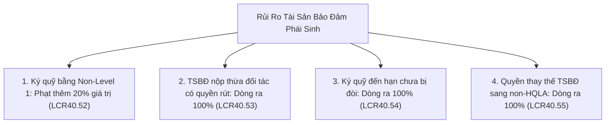
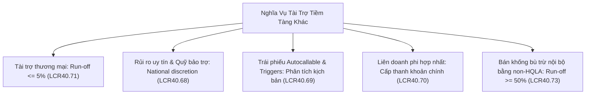

## Định nghĩa

**Nhu cầu thanh khoản phái sinh và nghĩa vụ tài trợ tiềm tàng** (*Derivatives liquidity needs and contingent funding obligations*) là nhóm dòng tiền ra phức tạp và có tính biến động cao nhất trong mẫu số [[net-cash-outflows]] của [[lcr]] [[src-bcbs-lcr#^lcr40-1]]. 

Không giống như các dòng tiền gửi có kỳ hạn hoặc khoản vay thông thường với lịch trả nợ cố định, nhóm này bao gồm:
1. Dòng tiền thanh toán ròng và nghĩa vụ ký quỹ tài sản bảo đảm (*margin collateral*) phát sinh từ các hợp đồng phái sinh khi thị trường biến động [[src-bcbs-lcr#^lcr40-49]] [[src-bcbs-lcr#^lcr40-56]].
2. Các nghĩa vụ thanh khoản bị kích hoạt tự động theo các sự kiện pháp lý hoặc tín dụng, đặc biệt là khi ngân hàng bị hạ bậc tín nhiệm dài hạn tới 3 bậc (*downgrade triggers*) [[src-bcbs-lcr#^lcr40-51]].
3. Rủi ro thanh khoản cấu trúc từ việc tài trợ công cụ nợ có bảo đảm bằng tài sản (ABCP, Conduits, SIVs) và các điều khoản quyền chọn bán thanh khoản (*liquidity puts*) [[src-bcbs-lcr#^lcr40-58]].
4. Các cam kết tài trợ tiềm tàng bắt nguồn từ [[reputational-risk|rủi ro uy tín]] (*reputational risk*) nhằm hỗ trợ các sản phẩm ngân hàng bảo trợ hoặc các liên doanh phi hợp nhất [[src-bcbs-lcr#^lcr40-68]] [[src-bcbs-lcr#^lcr40-70]].

---

## Công thức & tham số

### 1. Dòng tiền Phái sinh Ròng (Net Derivatives Cash Flows)

#### Nguyên tắc tính toán và Bù trừ Song phương
Theo [[src-bcbs-lcr#^lcr40-49]], tổng dòng tiền ra phái sinh ròng được áp hệ số **100%**:
- **Bù trừ theo đối tác (*Counterparty Netting*)**: Dòng tiền thu và dòng tiền chi phát sinh từ các giao dịch phái sinh chỉ được phép tính bù trừ ròng (*net basis*) khi và chỉ khi hai bên có một thỏa thuận bù trừ song phương có hiệu lực pháp lý (*valid bilateral master netting agreement*, ví dụ ISDA Master Agreement) [[src-bcbs-lcr#^lcr40-49]].
- Nếu không có master netting agreement hợp lệ, ngân hàng phải tính gộp toàn bộ dòng ra mà không được khấu trừ dòng vào.
- **Ngoại lệ giao dịch ngoại hối giao ngay/kỳ hạn (*FX Netting Exception*)**: Các giao dịch hoán đổi ngoại hối (FX swaps/forwards) có sự trao đổi toàn bộ tiền gốc diễn ra đồng thời (hoặc trong cùng một ngày) được phép ghi nhận theo dòng tiền ròng ngay cả khi không có master netting agreement [[src-bcbs-lcr#^lcr40-49]].

#### Giả định thực hiện Quyền chọn (*Option Exercise Assumptions*)
- Mọi hợp đồng quyền chọn (options) có thể được thực hiện trong vòng 30 ngày (bao gồm cả các quyền chọn kiểu Mỹ *American-style options* có ngày đáo hạn danh nghĩa $> 30$ ngày nhưng người mua có quyền thực hiện bất kỳ lúc nào) **bắt buộc phải giả định bị thực hiện nếu quyền chọn đang ở trạng thái có lãi (*in the money*) đối với bên mua** [[src-bcbs-lcr#^lcr40-49]].
- Nếu ngân hàng là bên bán quyền chọn (*option writer*) và quyền chọn đang *in the money*, ngân hàng phải ghi nhận 100% dòng tiền chi trả hoặc chuyển giao tài sản [[src-bcbs-lcr#^lcr40-49]].
- Ngược lại, nếu ngân hàng là bên mua quyền chọn và đang *in the money*, ngân hàng được ghi nhận dòng tiền vào (xem [[cash-inflows]], [[src-bcbs-lcr#^lcr40-91]]). Đây là ngoại lệ của nguyên tắc không tính dòng vào tiềm tàng; quyền chọn giao hàng vật chất tính theo giá trị thanh khoản của tài sản giao (áp haircut như tài sản bảo đảm), hợp đồng cho phép cả hai cách thì có thể giả định thanh toán tiền [[src-bcbs-lcr#^lcr40-49-faq]].

#### Quy tắc Tài sản Rẻ nhất để Giao (*Cheapest to Deliver*)
- Đối với các hợp đồng phái sinh mà nghĩa vụ giao nhận có thể được thực hiện bằng nhiều loại tài sản khác nhau, chuẩn mực quy định áp dụng nguyên tắc bất đối xứng thận trọng: **bên có nghĩa vụ giao sẽ chọn tài sản có giá trị thanh khoản thấp nhất trong LCR (*cheapest to deliver / lowest liquidity value*)** [[src-bcbs-lcr#^lcr40-49]].
- Quy tắc này áp dụng đồng bộ cho cả hai vế: khi ngân hàng phải giao tài sản, ngân hàng giả định giao tài sản thanh khoản kém nhất; khi đối tác phải giao cho ngân hàng, ngân hàng cũng phải giả định đối tác sẽ giao tài sản có giá trị thanh khoản thấp nhất [[src-bcbs-lcr#^lcr40-49]].

#### Phái sinh bảo đảm bằng HQLA (Chống đếm trùng)
- Khi nghĩa vụ thanh toán phái sinh được bảo đảm bằng [[hqla]], dòng tiền ra được tính ròng với dòng tiền hoặc tài sản bảo đảm nhận về nếu ngân hàng có đầy đủ quyền pháp lý và năng lực vận hành để tái sử dụng tài sản đó trong các giao dịch huy động tiền mặt mới [[src-bcbs-lcr#^lcr40-50]].

---

### 4. Biến động Định giá Thị trường: Phương pháp Hồi quy 24 tháng (Look-back Approach)

Chuẩn mực LCR40.56 quy định cách đo lường rủi ro thanh khoản phát sinh từ các cuộc gọi ký quỹ (*variation margin calls*) khi giá trị thị trường của danh mục phái sinh biến động bất lợi:

#### Thuật toán Look-back Approach
1. **Dữ liệu lịch sử**: Ngân hàng phải thu thập toàn bộ dữ liệu dòng tiền và tài sản bảo đảm ký quỹ ròng hàng ngày trong suốt **24 tháng** gần nhất [[src-bcbs-lcr#^lcr40-56]].
2. **Cửa sổ trượt 30 ngày (*Rolling 30-day window*)**: Tính toán dòng ký quỹ ròng tích lũy tại ngày kết thúc của mọi khoảng thời gian 30 ngày liên tục trong 24 tháng đó (FAQ1 LCR40.56) [[src-bcbs-lcr#^lcr40-56-faq]]. Hai công thức dưới đây là cách wiki viết lại mô tả của FAQ:
   $$\text{Net 30-day Collateral Flow}(t) = \sum_{k=0}^{29} \Big(\text{Collateral Outflows}(t-k) - \text{Collateral Inflows}(t-k)\Big)$$
3. **Xác định giá trị đỉnh**:
   $$\text{Look-back Outflow Buffer} = \max_{t \in [0, 24\text{M}]} \Big|\text{Net 30-day Collateral Flow}(t)\Big|$$
- Giá trị tuyệt đối lớn nhất này phải được đưa trực tiếp vào mẫu số LCR như một dòng tiền ra dự phòng bắt buộc [[src-bcbs-lcr#^lcr40-56]].
- **Phạm vi tính toán**: giao dịch cùng master netting agreement có thể tính ròng [[src-bcbs-lcr#^lcr40-56]]; dòng TSBĐ ròng lớn nhất là dòng ra hoặc vào ròng luỹ kế ở cuối mọi giai đoạn 30 ngày trong 24 tháng trước, bù trừ ở cấp danh mục; thanh toán của phái sinh settled-to-market liên quan thay đổi giá trị cũng được tính [[src-bcbs-lcr#^lcr40-56-faq]].
- **Xử lý phái sinh STM (*Settled-to-Market*)**: Các khoản thanh toán biến động định giá hàng ngày đối với phái sinh bù trừ qua CCP có cấu trúc STM được xử lý bình đẳng như các dòng luân chuyển tài sản bảo đảm thông thường (FAQ2 LCR40.56) [[src-bcbs-lcr#^lcr40-56-faq]].

---

## Diễn giải

### 2. Rủi ro Kích hoạt Hạ bậc Tín nhiệm (Downgrade Triggers)

#### Cơ chế hoạt động trong hợp đồng ISDA/CSA
*Diễn giải:* (ngoài wiki, chưa có nguồn) trong thực tiễn thị trường vốn quốc tế, các phụ lục bảo đảm tín dụng (*Credit Support Annex - CSA*) hoặc hợp đồng tài trợ thường có các điều khoản ràng buộc theo xếp hạng tín nhiệm (*credit rating triggers*):
- Khi một bên bị các tổ chức xếp hạng tín nhiệm (Moody's, S&P, Fitch) hạ bậc tín nhiệm xuống dưới một ngưỡng nhất định (ví dụ mất hạng A xuống BBB, hoặc mất hạng đầu tư *Investment Grade* xuống *High Yield*):
  1. Ngưỡng miễn trừ ký quỹ (*Threshold Amount*) bị hạ về 0, buộc bên bị hạ bậc phải nộp 100% tài sản bảo đảm cho toàn bộ giá trị phơi nhiễm thị trường (*mark-to-market*).
  2. Mức ký quỹ ban đầu tối thiểu (*Independent Amount*) tăng lên.
  3. Đối tác có quyền yêu cầu tất toán trước hạn (*early termination*) hợp đồng hoặc thu hồi các hạn mức tài trợ cam kết.

#### Yêu cầu của Basel LCR
Theo [[src-bcbs-lcr#^lcr40-51]]:
- Ngân hàng bắt buộc phải giả định kịch bản bị **hạ tới 3 bậc tín nhiệm dài hạn** (*up to and including a 3-notch downgrade*) đối với xếp hạng tín nhiệm của chính ngân hàng [[src-bcbs-lcr#^lcr40-51]].
- Ngân hàng phải tính dòng ra bằng **100% lượng tiền mặt hoặc tài sản bảo đảm bổ sung** phải nộp hoặc các dòng tiền rút vốn bị kích hoạt bởi đợt hạ 3 bậc này [[src-bcbs-lcr#^lcr40-51]].
- Đối với các điều khoản gắn với xếp hạng ngắn hạn, ngân hàng phải quy đổi tương đương sang thang xếp hạng dài hạn theo tiêu chuẩn công bố của tổ chức xếp hạng [cần nguồn: đoạn này của LCR40.51 chưa có claim trong src-bcbs-lcr].
- Đánh giá tác động phải bao gồm toàn bộ các thay đổi về quyền tái thế chấp (*rehypothecation rights*) đối với tài sản bảo đảm không tách biệt [[src-bcbs-lcr#^lcr40-51]].
- LCR40.51–40.55 áp chung cho mọi phái sinh (OTC hay sàn, có CCP hay không), trừ khi nêu khác. "Other transactions" ở LCR40.51, 40.52, 40.56 không gồm nguồn vốn có bảo đảm (LCR40.45–40.48) và cho vay có bảo đảm (LCR40.78–40.79) [[src-bcbs-lcr#^lcr40-51-faq]].

---

### 3. Rủi ro Định giá và Thay thế Tài sản Bảo đảm (Collateral Valuation & Substitution)

Basel đặt 4 quy định dự phòng rủi ro sụt giá hoặc thất thoát tài sản bảo đảm: TSBĐ non-Level 1 cộng 20% [[src-bcbs-lcr#^lcr40-52]], TSBĐ thừa đối tác có quyền rút 100% [[src-bcbs-lcr#^lcr40-53]], TSBĐ đến hạn chưa bị đòi 100% [[src-bcbs-lcr#^lcr40-54]], quyền thay thế sang non-HQLA 100% [[src-bcbs-lcr#^lcr40-55]].

#### 1. Phạt bổ sung đối với Tài sản bảo đảm Non-Level 1 (LCR40.52)
- *Diễn giải:* (ngoài wiki, chưa có nguồn) hầu hết các giao dịch phái sinh trên thị trường được ký quỹ bằng tiền mặt hoặc trái phiếu chính phủ 0% rủi ro ([[level-1-assets]]). Khi sử dụng tài sản Level 1, chuẩn mực không yêu cầu dự phòng thêm.
- Tuy nhiên, nếu ngân hàng ký quỹ cho đối tác bằng các tài sản khác (Level 2A, Level 2B hoặc non-HQLA), để bù đắp rủi ro tài sản bị sụt giá khi thị trường biến động:
  $$\text{Dòng ra bổ sung} = 20\% \times \text{Giá trị TSBĐ non-L1 đã ký quỹ}$$
  [[src-bcbs-lcr#^lcr40-52]]
- Khoản 20% này phải được tính ròng theo từng đối tác và **cấm tuyệt đối việc bù trừ dòng tài sản giữa các đối tác khác nhau** (FAQ3 LCR40.52) [[src-bcbs-lcr#^lcr40-52]] [[src-bcbs-lcr#^lcr40-52-faq]]. Ngân hàng cũng không được dùng tài sản non-Level 1 chưa bị ràng buộc làm tiểu danh mục riêng để giảm khoản này [[src-bcbs-lcr#^lcr40-52-faq]].

#### 2. Tài sản bảo đảm không tách biệt nộp thừa (LCR40.53)
- Nếu đối tác đã nộp tài sản bảo đảm vượt mức yêu cầu ký quỹ hiện tại (*excess collateral*), và phần tài sản này không nằm trong tài khoản phong tỏa tách biệt (*non-segregated account*):
  - Do đối tác có quyền rút lại phần thừa này bất kỳ lúc nào theo hợp đồng, ngân hàng phải tính **100% dòng ra** cho toàn bộ phần tài sản bảo đảm dư thừa đó [[src-bcbs-lcr#^lcr40-53]].

#### 3. Tài sản bảo đảm đến hạn theo hợp đồng nhưng chưa bị đòi (LCR40.54)
- Nếu theo biến động định giá vị thế thị trường (*mark-to-market*), ngân hàng có nghĩa vụ phải nộp thêm tiền hoặc tài sản bảo đảm cho đối tác nhưng đối tác chưa gửi yêu cầu ký quỹ (*margin call*):
  - Ngân hàng không được chủ quan; chuẩn mực yêu cầu phải ghi nhận ngay **100% dòng ra** đối với khoản bảo đảm này [[src-bcbs-lcr#^lcr40-54]].

#### 4. Quyền thay thế tài sản bảo đảm đơn phương (LCR40.55)
- Nếu hợp đồng cho phép đối tác có quyền rút lại tài sản bảo đảm HQLA đang gửi tại ngân hàng và thay thế bằng tài sản non-HQLA mà **không cần sự chấp thuận của ngân hàng**:
  - Ngân hàng phải tính **100% dòng ra** đối với toàn bộ phần HQLA có thể bị thay thế [[src-bcbs-lcr#^lcr40-55]].
  - Nếu đối tác có quyền thay thế HQLA bậc cao (Level 1) bằng HQLA bậc thấp hơn (Level 2A hoặc 2B), dòng ra được tính bằng **chênh lệch giữa mức haircut** của hai loại tài sản [[src-bcbs-lcr#^lcr40-55]].
  - Hệ số 100% áp trên giá trị thị trường sau haircut LCR của TSBĐ có thể bị thay. Với cho vay có bảo đảm kỳ hạn còn lại trên 30 ngày, rủi ro thay thế là dòng ra tiềm tàng theo LCR40.55; ngược lại, quyền của ngân hàng được thay TSBĐ HQLA bằng tài sản kém hơn là dòng vào tiềm tàng, không tính [[src-bcbs-lcr#^lcr40-55-faq]].

---

### 5. Rủi ro Tài trợ Cấu trúc: ABCP, Conduits, SIVs và Covered Bonds

#### 1. Trái phiếu bảo đảm (Covered Bonds) & ABS tự phát hành (LCR40.57)
- Các công cụ chứng khoán hóa (ABS), trái phiếu có bảo đảm (*covered bonds*) do chính ngân hàng phát hành đáo hạn trong vòng 30 ngày phải chịu dòng ra **100%** [[src-bcbs-lcr#^lcr40-57]].
- *Giả định*: Trong khủng hoảng, thị trường phát hành mới để đảo nợ (*refinancing market*) hoàn toàn biến mất.
- *Khấu trừ tài sản giải tỏa*: Dòng ra này được phép bù trừ với lượng HQLA nằm trong nhóm tài sản bảo đảm (*cover pool*) được giải chấp và trở nên khả dụng khi trái phiếu đáo hạn [[src-bcbs-lcr#^lcr40-57]].

#### 2. Thương phiếu bảo đảm bằng tài sản (ABCP) & SIVs (LCR40.58)
Đối với các cấu trúc tài trợ thông qua pháp nhân chuyên biệt (*Special Purpose Entity - SPE* như Conduit hay SIV), ngân hàng phải thực hiện **nhìn xuyên (*look-through*)** cấu trúc bất kể SPE có được hợp nhất vào báo cáo tài chính hay không [[src-bcbs-lcr#^lcr40-58]]:

| Yếu tố rủi ro thanh khoản tiềm ẩn | Lượng HQLA / Dòng ra bắt buộc | Căn cứ chuẩn mực |
|---|---|---|
| Nợ ngắn hạn (ABCP) do SPE phát hành đáo hạn $\le 30$ ngày | **100%** giá trị đáo hạn | [[src-bcbs-lcr#^lcr40-58]] |
| Điều khoản quyền chọn bán thanh khoản (*Liquidity Puts*) cho phép trả lại tài sản cho ngân hàng | **100%** giá trị tài sản có thể bị trả lại hoặc thanh khoản yêu cầu | [[src-bcbs-lcr#^lcr40-58]] |

---

### 6. Các Nghĩa vụ Tài trợ Tiềm tàng Khác (Contingent Funding Obligations)

Theo [[src-bcbs-lcr#^lcr40-67]] đến [[src-bcbs-lcr#^lcr40-74]], cơ quan thanh tra giám sát quốc gia có thẩm quyền quy định hệ số run-off đối với các nghĩa vụ tiềm tàng ngoài hợp đồng:

Nguồn sơ đồ: [[src-bcbs-lcr#^lcr40-71]] [[src-bcbs-lcr#^lcr40-68]] [[src-bcbs-lcr#^lcr40-69]] [[src-bcbs-lcr#^lcr40-70]] [[src-bcbs-lcr#^lcr40-73]]

#### 1. Tài trợ thương mại (Trade Finance - LCR40.71)
- Các công cụ tài trợ thương mại gắn trực tiếp với sự luân chuyển hàng hóa và cung ứng dịch vụ thực tế (thư tín dụng chứng từ L/C, nhờ thu, bảo lãnh nhận hàng *shipping guarantees*) có thể được cơ quan quốc gia áp tỷ lệ rút tương đối thấp (ví dụ **$\le 5\%$**) [[src-bcbs-lcr#^lcr40-71]] [[src-bcbs-lcr#^lcr40-71b]].
- *Lưu ý*: cam kết cho vay, như tài trợ xuất nhập khẩu trực tiếp cho doanh nghiệp phi tài chính, không thuộc trade finance và áp tỷ lệ rút của LCR40.64 [[src-bcbs-lcr#^lcr40-72]] (doanh nghiệp phi tài chính: 10% hạn mức tín dụng, 30% hạn mức thanh khoản [[src-bcbs-lcr#^lcr40-64]]).

#### 2. Nghĩa vụ tiềm tàng phi hợp đồng vì Rủi ro Uy tín (Reputational Risk - LCR40.68)
- Phát sinh khi ngân hàng đóng vai trò tài trợ (*sponsor*) hoặc bán các sản phẩm đầu tư mà khách hàng có kỳ vọng về tính thanh khoản ổn định (ví dụ các quỹ tương hỗ thị trường tiền tệ MMF giữ giá trị ổn định *stable NAV*).
- Trong stress, nếu ngân hàng không can thiệp mua lại tài sản hoặc cấp vốn, uy tín thương hiệu sẽ bị tổn hại nghiêm trọng, dẫn đến tháo chạy tiền gửi. Supervisor có quyền yêu cầu trích lập dòng ra cho các cam kết ngầm định này [[src-bcbs-lcr#^lcr40-68]].

#### 3. Công cụ nợ có điều kiện kích hoạt thị trường (Autocallable Notes - LCR40.69)
- Các trái phiếu cấu trúc (*autocallable notes*) tự động đáo hạn khi một chỉ số thị trường chạm ngưỡng kích hoạt (*market-based trigger*). Ngân hàng và cơ quan giám sát phải phân tích xác suất chạm ngưỡng trong kịch bản stress để xác định dòng tiền mua lại trước hạn [[src-bcbs-lcr#^lcr40-69]].

#### 4. Vị thế bán khống của khách hàng bù trừ nội bộ (LCR40.73(5))
- Nếu ngân hàng ghép cặp nội bộ (*internally match*) tài sản của một khách hàng này để bù đắp cho vị thế bán khống của một khách hàng khác bằng tài sản **không phải HQLA (non-HQLA)**:
  - Ngân hàng phải áp dụng tỷ lệ dòng ra **tối thiểu 50%**, vì khi khách hàng sở hữu tài sản rút tiền, ngân hàng bắt buộc phải tìm nguồn tài trợ khẩn cấp từ bên ngoài để bù đắp vị thế bán khống đang hở [[src-bcbs-lcr#^lcr40-73]].

---

## Basel vs VN

| Cấu phần phái sinh & tiềm ẩn | Quy định Basel (LCR40) | Quy định VN (TT50/2026/TT-NHNN) | Điều khoản TT50 | Hiệu lực |
|---|---|---|---|---|
| **Phái sinh ròng (Net derivatives)** | 100% dòng ra ròng theo master netting agreement; ngoại lệ FX swaps thanh toán cùng ngày [[src-bcbs-lcr#^lcr40-49]] | 100% dòng ra ròng khi có thỏa thuận bù trừ hai bên; với LCR quy VNĐ, phái sinh ngoại hối thanh toán toàn bộ trong cùng ngày được bù trừ ròng kể cả không có thỏa thuận bù trừ [[src-tt50-2026-nhnn#^pl1-b4-1]] | PL1.B.IV.1.1–1.2 | Áp dụng từ 01/10/2028 [[src-tt50-2026-nhnn#^d13-1]] |
| **Quyền chọn & Cheapest to deliver** | Option ITM giả định thực hiện; giao tài sản thanh khoản kém nhất [[src-bcbs-lcr#^lcr40-49]] | Option ITM trong 30 ngày giả định thực hiện; cheapest to deliver áp hệ số HQLA hoặc 25% với non-HQLA [[src-tt50-2026-nhnn#^pl1-b4-1]] [[src-tt50-2026-nhnn#^pl1-b4-14]] | PL1.B.IV.1.3–1.4 | Áp dụng từ 01/10/2028 [[src-tt50-2026-nhnn#^d13-1]] |
| **Kích hoạt hạ bậc tín nhiệm (Downgrade triggers)** | Tính 100% dòng tiền/TSBĐ nộp thêm khi bị hạ tới 3 bậc tín nhiệm [[src-bcbs-lcr#^lcr40-51]] | Tính thêm 100% vào dòng tiền ra phần giá trị yêu cầu thực hiện khi bị hạ tối đa 3 bậc tín nhiệm [[src-tt50-2026-nhnn#^pl1-b4-21]] | PL1.B.IV.2.1 | Áp dụng từ 01/10/2028 [[src-tt50-2026-nhnn#^d13-1]] |
| **Ký quỹ TSBĐ không phải Cấp 1** | Phạt cộng 20% giá trị TSBĐ non-L1 vào yêu cầu HQLA [[src-bcbs-lcr#^lcr40-52]] | Tính thêm 20% giá trị TSBĐ vào dòng tiền ra (giá trị = danh nghĩa $\times$ hệ số thanh khoản; non-HQLA tính 25%) [[src-tt50-2026-nhnn#^pl1-b4-22]] | PL1.B.IV.2.2 | Áp dụng từ 01/10/2028 [[src-tt50-2026-nhnn#^d13-1]] |
| **TSBĐ dư thừa không tách biệt** | Tính 100% dòng ra cho TSBĐ thừa đối tác có quyền đòi [[src-bcbs-lcr#^lcr40-53]] | Tính thêm 100% vào dòng tiền ra đối với TSBĐ dư thừa không tách biệt [[src-tt50-2026-nhnn#^pl1-b4-23]] | PL1.B.IV.2.3 | Áp dụng từ 01/10/2028 [[src-tt50-2026-nhnn#^d13-1]] |
| **TSBĐ đến hạn chưa bị đòi ký quỹ** | Tính 100% dòng ra [[src-bcbs-lcr#^lcr40-54]] | Tính thêm 100% vào dòng tiền ra đối với TSBĐ phải ký quỹ theo thỏa thuận nhưng chưa bị đòi [[src-tt50-2026-nhnn#^pl1-b4-23]] | PL1.B.IV.2.4 | Áp dụng từ 01/10/2028 [[src-tt50-2026-nhnn#^d13-1]] |
| **Biến động định giá thị trường phái sinh** | Look-back 24 tháng: dòng ký quỹ ròng 30 ngày lớn nhất ở cấp độ danh mục [[src-bcbs-lcr#^lcr40-56]] | Look-back 24 tháng: dòng ký quỹ ròng lớn nhất 30 ngày ở cấp độ danh mục, tính thêm 100% vào dòng ra [[src-tt50-2026-nhnn#^pl1-b4-25]] | PL1.B.IV.2.5 | Áp dụng từ 01/10/2028 [[src-tt50-2026-nhnn#^d13-1]] |
| **Cam kết hủy ngang vô điều kiện** | Do supervisor quốc gia quyết định (thường 0%) [[src-bcbs-lcr#^lcr40-64]] | 0%, gồm cả cam kết cung cấp một cam kết ngoại bảng khác [[src-tt50-2026-nhnn#^pl1-b5-31]] | PL1.B.V.3.1.a(i), (iv) | Áp dụng từ 01/10/2028 [[src-tt50-2026-nhnn#^d13-1]] |
| **Tài trợ thương mại (Trade finance)** | $\le 5\%$ do supervisor quốc gia ấn định [[src-bcbs-lcr#^lcr40-71]] | 3% (nhờ thu chứng từ, nhờ thu hóa đơn nhập khẩu và xuất khẩu, bảo lãnh vận chuyển) [[src-tt50-2026-nhnn#^pl1-b5-31]] | PL1.B.V.3.1.a(ii) | Áp dụng từ 01/10/2028 [[src-tt50-2026-nhnn#^d13-1]] |
| **Bảo lãnh ngân hàng, bảo lãnh dự thầu, Autocallable** | Thường $\le 5\%$ do supervisor ấn định [[src-bcbs-lcr#^lcr40-73]] | 5% (bảo lãnh ngân hàng, dự thầu, thực hiện hợp đồng; autocallable notes do ngân hàng phát hành) [[src-tt50-2026-nhnn#^pl1-b5-31]] | PL1.B.V.3.1.a(iii), (v) | Áp dụng từ 01/10/2028 [[src-tt50-2026-nhnn#^d13-1]] |
| **Nghĩa vụ tiềm ẩn phi hợp đồng** | Supervisor quyết định dựa trên rủi ro danh tiếng [[src-bcbs-lcr#^lcr40-68]] | Ngân hàng tự xác định dựa trên dữ liệu lịch sử và sự kiện pháp lý liên quan [[src-tt50-2026-nhnn#^pl1-b5-31]] | PL1.B.V.3.1.b, 3.2.d | Áp dụng từ 01/10/2028 [[src-tt50-2026-nhnn#^d13-1]] |
| **Nghĩa vụ tiềm ẩn đã kích hoạt hợp đồng** | 100% dòng ra [[src-bcbs-lcr#^lcr40-67]] | 100% dòng ra nếu có yêu cầu thanh toán trong vòng 30 ngày tiếp theo [[src-tt50-2026-nhnn#^pl1-b5-31]] | PL1.B.V.3.3 | Áp dụng từ 01/10/2028 [[src-tt50-2026-nhnn#^d13-1]] |

*Điểm đáng chú ý trong TT50/2026*:
1. **Kỹ thuật phạt TSBĐ non-Level 1**: Basel LCR40.52 cộng 20% vào HQLA yêu cầu [[src-bcbs-lcr#^lcr40-52]], TT50 tính thêm 20% vào dòng tiền ra (mẫu số LCR) [[src-tt50-2026-nhnn#^pl1-b4-22]]. *Diễn giải:* về mặt toán học, khi tỷ lệ LCR mục tiêu là 100%, việc cộng vào dòng tiền ra hay HQLA có tác động gần như tương đương, nhưng trong giai đoạn lộ trình LCR 50%–90%, việc cộng vào dòng tiền ra sẽ tạo áp lực thanh khoản thực tế thấp hơn so với việc cộng trực tiếp vào HQLA yêu cầu.
2. **Nội luật hóa dứt khoát các mức quốc gia tùy nghi**: TT50 ấn định mức rút vốn 3% cho tài trợ thương mại (Trade finance) và 5% cho bảo lãnh ngân hàng, bảo lãnh dự thầu, thực hiện hợp đồng và sản phẩm autocallable [[src-tt50-2026-nhnn#^pl1-b5-3]]. *Diễn giải:* điều này giúp các ngân hàng tại Việt Nam có căn cứ pháp lý minh bạch để lượng hóa nghĩa vụ ngoại bảng.

---

## Ứng dụng trong ALM

### 7. Góc nhìn Quản trị ALM Treasury & Chiến lược Tối ưu hóa

*Diễn giải:* (ngoài wiki, chưa có nguồn; các đòn bẩy dưới đây là đề xuất của wiki) nhóm nhu cầu thanh khoản phái sinh và nghĩa vụ tiềm tàng thường là "vùng mù" (*blind spot*) của các ngân hàng truyền thống, nhưng lại là nguồn rút cạn thanh khoản nhanh nhất trong khủng hoảng:

1. **Tối ưu hóa Tài sản Ký quỹ CSA (*Collateral Engineering*)**:
   - Khối Treasury phải thiết lập thuật toán lựa chọn tài sản ký quỹ tối ưu (*cheapest-to-deliver optimization*). Bằng mọi giá tránh sử dụng trái phiếu doanh nghiệp hoặc cổ phiếu non-Level 1 để ký quỹ phái sinh, vì khoản phạt cộng thêm 20% giá trị theo LCR40.52 [[src-bcbs-lcr#^lcr40-52]] sẽ làm gia tăng đáng kể mẫu số LCR.
2. **Quản trị Rủi ro Hạ bậc Tín nhiệm (*Downgrade Mitigation*)**:
   - Định kỳ chạy mô hình mô phỏng dòng tiền thanh toán tức thì khi bị hạ 1, 2 và 3 notch trên toàn bộ danh mục hợp đồng song phương ISDA/CSA.
   - Chủ động đàm phán chuyển đổi các giao dịch phái sinh song phương (*bilateral OTC*) sang thanh toán bù trừ qua đối tác trung tâm (*Central Counterparty - CCP*), nơi các yêu cầu ký quỹ được chuẩn hóa và không có các điều khoản downgrade triggers tùy nghi.
3. **Theo dõi Đỉnh Dòng tiền Ký quỹ 24 tháng (*Look-back Peak Monitoring*)**:
   - Xây dựng dashboard tự động tính toán dòng ký quỹ ròng lũy kế 30 ngày theo chuỗi thời gian thực.
   - Khi các đợt biến động mạnh trong quá khứ dần lùi ra khỏi cửa sổ 24 tháng, đệm dự phòng thanh khoản của ngân hàng sẽ tự động giảm xuống, giải phóng thanh khoản cho các hoạt động sinh lời.
4. **Kiểm soát các Sản phẩm Bảo trợ Ngoại bảng**:
   - Phối hợp với Khối Khách hàng Doanh nghiệp và Đầu tư để rà soát các điều khoản quyền chọn bán thanh khoản (*liquidity puts*) trong các cấu trúc tài trợ ABCP, ngăn ngừa rủi ro tài sản ngoại bảng ồ ạt đổ dồn về bảng cân đối kế toán khi thị trường đóng băng.

---

## Nhầm lẫn thường gặp

### 8. Những Nhầm lẫn Thường gặp

- ❌ **Hiểu nhầm về bù trừ tài sản ký quỹ phái sinh giữa các đối tác**: Bù trừ phần tài sản bảo đảm non-L1 nhận được từ đối tác A với phần tài sản non-L1 phải nộp cho đối tác B để giảm khoản phạt 20%.
  - *Thực tế*: LCR40.52 (FAQ3) nghiêm cấm việc bù trừ dòng tài sản ký quỹ giữa các đối tác khác nhau [[src-bcbs-lcr#^lcr40-52-faq]]. *Diễn giải:* lý do là rủi ro định giá và mức độ bất cân xứng thanh khoản giữa các đối tác là hoàn toàn độc lập.
- ❌ **Chủ quan với các khoản ký quỹ chưa bị đòi nộp**: Không tính dòng ra cho các khoản bảo đảm phái sinh đến hạn chỉ vì đối tác chưa gửi yêu cầu *margin call*.
  - *Thực tế*: LCR40.54 yêu cầu tính ngay **100% dòng ra** cho toàn bộ nghĩa vụ ký quỹ theo hợp đồng chưa bị đòi [[src-bcbs-lcr#^lcr40-54]].
- ❌ **Đánh đồng tài trợ thương mại với cho vay xuất nhập khẩu**: Xếp các khoản giải ngân cho vay vốn lưu động tài trợ xuất khẩu vào nhóm Trade Finance để hưởng run-off $\le 5\%$.
  - *Thực tế*: LCR40.72 loại cam kết cho vay xuất nhập khẩu trực tiếp khỏi nhóm trade finance, áp tỷ lệ rút của LCR40.64 [[src-bcbs-lcr#^lcr40-72]]. Mức thấp của LCR40.71 chỉ dành cho công cụ gắn trực tiếp với lưu chuyển hàng hoá, dịch vụ như L/C chứng từ, nhờ thu, bảo lãnh nhận hàng [[src-bcbs-lcr#^lcr40-71b]].
