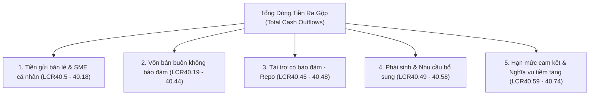

## Định nghĩa chuẩn mực

**Total net cash outflows (TNCO)** là mẫu số của tỷ lệ [[lcr]], đại diện cho tổng dòng tiền ra kỳ vọng thuần mà ngân hàng phải đối mặt trong kịch bản kiểm tra sức chịu tải thanh khoản nghiêm ngặt kéo dài 30 ngày dương lịch [[src-bcbs-lcr#^lcr20-1]] [[src-bcbs-lcr#^lcr40-1]].

Kịch bản stress 30 ngày kết hợp đồng thời hai cú sốc: cú sốc riêng lẻ của ngân hàng (*idiosyncratic shock*, ví dụ bị hạ 3 bậc tín nhiệm) và cú sốc thanh khoản toàn hệ thống (*market-wide shock*, ví dụ đóng băng thị trường repo tài sản cấp thấp) [[src-bcbs-lcr#^lcr20-2]].

Dòng tiền ra và dòng tiền vào trong phạm vi 30 ngày phải bao gồm cả lãi dự kiến thu và lãi dự kiến trả theo hợp đồng (footnote của LCR40.1).

---

## Công thức xác định

Theo chuẩn mực Basel (LCR40.1, LCR40.77, LCR99.1), tổng dòng tiền ra ròng được tính theo công thức:

$$
\text{TNCO} = \text{Total Cash Outflows} - \min\Big(\text{Total Contractual Inflows},\; 75\% \times \text{Total Cash Outflows}\Big)
$$

Khai triển chi tiết theo từng danh mục phơi nhiễm nợ, cam kết ngoại bảng và khoản phải thu:

$$
\text{TNCO} = \sum_{i} B_i^{\text{out}} \cdot r_i^{\text{out}} \;-\; \min\!\left(\sum_{j} B_j^{\text{in}} \cdot r_j^{\text{in}},\; 0.75 \times \sum_{i} B_i^{\text{out}} \cdot r_i^{\text{out}}\right)
$$

Trong đó:
- $B_i^{\text{out}}$: Số dư nợ phải trả, vốn huy động hoặc hạn mức cam kết cấp vốn ngoại bảng thuộc danh mục dòng ra $i$ đến hạn hoặc có thể bị rút trong 30 ngày [[src-bcbs-lcr#^lcr40-1]].
- $r_i^{\text{out}}$: Tỷ lệ rút vốn ([[run-off-rate]]) hoặc tỷ lệ rút hạn mức cam kết (*drawdown rate*) áp dụng cho danh mục $i$ [[src-bcbs-lcr#^lcr40-1]].
- $B_j^{\text{in}}$: Số dư các khoản phải thu theo hợp đồng đang hoạt động tốt (*fully performing*) thuộc danh mục $j$ đáo hạn trong vòng 30 ngày [[src-bcbs-lcr#^lcr40-1]] [[src-bcbs-lcr#^lcr40-75]].
- $r_j^{\text{in}}$: Tỷ lệ dòng vào (*inflow rate*) áp dụng cho danh mục $j$ theo phân loại đối tác và tài sản bảo đảm [[src-bcbs-lcr#^lcr40-78]] [[src-bcbs-lcr#^lcr40-83]].
- **Trần bù trừ dòng vào 75% (*75% Inflow Cap*)**: Tổng dòng tiền vào được phép khấu trừ tối đa bằng 75% tổng dòng tiền ra gộp [[src-bcbs-lcr#^lcr40-77]].

### Hệ quả toán học của Trần dòng vào 75%
Trần 75% tạo ra một mức sàn tuyệt đối cho mẫu số LCR:
$$
\text{TNCO} \;\ge\; 0.25 \times \text{Total Cash Outflows}
$$
Điều này buộc ngân hàng luôn phải duy trì một lượng [[hqla]] tối thiểu tương đương ít nhất **25% tổng dòng tiền ra gộp**, ngăn chặn chiến lược phụ thuộc hoàn toàn vào dòng thu hồi nợ để đáp ứng nghĩa vụ chi trả thanh khoản [[src-bcbs-lcr#^lcr40-77]].

---

## Cấu trúc chi tiết Dòng tiền ra (Total Cash Outflows)

Tổng dòng tiền ra gộp ($\text{Total Cash Outflows}$, phân tích toàn diện tại [[cash-outflows]]) gồm 5 trụ cột cấu thành:



### 1. Tiền gửi bán lẻ và SME (Retail Deposits & Small Business)
Áp dụng cho thể nhân (*natural persons*) [[src-bcbs-lcr#^lcr40-5]] và khách hàng doanh nghiệp nhỏ có tổng vốn huy động $< 1$ triệu EUR được quản lý như bán lẻ [[src-bcbs-lcr#^lcr40-22]] [[src-bcbs-lcr#^lcr40-23]].

| Danh mục | Run-off sàn Basel | Điều kiện áp dụng | Căn cứ chuẩn mực |
|---|---|---|---|
| **Stable deposits (chuẩn)** | **5%** | Được bảo hiểm toàn bộ bởi quỹ BHTG hiệu quả VÀ có quan hệ giao dịch khác (tài khoản lương, vay vốn) | [[src-bcbs-lcr#^lcr40-7]] [[src-bcbs-lcr#^lcr40-8]] |
| **Stable deposits (ưu đãi)** | **3%** | Quỹ BHTG có prefunding định kỳ, có bảo lãnh thanh khoản từ chính phủ và chi trả trong vòng 7 ngày làm việc; chứng minh run-off lịch sử $< 3\%$ | [[src-bcbs-lcr#^lcr40-11]] [[src-bcbs-lcr#^lcr40-12]] |
| **Less stable deposits** | **$\ge$ 10%** | Tiền gửi không được bảo hiểm toàn bộ, số dư lớn, khách hàng HNW, internet deposits, tiền gửi ngoại tệ | [[src-bcbs-lcr#^lcr40-13]] [[src-bcbs-lcr#^lcr40-15]] |
| **Tiền gửi không phân loại được** | **$\ge$ 10%** | Ngân hàng không chứng minh được tính chất stable thì mặc định đưa vào less stable | [[src-bcbs-lcr#^lcr40-14]] |
| **Tiền gửi có kỳ hạn $> 30$ ngày** | **0%** | Người gửi không có quyền rút trước hạn hoặc rút trước hạn bị phạt lớn hơn đáng kể phần mất lãi | [[src-bcbs-lcr#^lcr40-16]] |

> [!WARNING]
> **Quy tắc lây lan vi phạm đối với tiền gửi có kỳ hạn (*Contagion Rule*)**:
> Nếu ngân hàng cho phép một khách hàng rút tiền gửi có kỳ hạn mà không áp dụng mức phạt nghiêm ngặt (hoặc vi phạm điều khoản không được rút), thì **toàn bộ nhóm tiền gửi có kỳ hạn đó** bị coi là tiền gửi không kỳ hạn (*demand deposits*) và phải chịu run-off ngay lập tức [[src-bcbs-lcr#^lcr40-17]].

### 2. Nguồn vốn bán buôn không bảo đảm (Unsecured Wholesale Funding)
Phát sinh từ pháp nhân, đối tác tổ chức và các công cụ nợ không có bảo đảm cụ thể [[src-bcbs-lcr#^lcr40-19]]. Chỉ tính phần đến hạn hoặc có thể bị gọi vốn trong 30 ngày (tính cả quyền chọn rút vốn của nhà đầu tư và kỳ vọng mua lại trước hạn của thị trường) [[src-bcbs-lcr#^lcr40-20]].

| Danh mục đối tác | Run-off rate | Điều kiện & Bản chất kinh tế | Căn cứ chuẩn mực |
|---|---|---|---|
| **SME quản lý như bán lẻ** ($< 1$M EUR) | 5% / $\ge$ 10% | Áp dụng khung stable / less stable như tiền gửi bán lẻ | [[src-bcbs-lcr#^lcr40-22]] [[src-bcbs-lcr#^lcr40-23]] |
| **Operational deposits** | **25%** | Dịch vụ clearing, custody, cash management có phụ thuộc thực chất; báo trước $\ge 30$ ngày hoặc switching cost cao | [[src-bcbs-lcr#^lcr40-26]] [[src-bcbs-lcr#^lcr40-27]] |
| **Operational deposits (bảo hiểm toàn bộ)** | 5% (hoặc 3%) | Phần số dư operational được quỹ BHTG bảo hiểm toàn bộ | [[src-bcbs-lcr#^lcr40-36]] |
| **Excess operational balance** | 40% hoặc 100% | Phần số dư vượt quá nhu cầu vận hành thực tế; không tách được thì toàn bộ là non-operational | [[src-bcbs-lcr#^lcr40-29]] [[src-bcbs-lcr#^lcr40-30]] |
| **Mạng lưới ngân hàng hợp tác xã** | 25% | Tiền gửi theo luật định hoặc phân công nhiệm vụ chung trong mạng lưới có quỹ bảo vệ lẫn nhau | [[src-bcbs-lcr#^lcr40-37]] [[src-bcbs-lcr#^lcr40-39]] |
| **DN phi tài chính, Sovereign, CB, PSE, MDB** | **40%** | Tiền gửi không có quan hệ operational | [[src-bcbs-lcr#^lcr40-40]] |
| **DN phi tài chính / Sovereign (bảo hiểm toàn bộ)** | **20%** | Được bảo hiểm toàn bộ bởi quỹ BHTG hiệu quả hoặc bảo lãnh công | [[src-bcbs-lcr#^lcr40-41]] |
| **Tổ chức tài chính (Banks, Securities, Insurance, SPVs)** | **100%** | Toàn bộ tiền gửi và phơi nhiễm không có quan hệ operational | [[src-bcbs-lcr#^lcr40-42]] |
| **Giấy tờ nợ ngân hàng tự phát hành** | **100%** | Trái phiếu, kỳ phiếu đáo hạn $\le 30$ ngày (trừ khi chỉ bán riêng và chỉ nắm giữ bởi khách bán lẻ) | [[src-bcbs-lcr#^lcr40-43]] |
| **Correspondent banking & Prime brokerage** | **100%** | Loại trừ hoàn toàn khỏi danh mục operational deposits | [[src-bcbs-lcr#^lcr40-32]] |

### 3. Nguồn vốn có bảo đảm (Secured Funding - Repo & Securities Lending)
Khả năng tái tục các giao dịch repo, hoán đổi tài sản bảo đảm (*collateral swaps*) và cho mượn chứng khoán để bù đắp vị thế bán khống của khách hàng (*customer short positions*) phụ thuộc hoàn toàn vào **chất lượng thanh khoản của tài sản bảo đảm**, chứ không phụ thuộc vào uy tín đối tác [[src-bcbs-lcr#^lcr40-46]]:

| Tài sản bảo đảm / Đối tác giao dịch repo đáo hạn $\le 30$ ngày | Tỷ lệ dòng ra | Lý do kinh tế thanh khoản | Căn cứ chuẩn mực |
|---|---|---|---|
| **Level 1 assets** hoặc đối tác là **NHTW** | **0%** | Thanh khoản tuyệt đối; thị trường mở và NHTW không cắt giảm hạn mức tái cấp vốn | [[src-bcbs-lcr#^lcr40-47]] [[src-bcbs-lcr#^lcr40-48]] |
| **Level 2A assets** | **15%** | Tương đương mức haircut tối thiểu của Level 2A khi tái cấp vốn | [[src-bcbs-lcr#^lcr40-48]] |
| **Sovereign, PSE (RW $\le 20\%$), MDB trong nước** (TSBĐ khác L1/L2A) | **25%** | Các tổ chức công quyền trong nước ít có khả năng rút vốn có bảo đảm khi thị trường căng thẳng | [[src-bcbs-lcr#^lcr40-47]] [[src-bcbs-lcr#^lcr40-48]] |
| **Level 2B assets (RMBS đủ điều kiện)** | **25%** | Tương đương mức haircut tối thiểu của RMBS Level 2B | [[src-bcbs-lcr#^lcr40-48]] |
| **Level 2B assets khác** | **50%** | Tương đương mức haircut tối thiểu của Level 2B khác | [[src-bcbs-lcr#^lcr40-48]] |
| **Tài sản không phải HQLA (Non-HQLA)** | **100%** | Thị trường repo đối với tài sản rủi ro đóng băng hoàn toàn trong stress | [[src-bcbs-lcr#^lcr40-48]] |

### 4. Dòng ra phái sinh và các nhu cầu thanh khoản bổ sung (Additional Requirements)
Những nghĩa vụ rút vốn phát sinh từ biến động thị trường và các điều khoản phụ trong hợp đồng tài chính (phân tích chi tiết cơ chế bù trừ dòng tiền song phương, phương pháp hồi cứu 24 tháng *look-back approach*, kích hoạt hạ bậc tín nhiệm và các cam kết tiềm tàng: xem [[derivatives-and-contingent-outflows]]):

| Khoản mục phát sinh | Tỷ lệ dòng ra / Giá trị tính toán | Nguyên tắc xử lý chuẩn mực | Căn cứ chuẩn mực |
|---|---|---|---|
| **Dòng ra phái sinh ròng** | **100%** | Bù trừ thu/chi theo từng đối tác nếu có *master netting agreement*; quyền chọn *in-the-money* giả định bị thực hiện; quy tắc *cheapest-to-deliver* | [[src-bcbs-lcr#^lcr40-49]] [[src-bcbs-lcr#^lcr40-50]] |
| **Kích hoạt hạ bậc tín nhiệm (*Downgrade Triggers*)** | **100%** | Tính 100% tài sản bảo đảm bổ sung hoặc tiền mặt phải nộp khi ngân hàng bị hạ bậc tín nhiệm dài hạn tới **3 notch** | [[src-bcbs-lcr#^lcr40-51]] |
| **Tài sản bảo đảm non-Level 1 đã ký quỹ** | **+20%** giá trị | Phải bổ sung 20% giá trị tài sản non-L1 đã đặt cọc vào lượng HQLA yêu cầu để bù đắp rủi ro sụt giá tài sản bảo đảm | [[src-bcbs-lcr#^lcr40-52]] |
| **Tài sản bảo đảm dư thừa không tách biệt (*Excess non-segregated*)** | **100%** | Toàn bộ TSBĐ đối tác nộp thừa mà đối tác có quyền đòi lại bất kỳ lúc nào | [[src-bcbs-lcr#^lcr40-53]] |
| **Tài sản bảo đảm đến hạn chưa bị đòi nộp** | **100%** | Toàn bộ nghĩa vụ ký quỹ theo hợp đồng mà đối tác chưa yêu cầu thực hiện | [[src-bcbs-lcr#^lcr40-54]] |
| **Quyền thay thế TSBĐ (*Collateral substitution*)** | **100%** | Đối tác có quyền thay thế HQLA bằng non-HQLA mà không cần ngân hàng chấp thuận | [[src-bcbs-lcr#^lcr40-55]] |
| **Biến động định giá thị trường (*Look-back approach*)** | **Dòng collateral ròng tuyệt đối 30D lớn nhất** | Xác định dòng ký quỹ ròng 30 ngày lớn nhất từng diễn ra trong **24 tháng** gần nhất | [[src-bcbs-lcr#^lcr40-56]] |
| **ABS, covered bonds tự phát hành đáo hạn $\le 30$ ngày** | **100%** | Giả định thị trường tái cấp vốn chứng khoán hóa biến mất hoàn toàn | [[src-bcbs-lcr#^lcr40-57]] |
| **ABCP, Conduits, SIVs tự tài trợ** | **100%** nợ đáo hạn + **100%** returnable assets | Look-through nghĩa vụ tái cấp vốn và các quyền chọn bán thanh khoản (*liquidity puts*) | [[src-bcbs-lcr#^lcr40-58]] |

### 5. Hạn mức cam kết tín dụng & Nghĩa vụ tài trợ tiềm tàng (Committed Facilities & Contingent Outflows)
Tỷ lệ giải ngân (*drawdown rate*) áp dụng cho phần hạn mức tín dụng và thanh khoản **chưa giải ngân** (*undrawn portion*) [[src-bcbs-lcr#^lcr40-59]] [[src-bcbs-lcr#^lcr40-64]]:

| Phân loại đối tác nhận hạn mức | Hạn mức tín dụng (*Credit facility*) | Hạn mức thanh khoản (*Liquidity facility*) | Căn cứ chuẩn mực |
|---|---|---|---|
| **Bán lẻ và SME** | **5%** | **5%** | [[src-bcbs-lcr#^lcr40-64]] |
| **Doanh nghiệp phi tài chính, Sovereign, PSE, MDB** | **10%** | **30%** | [[src-bcbs-lcr#^lcr40-64]] |
| **Ngân hàng chịu giám sát an toàn** | **40%** | **40%** | [[src-bcbs-lcr#^lcr40-64]] |
| **Định chế tài chính khác (Securities, Insurance, Fiduciaries)** | **40%** | **100%** | [[src-bcbs-lcr#^lcr40-64]] |
| **Pháp nhân khác (SPEs, Conduits, Hedge funds, MMFs)** | **100%** | **100%** | [[src-bcbs-lcr#^lcr40-62]] [[src-bcbs-lcr#^lcr40-64]] |

> [!NOTE]
> **Phân biệt Credit Facility vs Liquidity Facility**:
> Theo [[src-bcbs-lcr#^lcr40-61]], *Liquidity Facility* là hạn mức cam kết dùng để tái tài trợ các khoản nợ của khách hàng trên thị trường tài chính (ví dụ backstop cho chương trình phát hành thương phiếu ABCP) khi khách hàng không rollover được. Các hạn mức tài trợ vốn lưu động thông thường (*revolving working capital*) được xếp vào *Credit Facility*.

Các nghĩa vụ tiềm tàng và hợp đồng khác:
- **Nghĩa vụ cấp vốn theo hợp đồng cho tổ chức tài chính & NHTW**: Dòng ra **100%** [[src-bcbs-lcr#^lcr40-65]].
- **Nghĩa vụ cấp vốn cho khách bán lẻ & DN phi tài chính**: Phần cam kết vượt quá 50% dòng vào hợp đồng từ chính nhóm khách đó tính dòng ra **100%** [[src-bcbs-lcr#^lcr40-66]].
- **Tài trợ thương mại (*Trade finance*)**: Run-off do quốc gia quyết định, thường $\le 5\%$ đối với L/C, nhờ thu, bảo lãnh vận chuyển gắn liền với luân chuyển hàng hóa thực tế [[src-bcbs-lcr#^lcr40-71]].
- **Nghĩa vụ tiềm tàng phi hợp đồng vì rủi ro uy tín**: Sản phẩm bảo trợ, quỹ đầu tư giữ giá ổn định, trái phiếu autocallable, liên doanh phi hợp nhất [[src-bcbs-lcr#^lcr40-68]], [[src-bcbs-lcr#^lcr40-69]], [[src-bcbs-lcr#^lcr40-70]], [[src-bcbs-lcr#^lcr40-73]].
- **Dòng ra hợp đồng khác**: **100%**, không bao gồm chi phí hoạt động nội bộ (*operating costs*) như lương nhân viên hay thuê văn phòng [[src-bcbs-lcr#^lcr40-74]].

---

## Cấu trúc chi tiết Dòng tiền vào (Total Contractual Inflows)

Dòng tiền vào đại diện cho các nguồn thanh khoản mà ngân hàng có quyền hợp đồng thu hồi trong vòng 30 ngày. Chi tiết được quy định tại [[cash-inflows]]:

### 1. Nguyên tắc cốt lõi của Dòng vào
1. **Chỉ ghi nhận khoản nợ hoạt động tốt (*Fully Performing*)**: Không tính dòng tiền từ các khoản nợ quá hạn, nợ xấu hoặc có dấu hiệu vỡ nợ trong 30 ngày [[src-bcbs-lcr#^lcr40-75]].
2. **Không tính dòng vào tiềm tàng (*No Contingent Inflows*)**: Hạn mức tín dụng hoặc thanh khoản mà ngân hàng được cấp bởi định chế khác hoặc NHTW nhận **inflow 0%** [[src-bcbs-lcr#^lcr40-75]] [[src-bcbs-lcr#^lcr40-82]].
3. **Nguyên tắc ngày muộn nhất (*Latest Possible Date*)**: Dòng vào chỉ được ghi nhận vào ngày muộn nhất mà đối tác có quyền thanh toán theo hợp đồng [[src-bcbs-lcr#^lcr40-84]].
4. **Loại trừ khoản vay không kỳ hạn (*Open Maturity Loans*)**: Trừ các khoản thanh toán tối thiểu (gốc, phí, lãi) đến hạn theo hợp đồng trong 30 ngày [[src-bcbs-lcr#^lcr40-85]].
5. **Chống đếm trùng với HQLA**: Tài sản Level 1 và Level 2 đáo hạn trong 30 ngày đã nằm trong kho [[hqla]] (tử số), không được ghi nhận thêm là dòng vào (mẫu số) [[src-bcbs-lcr#^lcr40-4]] [[src-bcbs-lcr#^lcr40-88]].

### 2. Bảng tham số Dòng vào theo đối tác và tài sản bảo đảm

| Danh mục dòng tiền vào theo hợp đồng | Inflow rate | Cơ chế & Giả định hành vi giám sát | Căn cứ chuẩn mực |
|---|---|---|---|
| **Reverse repo / Securities borrowing (bảo đảm bằng L1)** | **0%** | Giả định ngân hàng tiếp tục rollover để hỗ trợ đối tác hoặc bù đắp vị thế | [[src-bcbs-lcr#^lcr40-78]] |
| **Reverse repo (bảo đảm bằng Level 2A)** | **15%** | Thu hồi dòng tiền tương đương mức haircut của Level 2A | [[src-bcbs-lcr#^lcr40-78]] |
| **Reverse repo (bảo đảm bằng Level 2B RMBS)** | **25%** | Thu hồi dòng tiền tương đương mức haircut của Level 2B RMBS | [[src-bcbs-lcr#^lcr40-78]] |
| **Reverse repo (bảo đảm bằng Level 2B khác)** | **50%** | Thu hồi dòng tiền tương đương mức haircut của Level 2B khác | [[src-bcbs-lcr#^lcr40-78]] |
| **Reverse repo (bảo đảm bằng non-HQLA)** | **100%** | Ngân hàng dừng gia hạn và thu hồi 100% tiền mặt | [[src-bcbs-lcr#^lcr40-78]] |
| **Cho vay ký quỹ (*Margin loans* bảo đảm bằng non-HQLA)** | **50%** | Tối đa 50% dòng vào theo hợp đồng để đối ứng với rủi ro đòn bẩy | [[src-bcbs-lcr#^lcr40-78]] |
| **TSBĐ nhận về dùng bù đắp vị thế bán khống (*Short positions*)** | **0%** | Bắt buộc phải duy trì rollover để giữ vị thế bán khống không bị hở | [[src-bcbs-lcr#^lcr40-79]] |
| **Thu nợ từ khách hàng Bán lẻ & SME** | **50%** | Giả định ngân hàng phải tái cấp 50% tín dụng để duy trì quan hệ (*franchise preservation*) | [[src-bcbs-lcr#^lcr40-86]] |
| **Thu nợ từ Doanh nghiệp phi tài chính, Sovereign, PSE** | **50%** | Giả định tiếp tục giải ngân/tái cấp 50% để bảo vệ hoạt động kinh doanh | [[src-bcbs-lcr#^lcr40-87]] |
| **Thu nợ từ Tổ chức tài chính & NHTW** | **100%** | Giả định ngân hàng dừng toàn bộ tái cấp vốn cho đối thủ và thu hồi 100% thanh khoản | [[src-bcbs-lcr#^lcr40-87]] |
| **Chứng khoán đáo hạn $\le 30$ ngày ngoài HQLA** | **100%** | Thu hồi toàn bộ gốc lãi khi đáo hạn | [[src-bcbs-lcr#^lcr40-88]] |
| **Tiền gửi operational gửi tại ngân hàng khác** | **0%** | Bị ràng buộc vận hành tại đối tác, ngân hàng không thể tự ý rút về | [[src-bcbs-lcr#^lcr40-31]] [[src-bcbs-lcr#^lcr40-89]] |
| **Dòng vào phái sinh ròng** | **100%** | Bù trừ theo hợp đồng master netting agreement | [[src-bcbs-lcr#^lcr40-91]] [[src-bcbs-lcr#^lcr40-92]] |
| **Hạn mức cam kết nhận được từ ngân hàng khác** | **0%** | Tránh lây lan rủi ro thanh khoản chéo (*contagion risk*) | [[src-bcbs-lcr#^lcr40-82]] |

---

## Tính Bất đối xứng trong Giả định Hành vi (Behavioral Asymmetries)

Khung LCR40 được thiết kế dựa trên một tập hợp các **giả định hành vi bất đối xứng** sâu sắc giữa vị thế ngân hàng là bên đi vay (Dòng ra) và bên cho vay (Dòng vào):

```mermaid
graph LR
    subgraph Dòng Ra (Ngân hàng đi vay)
        FI_out["Tổ chức tài chính rút vốn: 100%"]
        Corp_out["Doanh nghiệp phi tài chính rút: 40%"]
        Retail_out["Bán lẻ rút: 5% - 10%"]
        Op_out["Operational deposit khách gửi: 25%"]
        Line_out["Hạn mức cam kết đã cấp: 5% - 100%"]
    end
    subgraph Dòng Vào (Ngân hàng cho vay)
        FI_in["Thu nợ Tổ chức tài chính: 100%"]
        Corp_in["Thu nợ Doanh nghiệp: chỉ 50%"]
        Retail_in["Thu nợ Bán lẻ: chỉ 50%"]
        Op_in["Operational deposit mình gửi: 0%"]
        Line_in["Hạn mức được cấp từ nơi khác: 0%"]
    end
    FI_out <--> FI_in
    Corp_out -.-> Corp_in
    Retail_out -.-> Retail_in
    Op_out -.-> Op_in
    Line_out -.-> Line_in
```

### Phân tích logic kinh tế:
1. **Bảo tồn thương quyền (*Franchise Preservation*)**:
   - Khi stress, ngân hàng không thể thu hồi 100% nợ từ khách hàng cá nhân và doanh nghiệp sản xuất kinh doanh, vì việc cắt hạn mức tín dụng sẽ phá hủy danh tiếng, gây vỡ nợ dây chuyền cho khách hàng và làm tổn hại quan hệ thương quyền dài hạn. Do đó, dòng vào từ khách hàng phi tài chính bị khống chế ở mức **50%** [[src-bcbs-lcr#^lcr40-86]] [[src-bcbs-lcr#^lcr40-87]].
   - Ngược lại, giữa các định chế tài chính với nhau, tính "vị tha" biến mất: ngân hàng thu hồi **100%** nợ từ các định chế tài chính khác, và các định chế tài chính khác cũng rút sạch **100%** vốn không bảo đảm gửi tại ngân hàng [[src-bcbs-lcr#^lcr40-42]] [[src-bcbs-lcr#^lcr40-87]].
2. **Kẹt vốn vận hành (*Operational Lock-in*)**:
   - Tiền gửi vận hành gửi tại ngân hàng khác nhận **inflow 0%** vì nếu rút về, ngân hàng sẽ bị ngừng trệ hoạt động thanh toán bù trừ quốc tế [[src-bcbs-lcr#^lcr40-89]]. Trong khi đó, khách hàng gửi operational tại ngân hàng mình vẫn có thể rút 25% lượng tiền [[src-bcbs-lcr#^lcr40-26]].
3. **Phòng chống lây lan hệ thống (*Anti-contagion Logic*)**:
   - Việc cấm ghi nhận dòng vào từ hạn mức cam kết nhận được (**inflow 0%**) ngăn chặn hiệu ứng "domino thanh khoản ảo": ngân hàng A không thể trông cậy vào hạn mức cấp bởi ngân hàng B khi bản thân B cũng đang chịu khủng hoảng thanh khoản [[src-bcbs-lcr#^lcr40-82]].

---

## Basel vs VN

| Tham số | Basel | VN ([[tt50-2026\|TT50/2026]]) | Điều khoản |
|---|---|---|---|
| Công thức | Tổng dòng ra − Min(tổng dòng vào; 75% tổng dòng ra) [[src-bcbs-lcr#^lcr40-77]] | Tổng dòng tiền ra − Min(Tổng dòng tiền vào, 75% Tổng dòng tiền ra) [[src-tt50-2026-nhnn#^d21-2]] | LCR40.77 / TT50 Đ21.2 |
| Dòng tiền ra | Số dư × run-off rate | Số dư nghĩa vụ nợ và cam kết ngoại bảng × hệ số rút tiền (Phần B PL I) [[src-tt50-2026-nhnn#^d21-2]] | TT50 Đ21.2.a |
| Dòng tiền vào từ HQLA | Không tính | Không tính dòng vào từ tài sản đã tính vào HQLA đủ điều kiện [[src-tt50-2026-nhnn#^d21-3]] | TT50 Đ21.3.c |
| Khoản mục thuộc nhiều nhóm | [cần nguồn] | Dùng hệ số rút tiền cao nhất [[src-tt50-2026-nhnn#^d21-3]] | TT50 Đ21.3.d |
| Hệ số rút tiền theo khoản mục | LCR40.5–40.74 | Bảng 6 Phần B PL I; chi tiết tại [[cash-outflows]] [[src-tt50-2026-nhnn#^pl1-b7]] | PL1.B.VII |
| Hệ số thu tiền theo khoản mục | LCR40.75–40.93 [[src-bcbs-lcr#^lcr40-78]] [[src-bcbs-lcr#^lcr40-87]] | Bảng 8 Phần C PL I; chi tiết tại [[cash-inflows]] [[src-tt50-2026-nhnn#^pl1-c7]] | PL1.C.VII |

## Ứng dụng trong ALM và Tối ưu hóa Bảng cân đối

Việc quản trị mẫu số LCR là trọng tâm hàng ngày của Khối Quản trị Nguồn vốn & ALM (*Treasury / ALM*):

1. **Khớp cặp đối tác và kỳ hạn (*Counterparty-Maturity Matching*)**:
   - Cho vay liên ngân hàng đáo hạn $\le 30$ ngày đem lại dòng vào 100%, trong khi huy động liên ngân hàng có run-off 100%. ALM tối ưu bằng cách duy trì các cặp giao dịch liên ngân hàng cân bằng kỳ hạn để triệt tiêu dòng tiền ra ròng.
2. **Chiến lược chuyển dịch cơ cấu tiền gửi (*Deposit Composition Shift*)**:
   - Thay thế tiền gửi bán buôn doanh nghiệp lớn (run-off 40%) bằng tiền gửi bán lẻ gắn tài khoản thanh toán lương (*payroll accounts*, run-off 5%) hoặc tiền gửi dịch vụ quản lý dòng tiền (*cash management operational*, run-off 25%).
   - Giảm phụ thuộc vào tiền gửi bán buôn nhạy cảm lãi suất (*search-for-yield wholesale*) có run-off 100%.
3. **Quản trị bẫy Trần dòng vào 75% (*Inflow Cap Trap*)**:
   - Nếu ngân hàng có danh mục cho vay ngắn hạn đáo hạn quá lớn khiến tổng dòng vào vượt 75% tổng dòng ra, **giá trị biên của dòng vào vượt trần bằng 0** đối với tỷ lệ LCR. Khi đó, ALM phải chủ động tái cấu trúc: kéo dài kỳ hạn cho vay ra ngoài 30 ngày để lấy lợi suất cao hơn, hoặc chuyển hướng thanh khoản sang mua HQLA (được tính 100% vào tử số).
4. **Tối ưu hóa quản trị tài sản thế chấp (*Collateral Velocity & Optimization*)**:
   - Giám sát chặt chẽ các điều khoản downgrade triggers trong hợp đồng ISDA/CSA phái sinh để dự phòng thanh khoản cho kịch bản hạ 3 bậc tín nhiệm [[src-bcbs-lcr#^lcr40-51]].
   - Ưu tiên sử dụng tài sản Level 1 (0% add-on) để đặt cọc bảo đảm phái sinh thay vì dùng tài sản non-L1 (vốn bị phạt thêm 20% yêu cầu HQLA) [[src-bcbs-lcr#^lcr40-52]].

Chi tiết tổng hợp về phân rã mẫu số, ba tiên đề hành vi bất đối xứng, hiện tượng tổn thất thanh khoản biên và các chiến lược cân đối vốn được phân tích tại synthesis note [[lcr-net-cash-outflows-mechanics]].

---

## Nhầm lẫn thường gặp và Cạm bẫy thực tế

- ❌ **Hiểu nhầm về bù trừ (*Netting Pitfall*)**: Cho rằng có thể bù trừ khoản tiền gửi của một tập đoàn với khoản vay ngắn hạn của chính tập đoàn đó.
  - *Thực tế*: LCR nghiêm cấm bù trừ dòng vào và dòng ra tự ý trên bảng cân đối. Chỉ được phép bù trừ duy nhất đối với các hợp đồng phái sinh có thỏa thuận bù trừ song phương (*valid master netting agreement*) [[src-bcbs-lcr#^lcr40-49]].
- ❌ **Đếm trùng tài sản Level 1/2 đáo hạn**: Tính trái phiếu chính phủ đáo hạn trong 15 ngày tới vừa là HQLA vừa là dòng tiền vào.
  - *Thực tế*: Chuẩn mực LCR40.4 và LCR40.88 cấm tuyệt đối việc đếm trùng: chứng khoán HQLA đáo hạn đã được ghi nhận trong kho HQLA (tử số), không được phép tính thêm vào dòng tiền vào (mẫu số).
- ❌ **Cạm bẫy vi phạm tiền gửi có kỳ hạn (*Contagion Rule Trap*)**: Ngân hàng linh hoạt cho phép một số khách hàng VIP rút tiền gửi tiết kiệm 3 tháng trước hạn mà không khấu trừ lãi phạt.
  - *Thực tế*: Theo LCR40.17, hành vi này có thể khiến cơ quan thanh tra giám sát đánh giá chính sách phạt không đủ tính răn đe và buộc ngân hàng tái phân loại **toàn bộ danh mục tiền gửi có kỳ hạn** thành tiền gửi không kỳ hạn, làm tăng vọt mẫu số LCR và phá vỡ tuân thủ tỷ lệ.
- ❌ **Ảo tưởng về hạn mức tín dụng dự phòng**: ALM ký các hợp đồng hạn mức thanh khoản dự phòng từ các ngân hàng mẹ hoặc ngân hàng đại lý và coi đó là dòng tiền vào sẵn sàng khi gặp stress.
  - *Thực tế*: LCR40.82 quy định dòng vào từ mọi hạn mức cam kết nhận được đều bằng **0%**.
