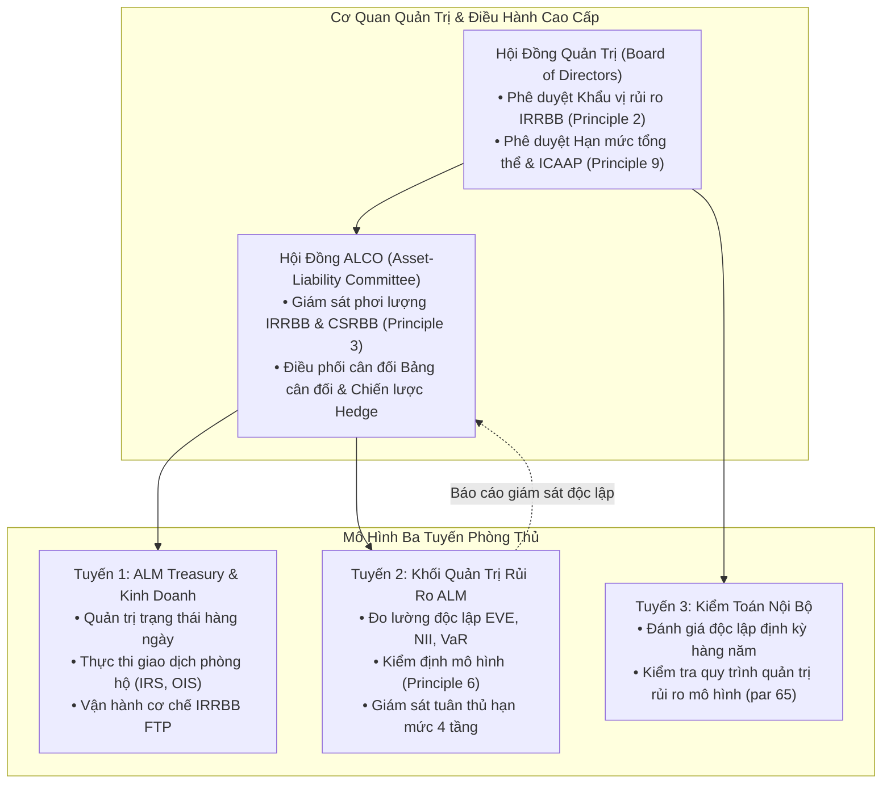

## Tóm tắt Quản trị Cấp cao (Executive Summary)

Rủi ro lãi suất trên sổ ngân hàng (IRRBB) không đơn thuần là một yêu cầu tuân thủ kỹ thuật Trụ cột 2 của [[bcbs-irrbb]], mà là **trọng tâm cốt lõi của mô hình kinh doanh ngân hàng thương mại** [[src-bcbs-irrbb-2016#^irrbb-p01-1]]. Ngân hàng về bản chất là tổ chức tạo lập giá trị thông qua hoạt động chuyển đổi kỳ hạn (maturity transformation) — sử dụng nguồn vốn ngắn hạn có chi phí thấp để tài trợ cho các tài sản sinh lời trung và dài hạn. Hoạt động này tất yếu tạo ra sự chênh lệch tái định giá ([[gap-risk]]), rủi ro cơ sở ([[basis-risk]]) và rủi ro quyền chọn nhúng ([[option-risk]]) [[src-bcbs-irrbb-2016#^irrbb-u02-2]].

Chiến lược quản trị ALM hiện đại đòi hỏi Khối Nguồn vốn & Quản lý Tài sản - Nợ (ALM Treasury) và Hội đồng ALCO phải giải quyết đồng thời **bốn thách thức mang tính chiến lược**:
1. **Sự đánh đổi căn bản giữa Giá trị kinh tế và Thu nhập (The Fundamental EVE vs. NII Trade-off)**: Không thể triệt tiêu đồng thời biến động của Giá trị kinh tế của Vốn chủ sở hữu ([[economic-value-of-equity|$\Delta\text{EVE}$]]) và Thu nhập thuần từ lãi ([[net-interest-income-sensitivity|$\Delta\text{NII}$]]). Một chiến lược phòng hộ tuyệt đối cho NII ngắn hạn thường làm gia tăng biến động EVE dài hạn và ngược lại [[src-bcbs-irrbb-2016#^irrbb-u06-5]].
2. **Cạm bẫy Thời lượng của Đệm Thanh khoản (The HQLA Duration Trap)**: Việc tối ưu hóa các chỉ số thanh khoản [[lcr]] và [[nsfr]] bằng cách tích lũy trái phiếu chính phủ Level 1 dài hạn tạo ra rủi ro thời lượng khổng lồ, khiến ngân hàng dễ bị tổn thương nghiêm trọng trước các kịch bản sốc lãi suất tăng ([[standardised-interest-rate-shocks]]) và kích hoạt ngưỡng xử phạt của [[outlier-bank-test|Phép thử Ngân hàng Ngoại lai (15% Vốn cấp 1)]] [[src-bcbs-irrbb-2016#^irrbb-p12-1]].
3. **Quản trị Rủi ro Hành vi Khách hàng Phi tuyến**: Mô hình hóa chính xác tiền gửi không kỳ hạn ([[non-maturity-deposits|NMDs]]) thông qua kỹ thuật Danh mục Tái lập (Replicating Portfolio) và kiểm soát tính lồi âm phát sinh từ quyền chọn trả nợ trước hạn và rút tiền gửi sớm ([[behavioural-options]]) [[src-bcbs-irrbb-2016#^irrbb-u06-6]] [[src-bcbs-irrbb-2016#^irrbb-u05-5]].
4. **Hệ thống Thực thi Đa tầng**: Vận hành Hệ thống hạn mức ALCO 4 tầng và Cơ chế Định giá Điều chuyển Vốn Nội bộ tích hợp (Integrated IRRBB & Liquidity FTP) để truyền dẫn chính xác chi phí rủi ro lãi suất vào từng quyết định kinh doanh tại chi nhánh [[src-bcbs-irrbb-2016#^irrbb-p04-1]].

```
                  ┌─────────────────────────────────────────────────────────────┐
                  │           HỘI ĐỒNG QUẢN LÝ TÀI SẢN - NỢ (ALCO)              │
                  │      Khẩu vị rủi ro, Hạn mức 4 tầng, Chiến lược cân bằng    │
                  └──────────────────────────────┬──────────────────────────────┘
                                                 │
          ┌──────────────────────────────────────┼──────────────────────────────────────┐
          ▼                                      ▼                                      ▼
┌───────────────────┐                  ┌───────────────────┐                  ┌───────────────────┐
│ TRỤ CỘT ĐO LƯỜNG  │                  │ TRỤ CỘT ĐIỀU HÀNH │                  │ TRỤ CỘT TRUYỀN DẪN│
├───────────────────┤                  ├───────────────────┤                  ├───────────────────┤
│ • ∆EVE (Run-off)  │                  │ • Portfolio Hedge │                  │ • IRRBB FTP       │
│ • ∆NII (12M Roll) │                  │ • Replicating NMD │                  │ • Margin Unbundling│
│ • 6 Sốc Chuẩn hoá │                  │ • IRS & Swaptions │                  │ • Behavioral Cost │
│ • Outlier Test 15%│                  │ • HQLA Duration   │                  │ • RAROC Allocation│
└───────────────────┘                  └───────────────────┘                  └───────────────────┘
```

---

## 1. Khung Quản trị Tác nghiệp theo 12 Nguyên tắc BCBS

Khuôn khổ quản trị IRRBB được xây dựng trên mô hình 3 tuyến phòng thủ theo hướng dẫn tại Principles 1–9 của Chuẩn mực d368 [[src-bcbs-irrbb-2016#^irrbb-u01-3]]:



### Trách nhiệm Cụ thể của Từng Cấp
- **Hội đồng Quản trị (Board of Directors)**: Chịu trách nhiệm cuối cùng về mức độ phơi lượng IRRBB; phê duyệt Khẩu vị rủi ro (Risk Appetite Framework); đảm bảo cơ cấu vốn quy định đủ năng lực hấp thụ rủi ro trong quy trình ICAAP (Principle 2 & Principle 9) [[src-bcbs-irrbb-2016#^irrbb-p02-1]] [[src-bcbs-irrbb-2016#^irrbb-p09-1]].
- **Hội đồng ALCO**: Tiếp nhận báo cáo đo lường định kỳ từ Khối Quản trị rủi ro; đưa ra các quyết định tái cơ cấu cấu trúc bảng cân đối (thay đổi tỷ trọng lãi suất cố định/thả nổi, điều chỉnh kỳ hạn danh mục cho vay và huy động); quyết định quy mô và công cụ phòng hộ phái sinh (Principle 3 & Principle 7) [[src-bcbs-irrbb-2016#^irrbb-p03-1]] [[src-bcbs-irrbb-2016#^irrbb-p07-1]].
- **Quy trình Kiểm định Mô hình Độc lập (Model Validation - Principle 6)**: Bộ phận quản trị rủi ro mô hình độc lập phải thẩm định toàn diện: (1) Tính đúng đắn của phương pháp luận lý thuyết; (2) Giám sát tham số liên tục và benchmarking; (3) Kiểm định ngược (backtesting) định kỳ đối với các tham số hành vi cốt lõi (tốc độ trả nợ trước hạn CPR, tỷ lệ rút tiền gửi sớm TDRR, tỷ lệ ổn định NMDs) [[src-bcbs-irrbb-2016#^irrbb-p06-2]].

### Triết Lý Quản Trị ALCO và Mô Hình Vận Hành ALM theo Moorad Choudhry & Polina Bardaeva
Theo Moorad Choudhry (2022), sự an toàn của ngân hàng bắt nguồn trực tiếp từ kỷ luật điều hành bảng cân đối:
- **ALCO — Diễn đàn Tối Quan Trọng Nhất Trong Ngân Hàng**: Các sai lầm dẫn tới sụp đổ ngân hàng trong lịch sử hầu hết đều xuất phát từ việc quản trị thanh khoản hoặc an toàn vốn sai lầm. Thậm chí các khoản phạt hàng tỷ USD không đánh sập được ngân hàng, nhưng *một bảng cân đối bị hỏng (broken balance sheet) thường sẽ đánh chìm ngân hàng* [[src-choudhry-principles-banking#^choudhry-alco-1]]. Do đó, ALCO là cơ quan quyền lực và quan trọng nhất toàn hàng.
- **Nguyên tắc Phân Bổ Thiên Kiến 50-50 (50-50 Profit vs Safety Split)**: Trong khi Hội đồng Quản trị ủy quyền và Ban Điều hành (Exco) luôn có thiên kiến tự nhiên nghiêng về lợi nhuận và ROE, vai trò bất biến của ALCO là phải **chia đều thiên kiến chính xác 50-50 giữa Lợi nhuận (Profit) và An toàn (Safety)** [[src-choudhry-principles-banking#^choudhry-alco-2]]. Để tránh xung đột lợi ích, ALCO nên do CFO hoặc Giám đốc Tài chính chủ trì (không để CEO hoặc các lãnh đạo khối kinh doanh chủ trì) [[src-choudhry-principles-banking#^choudhry-alco-3]].
- **Vị Trí Của Bàn ALM Trong Mô Hình Vận Hành Ngân Hàng**: Để loại bỏ các xung đột lợi ích cố hữu giữa bàn kinh doanh thị trường tiền tệ (profit centre) và đơn vị giám sát rủi ro (risk 2LoD), Choudhry & Bardaeva (2022) khuyến nghị mô hình tối ưu nhất là **Bàn ALM độc lập báo cáo trực tiếp cho Tổng Giám đốc (CEO)** (thường gọi là "Internal Treasury", phân tách độc lập khỏi "External Treasury") [[src-choudhry-principles-banking#^choudhry-opmodel-1]] [[src-choudhry-principles-banking#^choudhry-opmodel-2]].
- **Mô Hình Vận Hành Treasury**: Treasury hoạt động hiệu quả nhất khi được thiết lập như một Front-Office Profit Centre kết hợp bàn kinh doanh tiền tệ, bảo đảm tính kỷ luật và kiểm soát chặt chẽ hơn mô hình Middle Office Cost Centre [[src-choudhry-principles-banking#^choudhry-opmodel-3]].

---

## 2. Giải quyết Sự Đánh đổi Căn bản: EVE vs. NII

Mâu thuẫn giữa hai góc nhìn đo lường rủi ro lãi suất là nguyên lý nền tảng của ALM [[src-bcbs-irrbb-2016#^irrbb-u06-5]]:

| Tiêu chí | Góc nhìn Giá trị Kinh tế (EVE) | Góc nhìn Thu nhập thuần từ lãi (NII) |
|---|---|---|
| **Bản chất kinh tế** | Đo lường sự thay đổi giá trị hiện tại ròng của toàn bộ dòng tiền bảng cân đối cho đến khi tất toán hoàn toàn (*run-off horizon*) [[src-bcbs-irrbb-2016#^irrbb-u06-5]] | Đo lường sự biến động của thu nhập thuần từ lãi phát sinh trong một khoảng thời gian ngắn-trung hạn (thường là 12 tháng liên tục) [[src-bcbs-irrbb-2016#^irrbb-p08-3]] |
| **Bảo vệ đối tượng** | Bảo vệ **Vốn tự có của cổ đông** và năng lực thanh toán dài hạn đối với người gửi tiền | Bảo vệ **Khả năng sinh lời kế toán (P&L)**, cổ tức ngắn hạn và khả năng duy trì hoạt động liên tục |
| **Giả định bảng cân đối** | Run-off balance sheet (không tái đầu tư dòng tiền mới) [[src-bcbs-irrbb-2016#^irrbb-p08-2]] | Constant balance sheet (thay thế dòng tiền đáo hạn bằng công cụ tương đương) hoặc Dynamic [[src-bcbs-irrbb-2016#^irrbb-p08-3]] |
| **Xử lý Vốn chủ sở hữu** | Loại bỏ toàn bộ Vốn chủ sở hữu (CET1) khỏi bảng tính [[src-bcbs-irrbb-2016#^irrbb-p08-2]] | Vốn chủ sở hữu được xem là nguồn tài trợ chi phí 0% hỗ trợ cho thu nhập |

### Minh họa Toán học về Mâu thuẫn EVE - NII

Xét một bảng cân đối điển hình có cấu trúc chuyển đổi kỳ hạn:
- **Tài sản (Assets)**: 100 tỷ VND cho vay lãi suất cố định 5 năm ở mức $8.0\%/\text{năm}$ (Thời lượng Macaulay $D_A \approx 4.3$ năm).
- **Nguồn vốn (Liabilities)**: 90 tỷ VND tiền gửi kỳ hạn 3 tháng thả nổi ở mức $5.0\%/\text{năm}$ ($D_L \approx 0.25$ năm).
- **Vốn tự có (Equity)**: 10 tỷ VND.

Khi lãi suất thị trường tăng đột ngột $+200 \text{ bps}$ song song:
1. **Tác động lên [[net-interest-income-sensitivity|$\Delta\text{NII}_{12M}$]]**:
   - Thu nhập từ tài sản không đổi trong 12 tháng tới (vì cố định 5 năm).
   - Chi phí nguồn vốn tăng ngay lập tức $2.0\% \times 90 = 1.8 \text{ tỷ VND}$.
   - Thu nhập thuần từ lãi sụt giảm nghiêm trọng: $\Delta\text{NII} = -1.8 \text{ tỷ VND}$ (ăn mòn gần 60% NIM ban đầu).
2. **Chiến lược can thiệp ngây thơ nhằm bảo vệ NII**:
   - Để triệt tiêu rủi ro NII, Treasury thực hiện hợp đồng hoán đổi lãi suất (IRS) nhận cố định 5 năm và trả thả nổi 3 tháng cho quy mô 90 tỷ VND. Giờ đây thu nhập từ tài sản biến thành thả nổi và khớp hoàn hảo với chi phí huy động. $\Delta\text{NII}_{12M} \approx 0$.
3. **Hậu quả phản phệ lên [[economic-value-of-equity|$\Delta\text{EVE}$]]**:
   - Khi thực hiện IRS nhận cố định, Treasury đã **kéo dài gấp đôi thời lượng của tài sản**! Thời lượng ròng của bảng cân đối vọt lên:
     $$D_{\text{net}} \approx D_A \cdot A - D_L \cdot L + D_{\text{IRS}} \cdot \text{Notional} \approx 4.3 \times 100 - 0.25 \times 90 + 4.0 \times 90 \approx 767.5$$
   - Khi lãi suất tiếp tục tăng thêm, tổn thất giá trị kinh tế bốc hơi dữ dội:
     $$\Delta\text{EVE} \approx -D_{\text{net}} \cdot \Delta y \approx -7.675 \times 2\% \approx -15.35 \text{ tỷ VND}$$
   - Tổn thất 15.35 tỷ vượt quá toàn bộ Vốn tự có (10 tỷ), đẩy ngân hàng vào tình trạng phá sản kinh tế và kích hoạt ngay lập tức mức vi phạm [[outlier-bank-test|Outlier Bank Test (> 15% Tier 1)]]!

### Giải pháp Cân bằng của ALCO: Danh mục Tái lập (Replicating Portfolio)
Để hóa giải sự đánh đổi này, ALCO áp dụng phương pháp luận **Danh mục Tái lập** đối với các khoản tiền gửi không kỳ hạn ([[non-maturity-deposits|NMDs]]) và vốn chủ sở hữu [[src-bcbs-irrbb-2016#^irrbb-u06-6]]:
- Chia nhỏ số dư tiền gửi lõi (Core NMDs) thành 60 phần bằng nhau và tái đầu tư định kỳ mỗi tháng vào các tài sản có kỳ hạn cố định 5 năm [[src-bcbs-irrbb-2016#^irrbb-u06-6]].
- Danh mục tái lập này tạo ra một dòng thu nhập lãi bình quân di động (moving average yield) mượt mà, triệt tiêu các cú sốc biến động giật cục của lãi suất ngắn hạn lên NII, đồng thời duy trì thời lượng bình quân gia quyền của nguồn vốn ở mức cố định 2.5 năm, giúp thu hẹp khe hở thời lượng (Duration Gap) về mức an toàn mà không cần lạm dụng phái sinh [[src-bcbs-irrbb-2016#^irrbb-u06-6]].

### Nghịch Lý Giữa EVE Và Giá Trị Thị Trường Cổ Phiếu Ngân Hàng (The EVE vs Market Value Paradox)
Moorad Choudhry (2022) nhận diện một nghịch lý lớn giữa đo lường giám sát và thị trường tài chính:
- **Thước đo $\Delta\text{EVE}$**: Với đa số các ngân hàng có tài sản dài hạn hơn nợ, khi lãi suất tăng, $\Delta\text{EVE}$ sụt giảm do hiện giá tài sản giảm mạnh hơn nợ.
- **Thị giá cổ phiếu trên thị trường chứng khoán (Share Price / Market Cap)**: Ngược lại, giá cổ phiếu ngân hàng thường **tăng vọt** khi lãi suất tăng [[src-choudhry-principles-banking#^choudhry-irrbb-11]]. Nguyên nhân là các nhà đầu tư nhìn theo lăng kính thu nhập (earnings perspective): kỳ vọng lãi suất tăng sẽ mở rộng biên lãi thuần (NIM) và gia tăng thu nhập lãi thuần $\Delta\text{NII}$, do tài sản tái định giá nhanh hơn trong khi chi phí tiền gửi không kỳ hạn (CASA) có độ trễ lớn và deposit beta thấp.
- **Biện pháp xử lý bắt buộc**: Khi mức độ căng thẳng vượt quá khẩu vị rủi ro hoặc chạm ngưỡng cảnh báo, ngân hàng bắt buộc phải: (1) Miễn nhiễm rủi ro thông qua phòng hộ tự nhiên (organic hedges) hoặc phái sinh (derivative hedges); (2) Bổ sung thêm vốn Cấp 1 (Tier 1 Capital); hoặc (3) Tái cơ cấu loại bỏ tài sản rủi ro khỏi bảng cân đối [[src-choudhry-principles-banking#^choudhry-irrbb-12]].

---

## 3. Cạm bẫy Thời lượng của Đệm HQLA và Ma trận Tối ưu Đa ràng buộc

Một trong những bài học đắt giá nhất của quản trị ALM hiện đại (như sự sụp đổ của Silicon Valley Bank năm 2023) là sự tương tác tiêu cực giữa quy chuẩn thanh khoản và rủi ro lãi suất:

```
┌─────────────────────────────────────────────────────────────────────────────┐
│                 MA TRẬN RÀNG BUỘC ĐA CHỈ TIÊU ALM TOÀN DIỆN                  │
├─────────────────────────────────────────────────────────────────────────────┤
│   CHỈ TIÊU     │       MỤC TIÊU TỐI ƯU HOÁ      │   XUNG ĐỘT TIỀM ẨN        │
├────────────────┼────────────────────────────────┼───────────────────────────┤
│ [[lcr|LCR]]    │ Gom tối đa Trái phiếu Chính phủ│ Tăng mạnh Thời lượng (DA),│
│                │ Level 1 (Haircut 0%, Run-off 0)│ bùng nổ rủi ro EVE khi sốc│
├────────────────┼────────────────────────────────┼───────────────────────────┤
│ [[nsfr|NSFR]]  │ Nắm giữ tài sản có RSF 5% (TPCP│ Kéo dài kỳ hạn tài sản để │
│                │ Level 1), giảm tối đa RSF      │ tối ưu hóa RSF làm trầm   │
│                │                                │ trọng thêm Gap Risk       │
├────────────────┼────────────────────────────────┼───────────────────────────┤
│ [[bcbs-irrbb]] │ Giảm thiểu ∆EVE ≤ 15% Tier 1   │ Bán tài sản dài hạn hoặc  │
│                │ và kiểm soát biên độ ∆NII      │ trả cố định IRS làm giảm  │
│                │                                │ NIM và tăng chi phí vốn   │
└─────────────────────────────────────────────────────────────────────────────┘
```

### Cơ chế Phòng vệ của ALCO trước Cạm bẫy Thời lượng HQLA
1. **Áp trần Thời lượng (Duration Cap) cho Danh mục Thanh khoản**: ALCO bắt buộc áp trần thời lượng bình quân gia quyền đối với danh mục [[hqla|HQLA Level 1]] (ví dụ: không vượt quá 2.5–3.0 năm). Ngân hàng không được phép mua toàn bộ trái phiếu chính phủ kỳ hạn 10Y–15Y để hưởng lợi suất cao (*carry trade*) mà phải phân bổ theo chiến lược đòn gánh (**Barbell Strategy**): kết hợp tín phiếu kho bạc ngắn hạn (T-Bills 3M–6M) với trái phiếu trung hạn.
2. **Kỹ thuật Phòng hộ Vĩ mô (Macro Hedging via Pay-Fixed IRS)**: Đối với các trái phiếu chính phủ dài hạn bắt buộc nắm giữ để duy trì LCR trong các đợt căng thẳng, Treasury phải thực hiện các hợp đồng hoán đổi lãi suất trả cố định / nhận thả nổi (Pay-Fixed IRS). Nghiệp vụ này biến đổi thời lượng của trái phiếu từ 10 năm xuống tương đương tín phiếu 3 tháng, triệt tiêu tổn thất EVE khi lợi suất trái phiếu tăng vọt.
3. **Phân loại Kế toán Thận trọng (AFS/FVTOCI vs. HTM/Amortised Cost)**: Trái phiếu ghi nhận theo giá trị hợp lý (AFS/FVTOCI) phản ánh ngay tổn thất vào vốn chủ sở hữu (thông qua OCI), đe dọa trực tiếp tỷ lệ an toàn vốn CAR [[src-bcbs-irrbb-2016#^irrbb-u06-1]]. Trong khi đó, việc giấu các khoản lỗ chưa thực hiện vào danh mục nắm giữ đến ngày đáo hạn (HTM) không bảo vệ ngân hàng trước rủi ro kinh tế thực tế; khi thanh khoản bị tháo chạy, ngân hàng buộc phải bán lỗ HTM, biến lỗ vô hình thành lỗ hữu hình và sụp đổ vốn [[src-bcbs-irrbb-2016#^irrbb-u06-1]].

---

## 4. Hệ thống Hạn mức ALCO 4 Tầng (4-Tier Limit Structure)

Để kiểm soát rủi ro lãi suất một cách toàn diện và xuyên suốt từ chiến lược đến tác nghiệp hàng ngày, ALCO thiết lập hệ thống hạn mức 4 tầng:

```
┌─────────────────────────────────────────────────────────────────────────────┐
│ TẦNG 1: HẠN MỨC HỘI ĐỒNG QUẢN TRỊ (BOARD RISK APPETITE LIMITS)               │
│ • Max ∆EVE / Tier 1 Capital ≤ 10.0% (Thận trọng hơn trần Basel 15%)         │
│ • Max ∆NII_{12M} / Kế hoạch LNTT ≤ 5.0%                                    │
└──────────────────────────────────────┬──────────────────────────────────────┘
                                       │
┌──────────────────────────────────────▼──────────────────────────────────────┐
│ TẦNG 2: HẠN MỨC ALCO THEO THƯỚC ĐO RỦI RO CƠ CẤU (METRIC STRUCTURAL LIMITS) │
│ • Hạn mức Khe hở Thời lượng thuần: -0.5 năm ≤ Duration Gap ≤ +1.5 năm       │
│ • Hạn mức PV01 / BPV theo từng dải kỳ hạn (Bucket PV01 Limits)              │
│ • Hạn mức Khe hở tái định giá lũy kế (Cumulative Repricing Gap Limits)      │
└──────────────────────────────────────┬──────────────────────────────────────┘
                                       │
┌──────────────────────────────────────▼──────────────────────────────────────┐
│ TẦNG 3: HẠN MỨC THEO THÀNH PHẦN RỦI RO & TIỀN TỆ (COMPONENT & CCY LIMITS)    │
│ • Hạn mức Rủi ro Cơ sở (Basis Risk Limits: Max chênh lệch L1 - L2)          │
│ • Hạn mức Rủi ro Quyền chọn (Max KAO add-on ≤ 2% Tier 1 Capital)            │
│ • Hạn mức phơi lượng theo từng đồng tiền trọng yếu (USD, EUR, VND riêng)    │
└──────────────────────────────────────┬──────────────────────────────────────┘
                                       │
┌──────────────────────────────────────▼──────────────────────────────────────┐
│ TẦNG 4: HẠN MỨC TÁC NGHIỆP TREASURY (TREASURY OPERATIONAL TRADING LIMITS)   │
│ • Hạn mức danh nghĩa trạng thái phái sinh (IRS / Swaption Notional Limits)  │
│ • Hạn mức cắt lỗ (Stop-Loss Limits) cho danh mục AFS/FVTOCI                 │
│ • Hạn mức biến động giá trị kinh tế trong ngày (Intraday PV01)              │
└─────────────────────────────────────────────────────────────────────────────┘
```

---

## 5. Cơ chế Định giá Điều chuyển Vốn Nội bộ Tích hợp (IRRBB & Multi-dimensional FTP)

Cơ chế Định giá Điều chuyển Vốn Nội bộ (Funds Transfer Pricing - FTP) là công cụ kinh tế mạnh mẽ nhất để Khối ALM Treasury truyền tải chính sách quản trị rủi ro lãi suất xuống toàn bộ mạng lưới chi nhánh và các đơn vị kinh doanh [[src-bcbs-irrbb-2016#^irrbb-p04-1]].

### Nguyên tắc Bóc tách Rủi ro (Risk Unbundling Principle)
- Các chi nhánh và đơn vị kinh doanh chỉ chịu trách nhiệm quản trị **Rủi ro tín dụng (Credit Risk)** và tối đa hóa **Biên thương mại (Commercial Margin)**.
- Toàn bộ rủi ro lãi suất ([[gap-risk]], [[basis-risk]]) và rủi ro kỳ hạn bắt buộc phải được **chuyển giao 100% về cho ALM Treasury** thông qua việc ký kết các hợp đồng giao dịch FTP nội bộ tương ứng với ngày tái định giá và kỳ hạn của sản phẩm.

### Công thức Phân rã Biểu phí FTP Tích hợp Toàn diện

Đối với một khoản tín dụng hoặc tài sản đầu tư, mức phí FTP mà chi nhánh phải trả cho Treasury được cấu thành từ 4 thành phần riêng biệt:

$$
\text{FTP}_{\text{Asset}} = \text{Base Rate}(t_k) + \text{Term Liquidity Premium} + \text{Convexity / Option Surcharge} + \text{Regulatory Buffer Cost}
$$

Trong đó:
1. **Lãi suất Cơ sở theo Kỳ hạn ($\text{Base Rate}(t_k)$)**: Là lãi suất phi rủi ro trên đường cong chuẩn nội bộ tại kỳ hạn tái định giá $t_k$ của tài sản.
2. **Phí bù Thanh khoản Cấu trúc ($\text{Term Liquidity Premium}$)**: Chi phí bù đắp cho việc nắm giữ thanh khoản dài hạn theo hệ số [[required-stable-funding|RSF]] của [[nsfr]].
3. **Phụ phí Quyền chọn Hành vi ($\text{Convexity Surcharge}$)**: Khoản phí thu thêm đối với các khoản cho vay lãi suất cố định dài hạn có cho phép khách hàng trả nợ trước hạn mà không bị phạt kinh tế đủ bù đắp tổn thất. Phụ phí này dùng để bù đắp chi phí Treasury phải mua swaptions hoặc chịu hệ số $\gamma_i = 1.2$ trong [[behavioural-options]].
4. **Chi phí Đệm Quy định ($\text{Regulatory Buffer Cost}$)**: Chi phí nắm giữ đệm [[hqla]] dự phòng theo yêu cầu của [[lcr]].

Ngược lại, đối với nguồn tiền gửi ổn định ([[non-maturity-deposits|NMDs]] lõi), Treasury sẽ trả thưởng thanh khoản và lãi suất cơ sở theo kỳ hạn của Danh mục Tái lập (2.5–3.0 năm), giúp chi nhánh có động lực mở rộng tiền gửi không kỳ hạn giá rẻ mà không bị thiệt thòi khi so sánh với tiền gửi kỳ hạn ngắn.

---

## Ma trận Liên kết Hệ thống ALM

Chiến lược IRRBB liên kết mật thiết với các cấu phần cốt lõi khác trong ALM Wiki:
- **Bản thiết kế Kiến trúc Toàn diện**: [[irrbb-five-tier-architecture]].
- **Công cụ & Mô hình Định lượng**: [[interest-rate-swap]], [[interest-rate-cap-floor]], [[swaption]], [[duration-gap-model]], [[key-rate-duration]], [[replicating-portfolio-model]], [[economic-value-at-risk]].
- **Đo lường & Định lượng**: [[economic-value-of-equity]], [[net-interest-income-sensitivity]], [[standardised-interest-rate-shocks]], [[irrbb-standardised-framework]].
- **Các Thành phần Rủi ro**: [[gap-risk]], [[basis-risk]], [[option-risk]], [[behavioural-options]], [[non-maturity-deposits]], [[csrbb]].
- **Quy chuẩn & Giám sát**: [[bcbs-irrbb]], [[outlier-bank-test]].
- **Tối ưu hóa Bảng cân đối Toàn diện**: [[lcr-nsfr-interlinkages]], [[integrated-alm-liquidity-strategy]], [[hqla-decomposition-and-tradeoffs]].

## Đề xuất cập nhật
- [2026-10-19] ingest src-bcbs-irrbb-2016 U03 (bổ sung par 28, 29, 32): claim mới về risk appetite statement [[src-bcbs-irrbb-2016#^irrbb-p03-2]], aggregate limits hợp nhất [[src-bcbs-irrbb-2016#^irrbb-p03-3]] và báo cáo vượt hạn mức [[src-bcbs-irrbb-2016#^irrbb-p03-4]]; [[tt83-2025]] yêu cầu hạn mức ΔNII và ΔEVE [[src-tt83-2025-nhnn#^d53-2]]; cần rà lại mục hệ thống hạn mức ALCO 4 tầng và câu "Principle 2/9" ở sơ đồ quản trị.
- [2026-10-19] ingest src-tt83-2025-nhnn PL2 (+ Đ9): [[tt83-2025]] có báo cáo quản lý rủi ro hằng năm gửi NHNN, hạn 90 ngày sau năm tài chính, Tổng giám đốc phê duyệt [[src-tt83-2025-nhnn#^d9-3a]] [[src-tt83-2025-nhnn#^d9-4c]]; mục IRRBB gồm chiến lược, hạn mức, kiểm tra sức chịu đựng, vi phạm [[src-tt83-2025-nhnn#^pl2-ii6]]; cần rà lại mục vai trò ALCO / báo cáo và phần hàm ý quy định NHNN.
- [2026-10-19] ingest src-tt83-2025-nhnn C3-M1: đã có node [[risk-appetite]], [[risk-limits]], [[stress-testing]]; TT83 quy định bộ phận ALM kiểm soát hạn mức IRRBB và tổng tài sản tính theo rủi ro IRRBB, đề xuất nguyên tắc FTP [[src-tt83-2025-nhnn#^d25-3]]; hạn mức do Tổng giám đốc ban hành, nới lỏng phải báo cáo HĐQT [[src-tt83-2025-nhnn#^d20-1]] [[src-tt83-2025-nhnn#^d20-2]]; stress test IRRBB tối thiểu hằng quý [[src-tt83-2025-nhnn#^d23-5]]; cần rà lại mục vai trò ALCO / hệ thống hạn mức và hàm ý NHNN.
- [2026-10-19] ingest src-tt83-2025-nhnn C3-M9: đã có node [[icaap]], [[capital-plan]]; vốn mục tiêu phân bổ cho rủi ro trọng yếu làm cơ sở hạn mức [[src-tt83-2025-nhnn#^d61-1]]; stress test vốn tính tác động lãi suất lên tài sản tính theo rủi ro IRRBB [[src-tt83-2025-nhnn#^d60-1]]; cần rà lại mục Nguyên tắc 9 / ICAAP và hàm ý NHNN.
- [2026-10-19] ingest src-tt83-2025-nhnn PL6: đã có [[economic-capital]] (hết stub), [[rwa-irrbb]], [[target-capital]], [[raroc]], [[projected-own-funds]]; $RWA_{IRRBB}$ theo ΔEVE từ 01/01/2028 [[src-tt83-2025-nhnn#^pl6-1c]]; cần rà lại mục EVE vs NII (ΔEVE nay nối thẳng vào vốn kinh tế) và Nguyên tắc 9.
- [2026-10-19] ingest src-tt83-2025-nhnn C1: đã có node [[alco]] (TT83 Đ6.4.b: Hội đồng ALCO giúp việc Tổng giám đốc về nội dung Đ25.3, họp tối thiểu hằng quý [[src-tt83-2025-nhnn#^d6-4b]]); cần rà lại chỗ nhắc ALCO và góc nhìn NHNN.
- [2026-10-19] ingest src-tt83-2025-nhnn C1: đã có node [[three-lines-of-defence]] (TT83 Đ4.2 [[src-tt83-2025-nhnn#^d4-2]]); cần rà lại chỗ nhắc 1LoD/2LoD.
- [2026-10-19] ingest src-tt83-2025-nhnn C3-M8: đã có node [[model-validation]]; TT83 yêu cầu kiểm định mô hình trước khi dùng, khi thay đổi trọng yếu và tối thiểu hằng năm [[src-tt83-2025-nhnn#^d56-4d]], do tuyến 2 thực hiện [[src-tt83-2025-nhnn#^d56-7]]; cần rà lại chỗ nhắc kiểm định mô hình hành vi.
- [2026-10-19] ingest src-tt83-2025-nhnn PL3: [[rwa-irrbb]] phải được thuyết minh phương pháp (mô tả, điểm mạnh, hạn chế, điều chỉnh giả định) trong báo cáo ICAAP hằng năm gửi NHNN [[src-tt83-2025-nhnn#^pl3-3b]] [[src-tt83-2025-nhnn#^d9-2c]]; cần rà lại mục vốn cho IRRBB / ICAAP.
- [2026-10-19] ingest src-tt83-2025-nhnn C5: [[model-validation]] sửa hiệu lực — quản lý rủi ro mô hình Mục 8 (kể cả kiểm định hằng năm) bắt buộc chậm nhất từ 01/01/2028, sớm hơn chỉ với mô hình xếp hạng nội bộ [[src-tt83-2025-nhnn#^d74-3]]; áp dụng sớm phải thông báo NHNN trong 10 ngày [[src-tt83-2025-nhnn#^d74-5]]; cần rà lại chỗ nhắc kiểm định mô hình hành vi.
- [2026-10-19] ingest src-tata-bank-alm u08: [[outlier-bank-test]] có đề xuất thêm khung EU — SOT NII 5% vốn cấp 1 (d368, TT83 không có) [[src-tata-bank-alm#^tata-sot-3]], sàn lãi suất sau sốc tuyến tính [[src-tata-bank-alm#^tata-sot-2]], bài toán tuân thủ đồng thời EVE/NII [[src-tata-bank-alm#^tata-sot-4]]; cần rà lại mục đánh đổi EVE–NII.
- [2026-10-19] ingest src-tata-bank-alm u07: đã có node [[silicon-valley-bank]] có nguồn (số liệu bảng cân đối, phòng ngừa, duration gap 3 năm, giả định duration tiền gửi) [[src-tata-bank-alm#^tata-svb-5]] [[src-tata-bank-alm#^tata-svb-7]] [[src-tata-bank-alm#^tata-svb-9]]; cần rà lại chỗ nhắc SVB, đối chiếu số liệu và thay bằng citation.
- [2026-10-19] ingest src-choudhry-principles-banking u25: đã có node [[structural-hedging]] (phòng ngừa IRRBB theo phần ròng sau natural hedge, macro hedge pool IRS không áp được hedge accounting [[src-choudhry-principles-banking#^choudhry-cs-14]] [[src-choudhry-principles-banking#^choudhry-cs-17]]); cần rà lại mục chiến lược phòng ngừa và vai trò ALCO.
- [2026-10-19] ingest src-choudhry-principles-banking u10/u11/u14: [[alco]] thêm best practice FSA/PRA SS1/13 và ToR Choudhry (CFO chủ tịch, họp hằng tháng, báo cáo Board, pari passu với ExCo) đối chiếu TT83 (giúp việc TGĐ, tối thiểu hằng quý), MI pack có NII/NIM sensitivity và basis risk; cần rà lại phần quản trị ALCO.
- [2026-10-19] ingest src-choudhry-principles-banking u10/u11/u14: [[structural-hedging]] thêm công cụ phòng ngừa (FRA, futures, OIS, cap) và ví dụ EAR: gap −80, +1% làm NII giảm 0,8 triệu USD (EAR ~7,8%), cap 80 triệu strike 3% loại bỏ EAR với chi phí 5bp NIM, hạn mức EAR ALCO ±5%/±10%; cần rà lại phần lựa chọn công cụ phòng ngừa.
- [2026-10-19] ingest src-choudhry-principles-banking u10/u11/u14: đã có node [[overnight-index-swap]] (OIS/SONIA, phòng ngừa NII và basis risk tiền gửi so với lãi suất cơ bản); cần rà lại chỗ nhắc OIS để link.
- [2026-10-19] ingest src-choudhry-principles-banking u09/u15: [[risk-appetite]] thêm RAS theo Choudhry (văn bản quan trọng nhất cần Board phê duyệt, macro-tolerance chia theo khối, hạn mức FX và encumbrance, rà soát hằng năm); cần rà lại phần khẩu vị rủi ro.
- [2026-10-19] ingest src-choudhry-principles-banking u03/u04: đã có node [[net-interest-margin]] (định nghĩa, case ChoudWest 5 kịch bản: NII và NIM có thể đi ngược chiều, buffer £1,5bn làm NIM −0,50 điểm %, Table 1.10 hành động quản lý NIM); cần rà lại chỗ dùng NIM làm chỉ số đánh đổi.
- [2026-10-19] ingest src-bardaeva-alm u03: mục 1 "Triết Lý Quản Trị ALCO và Mô Hình Vận Hành ALM theo Moorad Choudhry & Polina Bardaeva" quy cho Bardaeva khuyến nghị ALM báo cáo trực tiếp CEO nhưng chỉ cite Choudhry. Bardaeva nói ALM nên độc lập, trực thuộc CFO hoặc CEO (khi họ có KPI cả về tham số rủi ro), hoặc thuộc đơn vị phụ trách chiến lược dài hạn [[src-bardaeva-alm#^ch11-21]]; gộp ALM vào Trading Desk là sai kể cả khi ALM không là profit center [[src-bardaeva-alm#^ch11-11]], trong khi bullet "Mô Hình Vận Hành Treasury" ưu tiên Front-Office Profit Centre. Đã có node [[irrbb-management]], [[alm-operating-model]], [[srep]]; cần rà lại mục 1.
- [2026-10-19] ingest src-bardaeva-alm u04: [[irrbb-management]] thêm bảng thị trường phát triển và mới nổi (liability sensitive, khả năng phòng ngừa hạn chế, khó dựng đường cong nội bộ) và vai trò IRRBB/FTP trong khủng hoảng (chỉnh độ dốc đường cong FTP); đã có node [[recovery-and-resolution-planning]], [[mrel]]; cần rà lại phần hàm ý cho VN và mục 5 (FTP).
- [2026-10-19] ingest src-choudhry-principles-banking u21–u22: Choudhry nêu bộ hạn mức Banking Book gồm BPV và Interest Rate Gap Limits trong hạn mức do ALCO đặt [[src-choudhry-principles-banking#^choudhry-bbp-5]], risk register ghi khẩu vị IRR là hạn mức chênh lệch tái định giá [[src-choudhry-principles-banking#^choudhry-rmf-5]], và toàn bộ IRR tập trung về Treasury qua internal swap [[src-choudhry-principles-banking#^choudhry-st-11]]; đã có node [[key-risk-indicators]]; cần rà lại mục 4 (hệ thống hạn mức ALCO 4 tầng).
- [2026-10-19] ingest src-choudhry-principles-banking u23–u24: [[icaap]] có thêm quy trình UK (use test, một chủ sở hữu ICAAP, Pillar 2A/2B), [[srep]] có Pillar 2A/2B của PRA, [[recovery-and-resolution-planning]] có FSB Key Attributes và EU vs US; đã có node [[reverse-stress-testing]], [[bail-in]]; cần rà lại mục quản trị vốn/ICAAP và RRP.
- [2026-10-19] ingest src-choudhry-principles-banking u18 — chờ user duyệt: [[risk-appetite]] có quan hệ mới `limits` → [[bank-strategic-plan]]; [[capital-plan]] thêm `part-of` strategic plan và 3 mục tiêu capital management; [[raroc]] thêm các lựa chọn chỉ tiêu return (RoC Pillar I+II, RARoC, RoRAC, RoRWA); cần rà lại mục khẩu vị rủi ro và hạn mức ALCO.
- [2026-10-19] ingest src-choudhry-principles-banking u19: [[capital-plan]] và [[alco]] thêm mẫu capital management policy của Choudhry, trong đó ALCO sở hữu capital planning (capm-16, capm-19, capm-30); TT83 Đ6.4.c lại giao đánh giá mức đủ vốn cho Hội đồng quản lý vốn riêng (d6-4c); cần rà lại phần phân vai ALCO trong khung quản trị.
