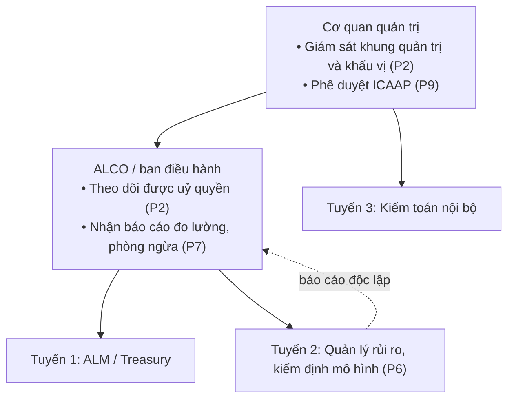

## Câu hỏi
- **Q1**: Khung quản trị tác nghiệp của HĐQT và ALCO theo 12 Nguyên tắc BCBS.
- **Q2**: Giải quyết sự đánh đổi căn bản giữa EVE và NII.
- **Q3**: Kiểm soát cạm bẫy thời lượng của đệm thanh khoản HQLA.
- **Q4**: Hệ thống hạn mức ALCO 4 tầng.
- **Q5**: Cơ chế IRRBB FTP vận hành thế nào trong chiến lược ALM tổng thể.
- **Q6** (bổ sung khi rà lại 2026-10-20): Nghĩa vụ tại VN theo TT83/2025 đối với quản trị IRRBB và vốn cho IRRBB.

Bản rà lại 2026-10-20 (hạ canonical → draft theo duyệt của user): sửa citation lệch, gỡ các con số hạn mức không có nguồn, sửa ví dụ số ở Q2, sửa câu về SVB ở Q3, sửa quy kết Bardaeva ở Q1, thêm Q6.

## Kết luận
- **Q1**: Theo [[bcbs-irrbb]], cơ quan quản trị chịu trách nhiệm giám sát khung quản trị IRRBB và khẩu vị rủi ro, có thể uỷ quyền theo dõi cho ban điều hành hoặc ALCO [[src-bcbs-irrbb-2016#^irrbb-p02-1]]. Kết quả đo lường và chiến lược phòng ngừa nên được báo cáo định kỳ cho cơ quan quản trị hoặc ALCO [[src-bcbs-irrbb-2016#^irrbb-p07-1]]; khung kiểm định độc lập nên gồm đánh giá phương pháp luận, giám sát liên tục và phân tích kết quả [[src-bcbs-irrbb-2016#^irrbb-p06-2]]. Ở VN, ALCO là hội đồng tham mưu Tổng giám đốc [[src-tt83-2025-nhnn#^d6-4b]], khác với mô hình ALCO do CFO chủ trì, pari passu với ExCo mà Choudhry mô tả theo FSA/PRA [[src-choudhry-principles-banking#^choudhry-alco-3]] [[src-choudhry-principles-banking#^choudhry-alco-7]].
- **Q2**: d368 nêu rằng ngân hàng chỉ tối thiểu hoá rủi ro giá trị kinh tế bằng cách khớp tái định giá tài sản và nợ ngoài kỳ hạn ngắn thì có thể chịu biến động thu nhập [[src-bcbs-irrbb-2016#^irrbb-u02-4]]. Vì vậy IRRBB phải được quản lý bằng cả hai thước đo [[src-bcbs-irrbb-2016#^irrbb-u02-4]]. Danh mục tái lập (replicating portfolio) là kỹ thuật phổ biến để ổn định thu nhập từ NMD và vốn chủ sở hữu [[src-bcbs-irrbb-2016#^irrbb-u06-6]]. Từ 01/01/2028, ΔEVE còn là đầu vào của vốn kinh tế tại VN qua $RWA_{IRRBB}$ [[src-tt83-2025-nhnn#^pl6-1c]].
- **Q3**: Không nguồn nào trong wiki định danh khái niệm "HQLA duration trap"; nội dung Q3 chủ yếu là diễn giải. Bằng chứng có nguồn gần nhất là trường hợp [[silicon-valley-bank]]: lỗ chưa thực hiện 15,2 tỷ USD trong sổ HTM (MBS dài hạn, duration khoảng 6,25 năm) so với vốn khoảng 12 tỷ USD [[src-tata-bank-alm#^tata-svb-5]].
- **Q4**: Nguồn chỉ yêu cầu khẩu vị rủi ro thể hiện theo cả EVE và thu nhập, hạn mức chính sách nhất quán với khẩu vị [[src-bcbs-irrbb-2016#^irrbb-p03-1]], hạn mức tổng áp trên cơ sở hợp nhất [[src-bcbs-irrbb-2016#^irrbb-p03-3]], sub-limits theo đơn vị, danh mục, công cụ và risk tolerance riêng cho gap, basis, option khi phơi nhiễm đáng kể [[src-bcbs-irrbb-2016#^irrbb-p03-5]], hạn mức riêng cho chiến lược phòng ngừa bằng phái sinh [[src-bcbs-irrbb-2016#^irrbb-p03-6]] và leo thang khi vượt [[src-bcbs-irrbb-2016#^irrbb-p03-4]]. TT83 bắt buộc tối thiểu hạn mức ΔNII và ΔEVE [[src-tt83-2025-nhnn#^d53-2]]. Cách chia "4 tầng" là cách nhóm của wiki; các con số hạn mức ở bản cũ không có nguồn và đã được gỡ.
- **Q5**: FTP là ranh giới giữa chuyển đổi kỳ hạn và thương quyền khách hàng [[src-choudhry-principles-banking#^choudhry-ftp-3]]. Thông lệ tốt là tập trung toàn bộ rủi ro lãi suất về Treasury qua giao dịch funding [[src-choudhry-principles-banking#^choudhry-st-11]]. Chuẩn Basel cho FTP mới có ở phần thanh khoản (BCBS 144 P4) [[src-bcbs-liquidity-principles-2008#^lrm-p04]]; phần lãi suất chưa có chuẩn BCBS trong wiki.
- **Q6**: TT83/2025 (hiệu lực 01/07/2026 [[src-tt83-2025-nhnn#^d74-1]]) yêu cầu đo lường bằng ΔNII và ΔEVE [[src-tt83-2025-nhnn#^d53-1a2]], hạn mức tối thiểu cho cả hai [[src-tt83-2025-nhnn#^d53-2]], với lộ trình được dùng một trong hai chỉ tiêu tới 31/12/2027 [[src-tt83-2025-nhnn#^d74-4a]] và bắt buộc cả hai chậm nhất từ 01/01/2028 [[src-tt83-2025-nhnn#^d74-4b]]. IRRBB đi vào ICAAP qua stress test vốn [[src-tt83-2025-nhnn#^d60-1]] và $RWA_{IRRBB}$ trong vốn kinh tế [[src-tt83-2025-nhnn#^pl6-1c]].

## Cơ chế

### Q1 — Khung quản trị theo 12 nguyên tắc và mô hình vận hành ALM

| Từ | Quan hệ | Tới | Chiều · regime | Nguồn |
|---|---|---|---|---|
| [[bcbs-irrbb]] | governs | [[economic-value-of-equity]] | — | [[src-bcbs-irrbb-2016#^irrbb-u01-4]] |
| [[bcbs-irrbb]] | governs | [[net-interest-income-sensitivity]] | — | [[src-bcbs-irrbb-2016#^irrbb-u01-4]] |
| [[risk-appetite]] | input-to | [[risk-limits]] | — | [[src-tt83-2025-nhnn#^d20-2]] |

**Phân vai theo d368.**
- Cơ quan quản trị chịu trách nhiệm giám sát khung quản trị và khẩu vị rủi ro IRRBB; việc theo dõi có thể uỷ quyền cho ban điều hành hoặc ALCO [[src-bcbs-irrbb-2016#^irrbb-p02-1]]. Xem [[alco]].
- Khẩu vị rủi ro nên thể hiện theo cả giá trị kinh tế và thu nhập; ngân hàng phải áp dụng hạn mức chính sách nhất quán với khẩu vị [[src-bcbs-irrbb-2016#^irrbb-p03-1]]. Xem [[risk-appetite]], [[risk-limits]].
- Kết quả đo lường và chiến lược phòng ngừa nên được báo cáo định kỳ cho cơ quan quản trị hoặc ALCO [[src-bcbs-irrbb-2016#^irrbb-p07-1]].
- Khung kiểm định độc lập nên gồm ba cấu phần: đánh giá phương pháp luận; giám sát liên tục và benchmarking; phân tích kết quả gồm backtesting [[src-bcbs-irrbb-2016#^irrbb-p06-2]]. Xem [[model-validation]].
- Mức đủ vốn cho IRRBB được xét trong ICAAP do cơ quan quản trị phê duyệt [[src-bcbs-irrbb-2016#^irrbb-p09-1]]. Xem [[icaap]].

*Diễn giải:* sơ đồ ba tuyến là cách wiki trình bày; d368 không dùng thuật ngữ "ba tuyến". TT83 thì quy định ba tuyến bảo vệ độc lập cho hệ thống kiểm soát nội bộ [[src-tt83-2025-nhnn#^d4-2]] và riêng cho quản lý rủi ro mô hình [[src-tt83-2025-nhnn#^d56-7]]. Xem [[three-lines-of-defence]].

**ALCO và mô hình vận hành ALM theo các nguồn T4.**
- Choudhry gọi ALCO là diễn đàn quan trọng nhất trong mọi ngân hàng; một bảng cân đối bị hỏng thường sẽ đánh chìm ngân hàng [[src-choudhry-principles-banking#^choudhry-alco-1]]. Vai trò của ALCO là chia đều thiên kiến 50-50 giữa lợi nhuận và an toàn [[src-choudhry-principles-banking#^choudhry-alco-2]]; ALCO do CFO chủ trì, không để CEO hay lãnh đạo khối kinh doanh chủ trì [[src-choudhry-principles-banking#^choudhry-alco-3]].
- FSA (2011) và PRA SS1/13 (2013) có hướng dẫn good practice cho ALCO [[src-choudhry-principles-banking#^choudhry-alco-5]]; thành phần gồm CEO hoặc Phó CEO, CFO làm chủ tịch, các trưởng khối, CRO, trưởng kiểm toán nội bộ [[src-choudhry-principles-banking#^choudhry-alco-7]].
- **Vị trí bàn ALM**: Choudhry cho rằng cấu trúc tối ưu là ALM độc lập, báo cáo trực tiếp CEO [[src-choudhry-principles-banking#^choudhry-opmodel-1]] [[src-choudhry-principles-banking#^choudhry-opmodel-2]]. Bardaeva nêu ALM nên độc lập, trực thuộc CFO hoặc CEO (khi họ có KPI cả về tham số rủi ro), hoặc thuộc đơn vị phụ trách chiến lược dài hạn [[src-bardaeva-alm#^ch11-21]]; gộp ALM vào Trading Desk là sai, kể cả khi ALM không là profit center [[src-bardaeva-alm#^ch11-11]]. Xem [[alm-operating-model]].
- **Mô hình Treasury**: Choudhry nêu ở ngân hàng vận hành tốt, kỷ luật và kiểm soát hiệu quả hơn khi Treasury là profit centre [[src-choudhry-principles-banking#^choudhry-opmodel-3]]. *Diễn giải:* đây là Treasury nói chung; Bardaeva phản đối việc gộp chức năng ALM vào bàn giao dịch, nên hai ý không mâu thuẫn nếu ALM tách khỏi Trading Desk trong Treasury.

### Q2 — Đánh đổi EVE và NII

| Từ | Quan hệ | Tới | Chiều · regime | Nguồn |
|---|---|---|---|---|
| [[replicating-portfolio-model]] | hedges | [[net-interest-income-sensitivity]] | ổn định NII từ NMD | Cạnh đề xuất, chờ duyệt ở node; claim [[src-bcbs-irrbb-2016#^irrbb-u06-6]] |
| [[economic-value-of-equity]] | input-to | [[rwa-irrbb]] | VN, từ 01/01/2028 | Cạnh đề xuất, chờ duyệt ở node; claim [[src-tt83-2025-nhnn#^pl6-1c]] |

| Tiêu chí | ΔEVE | ΔNII |
|---|---|---|
| Phạm vi | Thay đổi giá trị hiện tại của mọi dòng tiền tới khi tất toán (run-off) [[src-bcbs-irrbb-2016#^irrbb-u06-5]] | Thay đổi thu nhập lãi trong 12 tháng liên tục [[src-bcbs-irrbb-2016#^irrbb-p08-3]] |
| Giả định bảng cân đối | Run-off; loại bỏ vốn chủ sở hữu; chiết khấu phi rủi ro [[src-bcbs-irrbb-2016#^irrbb-p08-2]] | Bảng cân đối không đổi; gồm biên thương mại và spread [[src-bcbs-irrbb-2016#^irrbb-p08-3]] |

- Ngân hàng chỉ tối thiểu hoá rủi ro giá trị kinh tế bằng cách khớp tái định giá tài sản và nợ ngoài kỳ hạn ngắn thì có thể chịu biến động thu nhập [[src-bcbs-irrbb-2016#^irrbb-u02-4]].
- Danh mục tái lập tạo hồ sơ kỳ hạn không đổi, cho lợi suất cố định bình quân di động; ví dụ tái đầu tư 1/60 mỗi tháng trong 5 năm cho kỳ hạn bình quân 2,5 năm [[src-bcbs-irrbb-2016#^irrbb-u06-6]]. Xem [[replicating-portfolio-model]], [[non-maturity-deposits]].
- Choudhry nêu nghịch lý: thị trường cổ phiếu xem lãi suất tăng là lý do đẩy giá cổ phiếu ngân hàng lên (kỳ vọng NIM mở rộng), ngược hướng với ΔEVE giảm [[src-choudhry-principles-banking#^choudhry-irrbb-11]]. Khi tác động stress vượt khẩu vị rủi ro, ngân hàng phải phòng ngừa (tự nhiên hoặc phái sinh), bổ sung vốn cấp 1, hoặc loại bỏ rủi ro khỏi bảng cân đối [[src-choudhry-principles-banking#^choudhry-irrbb-12]]. Xem [[net-interest-margin]].
- Choudhry mô tả phòng ngừa IRRBB ở mức macro để giảm biến động NII và NIM (pool IRS cuối tháng, thường không áp được hedge accounting) [[src-choudhry-principles-banking#^choudhry-cs-14]], và phòng ngừa phần ròng sau natural hedge [[src-choudhry-principles-banking#^choudhry-cs-17]]. Xem [[structural-hedging]].

*Diễn giải (minh hoạ, ngoài wiki, chưa có nguồn):* xét ngân hàng có 100 tỷ VND tài sản lãi suất cố định 5 năm, tài trợ bằng 90 tỷ tiền gửi 3 tháng và 10 tỷ vốn. Lãi suất tăng 200 bp làm chi phí huy động tăng khoảng 1,8 tỷ trong 12 tháng (ΔNII âm), đồng thời giá trị tài sản dài hạn giảm (ΔEVE âm). Nếu vào IRS **trả cố định, nhận thả nổi** để biến tài sản thành thả nổi, cả ΔNII và ΔEVE cùng giảm, nên ví dụ này không thể hiện đánh đổi. Đánh đổi rõ nhất ở phía vốn chủ sở hữu và NMD: đầu tư phần nguồn này vào tài sản thả nổi giữ EVE ổn định nhưng làm NII dao động theo lãi suất ngắn; đầu tư vào tài sản cố định dài (như danh mục tái lập) ổn định NII nhưng làm EVE nhạy lãi suất. Đây là đúng tình huống d368 mô tả ở par 11 [[src-bcbs-irrbb-2016#^irrbb-u02-4]].

### Q3 — Rủi ro thời lượng của đệm thanh khoản

| Từ | Quan hệ | Tới | Chiều · regime | Nguồn |
|---|---|---|---|---|
| [[hqla]] | exposed-to | [[gap-risk]] | lãi suất tăng | *Diễn giải:* (ngoài wiki, chưa có nguồn) |

- Trường hợp [[silicon-valley-bank]]: cuối 2022, sổ HTM (chủ yếu MBS dài hạn) có lỗ chưa thực hiện 15,2 tỷ USD, tương ứng duration khoảng 6,25 năm, trong khi vốn chủ sở hữu khoảng 12 tỷ USD [[src-tata-bank-alm#^tata-svb-5]]. Để không là outlier theo phép thử EVE, duration tiền gửi phải trên 3,7 năm [[src-tata-bank-alm#^tata-svb-7]]. Tăng giả định duration tiền gửi làm giảm rủi ro hiển thị nhưng không giảm rủi ro thực [[src-tata-bank-alm#^tata-svb-9]].
- Kế toán: công cụ theo giá trị phân bổ không phản ánh ngay biến động giá thị trường vào lãi/lỗ nhưng vẫn chịu rủi ro kinh tế [[src-bcbs-irrbb-2016#^irrbb-u06-1]].
- Phép thử outlier so mức giảm giá trị kinh tế cực đại với 15% vốn cấp 1 (should) [[src-bcbs-irrbb-2016#^irrbb-p12-1]]. Xem [[outlier-bank-test]].
- *Diễn giải (ngoài wiki, chưa có nguồn):* danh mục HQLA kỳ hạn dài không phòng ngừa mang rủi ro giá trị kinh tế giống sổ HTM của SVB, dù SVB không phải ví dụ về HQLA dùng cho LCR. ALCO có thể đặt trần duration cho danh mục thanh khoản hoặc phòng ngừa bằng IRS trả cố định; mức trần là quyết định nội bộ, wiki chưa có nguồn cho con số cụ thể. Xem [[hqla]], [[interest-rate-swap]], [[overnight-index-swap]].

### Q4 — Hệ thống hạn mức

| Từ | Quan hệ | Tới | Chiều · regime | Nguồn |
|---|---|---|---|---|
| [[risk-appetite]] | input-to | [[risk-limits]] | — | [[src-tt83-2025-nhnn#^d20-2]] |
| [[icaap]] | input-to | [[risk-limits]] | — | [[src-tt83-2025-nhnn#^d61-1]] |

**Yêu cầu có nguồn.**

| Cấp | Yêu cầu | Nguồn |
|---|---|---|
| Khẩu vị (Board) | Khẩu vị rủi ro IRRBB theo cả giá trị kinh tế và thu nhập; hạn mức chính sách nhất quán | [[src-bcbs-irrbb-2016#^irrbb-p03-1]] |
| Khẩu vị (Board) | Risk appetite statement được cơ quan quản trị phê duyệt, chính sách rà soát tối thiểu hằng năm | [[src-bcbs-irrbb-2016#^irrbb-p03-2]] |
| Khẩu vị (Board) | RAS là văn bản quan trọng nhất cần Board phê duyệt (Choudhry, T4) | [[src-choudhry-principles-banking#^choudhry-salm-9]] |
| Hạn mức tổng | Áp trên cơ sở hợp nhất, có thể gắn với kịch bản sốc cụ thể | [[src-bcbs-irrbb-2016#^irrbb-p03-3]] |
| Leo thang | Vị thế vượt hoặc sắp vượt hạn mức được xử lý kịp thời và báo cáo lên ngay | [[src-bcbs-irrbb-2016#^irrbb-p03-4]] |
| Hạn mức VN | Tối thiểu hạn mức ΔNII và ΔEVE; Tổng giám đốc ban hành hạn mức | [[src-tt83-2025-nhnn#^d53-2]] [[src-tt83-2025-nhnn#^d20-1]] |
| Hạn mức cơ cấu (Choudhry) | Banking Book kiểm soát bằng hạn mức BPV, Interest Rate Gap, Trader/Desk, Product | [[src-choudhry-principles-banking#^choudhry-bbp-5]] |
| Hạn mức thu nhập (Choudhry) | ALCO thường đặt hạn mức EAR ±5% hoặc ±10% | [[src-choudhry-principles-banking#^choudhry-hedge-22]] |
| Tác nghiệp | Treasury quản lý rủi ro thanh khoản, thị trường, lãi suất, FX trong hạn mức do ALCO đặt | [[src-choudhry-principles-banking#^choudhry-bbp-4]] |
| Hạn mức con | Hạn mức phù hợp quy mô, độ phức tạp, mức đủ vốn; có thể đặt sub-limits theo đơn vị kinh doanh, danh mục, loại công cụ | [[src-bcbs-irrbb-2016#^irrbb-p03-5]] |
| Hạn mức theo cấu phần | Phơi nhiễm đáng kể với gap risk, basis risk, vị thế có quyền chọn thì nên đặt risk tolerance riêng | [[src-bcbs-irrbb-2016#^irrbb-p03-5]] |
| Hạn mức phòng ngừa | Bộ hạn mức riêng cho chiến lược phòng ngừa dùng phái sinh và rủi ro mark-to-market; sáng kiến phòng ngừa lớn duyệt trước | [[src-bcbs-irrbb-2016#^irrbb-p03-6]] |

*Diễn giải:* có thể nhóm các hạn mức trên thành bốn tầng (khẩu vị của Board; hạn mức cơ cấu của ALCO như ΔEVE, ΔNII, gap, BPV; hạn mức theo cấu phần và đồng tiền; hạn mức tác nghiệp của Treasury). Cách nhóm này là của wiki. Bản trước có các con số cụ thể (ΔEVE ≤ 10% vốn cấp 1, ΔNII ≤ 5% lợi nhuận kế hoạch, duration gap −0,5 đến +1,5 năm, add-on KAO ≤ 2% vốn cấp 1); các con số này không có nguồn nên đã gỡ. Ngưỡng outlier 15% vốn cấp 1 của d368 là phép thử giám sát, không phải hạn mức nội bộ [[src-bcbs-irrbb-2016#^irrbb-p12-1]]. Tham chiếu EU có SOT NII 5% vốn cấp 1, không có trong d368 và TT83 [[src-tata-bank-alm#^tata-sot-3]].

### Q5 — FTP cho IRRBB

| Từ | Quan hệ | Tới | Chiều · regime | Nguồn |
|---|---|---|---|---|
| [[bcbs-liquidity-principles]] | governs | [[liquidity-transfer-pricing]] | — | [[src-bcbs-liquidity-principles-2008#^lrm-p04]] |

- FTP là ranh giới giữa chuyển đổi kỳ hạn và thương quyền khách hàng [[src-choudhry-principles-banking#^choudhry-ftp-3]]. Toàn bộ rủi ro lãi suất tập trung về Treasury qua giao dịch funding; vị thế của các mảng khác được match fund hoặc phòng ngừa bằng internal swap [[src-choudhry-principles-banking#^choudhry-st-11]]. Xem [[funds-transfer-pricing]], [[internal-risk-transfer]].
- Liquidity FTP là tầng bổ sung vào FTP lãi suất cổ điển, sinh ra khi chênh lệch chi phí huy động của ngân hàng nới rộng [[src-choudhry-principles-banking#^choudhry-ftp-14]]. BCBS 144 P4 yêu cầu đưa chi phí, lợi ích, rủi ro thanh khoản vào định giá nội bộ [[src-bcbs-liquidity-principles-2008#^lrm-p04]]. Xem [[liquidity-transfer-pricing]].
- Ở VN, bộ phận ALM có trách nhiệm đề xuất nguyên tắc xây dựng giá điều chuyển vốn nội bộ [[src-tt83-2025-nhnn#^d25-3]].
- Bardaeva: nguyên tắc gán kỳ hạn trên đường cong FTP không được do đơn vị thực hiện giao dịch quyết định [[src-bardaeva-alm#^ch11-11]].
- *Diễn giải (ngoài wiki, chưa có nguồn cho công thức):* giá FTP của một tài sản có thể phân rã thành lãi suất cơ sở theo kỳ hạn tái định giá, phần bù thanh khoản kỳ hạn, phụ phí quyền chọn hành vi và chi phí đệm quy định. Phụ phí quyền chọn bù cho rủi ro trả trước; trong khuôn khổ chuẩn hoá d368, CPR được nhân hệ số $\gamma_i$ 1,2 khi lãi suất giảm [[src-bcbs-irrbb-2016#^irrbb-u05-5]]. Với NMD lõi, Treasury trả giá theo kỳ hạn của danh mục tái lập. Wiki chưa có chuẩn BCBS cho FTP phần lãi suất.

### Q6 — Nghĩa vụ tại VN theo TT83/2025

| Nội dung | Quy định | Nguồn |
|---|---|---|
| Chỉ số đo lường | ΔNII và ΔEVE, cách tính theo Phụ lục V | [[src-tt83-2025-nhnn#^d53-1a2]] |
| Hạn mức | Tối thiểu hạn mức ΔNII và ΔEVE | [[src-tt83-2025-nhnn#^d53-2]] |
| Lộ trình | 01/07/2026–31/12/2027 được dùng ΔNII hoặc ΔEVE; chậm nhất 01/01/2028 dùng cả hai | [[src-tt83-2025-nhnn#^d74-4a]] [[src-tt83-2025-nhnn#^d74-4b]] |
| ALCO | Tham mưu Tổng giám đốc về quản lý tài sản/nợ (nội dung Đ25.3); Chủ tịch là Tổng giám đốc hoặc người điều hành khác tại trụ sở chính | [[src-tt83-2025-nhnn#^d6-4b]] |
| Bộ phận ALM | Quản lý bảng cân đối, đề xuất nguyên tắc FTP, kiểm soát tuân thủ hạn mức IRRBB và tài sản tính theo rủi ro IRRBB | [[src-tt83-2025-nhnn#^d25-3]] |
| ICAAP | Stress test vốn 2 kịch bản với giả định lãi suất, tác động lên tài sản tính theo rủi ro | [[src-tt83-2025-nhnn#^d60-1]] |
| Vốn cho IRRBB | $RWA_{IRRBB}$ theo phương pháp ngân hàng tự xây dựng; chậm nhất từ 01/01/2028 tính theo ΔEVE | [[src-tt83-2025-nhnn#^pl6-1c]] |
| Phân bổ vốn | Kế hoạch vốn phân bổ vốn mục tiêu cho rủi ro trọng yếu làm cơ sở hạn mức | [[src-tt83-2025-nhnn#^d61-1]] |
| Báo cáo | Báo cáo ICAAP hằng năm (Phụ lục III) thuyết minh phương pháp RWA_IRRBB; gửi trong 90 ngày sau năm tài chính; Tổng giám đốc phê duyệt báo cáo quản lý rủi ro | [[src-tt83-2025-nhnn#^pl3-3b]] [[src-tt83-2025-nhnn#^d9-2c]] [[src-tt83-2025-nhnn#^d9-3a]] [[src-tt83-2025-nhnn#^d9-4c]] |
| Kiểm định mô hình | Trước khi dùng, khi thay đổi trọng yếu, tối thiểu hằng năm; tuyến 2 thực hiện | [[src-tt83-2025-nhnn#^d56-4d]] [[src-tt83-2025-nhnn#^d56-7]] |
| Hiệu lực quản lý rủi ro mô hình | Mục 8 áp dụng theo lộ trình Đ74.3, sớm hơn với mô hình của phương pháp xếp hạng nội bộ | [[src-tt83-2025-nhnn#^d74-3]] |
| Vốn | Hội đồng quản lý vốn (riêng với ALCO) tham mưu Tổng giám đốc về ICAAP | [[src-tt83-2025-nhnn#^d6-4c]] |

- Khác biệt với mô hình UK theo Choudhry: Choudhry đề xuất ALCO sở hữu và dẫn dắt capital planning [[src-choudhry-principles-banking#^choudhry-capm-30]] và duyệt cấp vốn bảng cân đối [[src-choudhry-principles-banking#^choudhry-capm-19]]; TT83 giao đánh giá mức đủ vốn cho Hội đồng quản lý vốn [[src-tt83-2025-nhnn#^d6-4c]]. Xem [[capital-plan]], [[economic-capital]], [[rwa-irrbb]].
- TT83 không có phép thử outlier trong phần IRRBB đã ingest [cần nguồn]. Xem [[tt83-2025]].

## Bằng chứng ủng hộ
- Đánh đổi EVE–NII được nêu trực tiếp ở d368 par 11 [[src-bcbs-irrbb-2016#^irrbb-u02-4]], có ví dụ danh mục tái lập ở footnote 38 [[src-bcbs-irrbb-2016#^irrbb-u06-6]].
- Phân vai HĐQT, ALCO, kiểm định độc lập có nguồn ở d368 (P2, P3, P6, P7, P9) và TT83 (Đ6, Đ25, Đ56).

## Bằng chứng trái chiều
- Vị trí ALM: Choudhry ưu tiên ALM báo cáo trực tiếp CEO [[src-choudhry-principles-banking#^choudhry-opmodel-2]]; Bardaeva chấp nhận ALM trực thuộc CFO hoặc CEO [[src-bardaeva-alm#^ch11-21]]. Hai nguồn T4, khác mức độ, không phải conflict cùng phạm vi.
- Chủ trì ALCO: Choudhry và FSA đặt CFO làm chủ tịch [[src-choudhry-principles-banking#^choudhry-alco-3]] [[src-choudhry-principles-banking#^choudhry-alco-7]]; TT83 cho Tổng giám đốc hoặc người điều hành khác làm chủ tịch [[src-tt83-2025-nhnn#^d6-4b]]. Khác jurisdiction.

## Phụ thuộc regime
- Ở VN, lộ trình TT83 cho phép dùng một trong hai chỉ tiêu ΔNII, ΔEVE tới hết 2027 [[src-tt83-2025-nhnn#^d74-4a]]; đánh đổi EVE–NII chỉ được đo đầy đủ từ 2028 [[src-tt83-2025-nhnn#^d74-4b]].
- Lãi suất tăng nhanh làm lộ rủi ro EVE của tài sản kỳ hạn dài, như trường hợp SVB [[src-tata-bank-alm#^tata-svb-5]].
- Đặc điểm thị trường mới nổi (khả năng phòng ngừa hạn chế, tiền gửi biến động hơn): xem [[irrbb-management]], [[non-maturity-deposits]].

## Hàm ý ALM / quy định
- **Nghĩa vụ tại VN** là TT83/2025: hạn mức ΔNII và ΔEVE, ALCO tham mưu Tổng giám đốc, ICAAP có IRRBB, $RWA_{IRRBB}$ theo ΔEVE từ 2028. **Basel d368** chỉ là tham chiếu.
- *Diễn giải:*
  - Trước 2028, ngân hàng chỉ đo một chỉ tiêu vẫn tuân thủ, nhưng không thấy được đánh đổi EVE–NII. Nên chạy cả hai sớm trong hệ thống nội bộ để ALCO quen với xung đột giữa hai hạn mức.
  - Vì $RWA_{IRRBB}$ tính theo ΔEVE từ 2028, quyết định giữ tài sản cố định dài để ổn định NII sẽ có chi phí vốn kinh tế rõ ràng. FTP nên phản ánh chi phí này.
  - Hạn mức cụ thể (mức ΔEVE, ΔNII so với vốn, lợi nhuận) là quyết định nội bộ; wiki chưa có nguồn cho mức chuẩn.

## Bất định
- Hạn mức riêng cho gap, basis, option (d368 par 30) chưa có claim → `/ingest src-bcbs-irrbb-2016 u03` (bổ sung). → đã ingest [2026-10-20]: par 30 nói risk tolerance (mức "should", khi phơi nhiễm đáng kể), không phải hạn mức bắt buộc; thêm par 31 (hạn mức chiến lược phòng ngừa).
- Hai cạnh ở bảng Q2 chờ duyệt ở node canonical: [[replicating-portfolio-model]] —hedges→ [[net-interest-income-sensitivity]] (claim irrbb-u06-6) và [[economic-value-of-equity]] —input-to→ [[rwa-irrbb]] (claim pl6-1c).
- Q3 không có nguồn định danh "HQLA duration trap"; trần duration cho danh mục thanh khoản chưa có nguồn.
- Công thức phân rã FTP ở Q5 là diễn giải; chưa có chuẩn BCBS cho FTP phần lãi suất.
- TT83 không có phép thử outlier cho IRRBB trong phần đã ingest; cần kiểm khi có văn bản NHNN khác.

## Ma trận Liên kết Hệ thống ALM
- **Công cụ và mô hình**: [[interest-rate-swap]], [[interest-rate-cap-floor]], [[swaption]], [[duration-gap-model]], [[key-rate-duration]], [[replicating-portfolio-model]], [[economic-value-at-risk]], [[structural-hedging]].
- **Đo lường**: [[economic-value-of-equity]], [[net-interest-income-sensitivity]], [[standardised-interest-rate-shocks]], [[irrbb-standardised-framework]].
- **Thành phần rủi ro**: [[gap-risk]], [[basis-risk]], [[option-risk]], [[behavioural-options]], [[non-maturity-deposits]], [[csrbb]].
- **Quy định và giám sát**: [[bcbs-irrbb]], [[tt83-2025]], [[outlier-bank-test]], [[srep]], [[reverse-stress-testing]], [[recovery-and-resolution-planning]].
- **Vốn**: [[icaap]], [[capital-plan]], [[economic-capital]], [[rwa-irrbb]], [[target-capital]], [[raroc]], [[bank-strategic-plan]].
- **Synthesis liên quan**: [[irrbb-five-tier-architecture]], [[integrated-alm-liquidity-strategy]], [[hqla-decomposition-and-tradeoffs]], [[lcr-nsfr-interlinkages]].

## Đề xuất cập nhật
- [2026-10-19] ingest src-bcbs-irrbb-2016 U03 (bổ sung par 28, 29, 32): claim mới về risk appetite statement [[src-bcbs-irrbb-2016#^irrbb-p03-2]], aggregate limits hợp nhất [[src-bcbs-irrbb-2016#^irrbb-p03-3]] và báo cáo vượt hạn mức [[src-bcbs-irrbb-2016#^irrbb-p03-4]]; [[tt83-2025]] yêu cầu hạn mức ΔNII và ΔEVE [[src-tt83-2025-nhnn#^d53-2]]; cần rà lại mục hệ thống hạn mức ALCO 4 tầng và câu "Principle 2/9" ở sơ đồ quản trị. → đã rà [2026-10-20]
- [2026-10-19] ingest src-tt83-2025-nhnn PL2 (+ Đ9): [[tt83-2025]] có báo cáo quản lý rủi ro hằng năm gửi NHNN, hạn 90 ngày sau năm tài chính, Tổng giám đốc phê duyệt [[src-tt83-2025-nhnn#^d9-3a]] [[src-tt83-2025-nhnn#^d9-4c]]; mục IRRBB gồm chiến lược, hạn mức, kiểm tra sức chịu đựng, vi phạm [[src-tt83-2025-nhnn#^pl2-ii6]]; cần rà lại mục vai trò ALCO / báo cáo và phần hàm ý quy định NHNN. → đã rà [2026-10-20]
- [2026-10-19] ingest src-tt83-2025-nhnn C3-M1: đã có node [[risk-appetite]], [[risk-limits]], [[stress-testing]]; TT83 quy định bộ phận ALM kiểm soát hạn mức IRRBB và tổng tài sản tính theo rủi ro IRRBB, đề xuất nguyên tắc FTP [[src-tt83-2025-nhnn#^d25-3]]; hạn mức do Tổng giám đốc ban hành, nới lỏng phải báo cáo HĐQT [[src-tt83-2025-nhnn#^d20-1]] [[src-tt83-2025-nhnn#^d20-2]]; stress test IRRBB tối thiểu hằng quý [[src-tt83-2025-nhnn#^d23-5]]; cần rà lại mục vai trò ALCO / hệ thống hạn mức và hàm ý NHNN. → đã rà [2026-10-20]
- [2026-10-19] ingest src-tt83-2025-nhnn C3-M9: đã có node [[icaap]], [[capital-plan]]; vốn mục tiêu phân bổ cho rủi ro trọng yếu làm cơ sở hạn mức [[src-tt83-2025-nhnn#^d61-1]]; stress test vốn tính tác động lãi suất lên tài sản tính theo rủi ro IRRBB [[src-tt83-2025-nhnn#^d60-1]]; cần rà lại mục Nguyên tắc 9 / ICAAP và hàm ý NHNN. → đã rà [2026-10-20]
- [2026-10-19] ingest src-tt83-2025-nhnn PL6: đã có [[economic-capital]] (hết stub), [[rwa-irrbb]], [[target-capital]], [[raroc]], [[projected-own-funds]]; $RWA_{IRRBB}$ theo ΔEVE từ 01/01/2028 [[src-tt83-2025-nhnn#^pl6-1c]]; cần rà lại mục EVE vs NII (ΔEVE nay nối thẳng vào vốn kinh tế) và Nguyên tắc 9. → đã rà [2026-10-20]
- [2026-10-19] ingest src-tt83-2025-nhnn C1: đã có node [[alco]] (TT83 Đ6.4.b: Hội đồng ALCO giúp việc Tổng giám đốc về nội dung Đ25.3, họp tối thiểu hằng quý [[src-tt83-2025-nhnn#^d6-4b]]); cần rà lại chỗ nhắc ALCO và góc nhìn NHNN. → đã rà [2026-10-20]
- [2026-10-19] ingest src-tt83-2025-nhnn C1: đã có node [[three-lines-of-defence]] (TT83 Đ4.2 [[src-tt83-2025-nhnn#^d4-2]]); cần rà lại chỗ nhắc 1LoD/2LoD. → đã rà [2026-10-20]
- [2026-10-19] ingest src-tt83-2025-nhnn C3-M8: đã có node [[model-validation]]; TT83 yêu cầu kiểm định mô hình trước khi dùng, khi thay đổi trọng yếu và tối thiểu hằng năm [[src-tt83-2025-nhnn#^d56-4d]], do tuyến 2 thực hiện [[src-tt83-2025-nhnn#^d56-7]]; cần rà lại chỗ nhắc kiểm định mô hình hành vi. → đã rà [2026-10-20]
- [2026-10-19] ingest src-tt83-2025-nhnn PL3: [[rwa-irrbb]] phải được thuyết minh phương pháp (mô tả, điểm mạnh, hạn chế, điều chỉnh giả định) trong báo cáo ICAAP hằng năm gửi NHNN [[src-tt83-2025-nhnn#^pl3-3b]] [[src-tt83-2025-nhnn#^d9-2c]]; cần rà lại mục vốn cho IRRBB / ICAAP. → đã rà [2026-10-20]
- [2026-10-19] ingest src-tt83-2025-nhnn C5: [[model-validation]] sửa hiệu lực — quản lý rủi ro mô hình Mục 8 (kể cả kiểm định hằng năm) bắt buộc chậm nhất từ 01/01/2028, sớm hơn chỉ với mô hình xếp hạng nội bộ [[src-tt83-2025-nhnn#^d74-3]]; áp dụng sớm phải thông báo NHNN trong 10 ngày [[src-tt83-2025-nhnn#^d74-5]]; cần rà lại chỗ nhắc kiểm định mô hình hành vi. → đã rà [2026-10-20]
- [2026-10-19] ingest src-tata-bank-alm u08: [[outlier-bank-test]] có đề xuất thêm khung EU — SOT NII 5% vốn cấp 1 (d368, TT83 không có) [[src-tata-bank-alm#^tata-sot-3]], sàn lãi suất sau sốc tuyến tính [[src-tata-bank-alm#^tata-sot-2]], bài toán tuân thủ đồng thời EVE/NII [[src-tata-bank-alm#^tata-sot-4]]; cần rà lại mục đánh đổi EVE–NII. → đã rà [2026-10-20]
- [2026-10-19] ingest src-tata-bank-alm u07: đã có node [[silicon-valley-bank]] có nguồn (số liệu bảng cân đối, phòng ngừa, duration gap 3 năm, giả định duration tiền gửi) [[src-tata-bank-alm#^tata-svb-5]] [[src-tata-bank-alm#^tata-svb-7]] [[src-tata-bank-alm#^tata-svb-9]]; cần rà lại chỗ nhắc SVB, đối chiếu số liệu và thay bằng citation. → đã rà [2026-10-20]
- [2026-10-19] ingest src-choudhry-principles-banking u25: đã có node [[structural-hedging]] (phòng ngừa IRRBB theo phần ròng sau natural hedge, macro hedge pool IRS không áp được hedge accounting [[src-choudhry-principles-banking#^choudhry-cs-14]] [[src-choudhry-principles-banking#^choudhry-cs-17]]); cần rà lại mục chiến lược phòng ngừa và vai trò ALCO. → đã rà [2026-10-20]
- [2026-10-19] ingest src-choudhry-principles-banking u10/u11/u14: [[alco]] thêm best practice FSA/PRA SS1/13 và ToR Choudhry (CFO chủ tịch, họp hằng tháng, báo cáo Board, pari passu với ExCo) đối chiếu TT83 (giúp việc TGĐ, tối thiểu hằng quý), MI pack có NII/NIM sensitivity và basis risk; cần rà lại phần quản trị ALCO. → đã rà [2026-10-20]
- [2026-10-19] ingest src-choudhry-principles-banking u10/u11/u14: [[structural-hedging]] thêm công cụ phòng ngừa (FRA, futures, OIS, cap) và ví dụ EAR: gap −80, +1% làm NII giảm 0,8 triệu USD (EAR ~7,8%), cap 80 triệu strike 3% loại bỏ EAR với chi phí 5bp NIM, hạn mức EAR ALCO ±5%/±10%; cần rà lại phần lựa chọn công cụ phòng ngừa. → đã rà [2026-10-20]
- [2026-10-19] ingest src-choudhry-principles-banking u10/u11/u14: đã có node [[overnight-index-swap]] (OIS/SONIA, phòng ngừa NII và basis risk tiền gửi so với lãi suất cơ bản); cần rà lại chỗ nhắc OIS để link. → đã rà [2026-10-20]
- [2026-10-19] ingest src-choudhry-principles-banking u09/u15: [[risk-appetite]] thêm RAS theo Choudhry (văn bản quan trọng nhất cần Board phê duyệt, macro-tolerance chia theo khối, hạn mức FX và encumbrance, rà soát hằng năm); cần rà lại phần khẩu vị rủi ro. → đã rà [2026-10-20]
- [2026-10-19] ingest src-choudhry-principles-banking u03/u04: đã có node [[net-interest-margin]] (định nghĩa, case ChoudWest 5 kịch bản: NII và NIM có thể đi ngược chiều, buffer £1,5bn làm NIM −0,50 điểm %, Table 1.10 hành động quản lý NIM); cần rà lại chỗ dùng NIM làm chỉ số đánh đổi. → đã rà [2026-10-20]
- [2026-10-19] ingest src-bardaeva-alm u03: mục 1 "Triết Lý Quản Trị ALCO và Mô Hình Vận Hành ALM theo Moorad Choudhry & Polina Bardaeva" quy cho Bardaeva khuyến nghị ALM báo cáo trực tiếp CEO nhưng chỉ cite Choudhry. Bardaeva nói ALM nên độc lập, trực thuộc CFO hoặc CEO (khi họ có KPI cả về tham số rủi ro), hoặc thuộc đơn vị phụ trách chiến lược dài hạn [[src-bardaeva-alm#^ch11-21]]; gộp ALM vào Trading Desk là sai kể cả khi ALM không là profit center [[src-bardaeva-alm#^ch11-11]], trong khi bullet "Mô Hình Vận Hành Treasury" ưu tiên Front-Office Profit Centre. Đã có node [[irrbb-management]], [[alm-operating-model]], [[srep]]; cần rà lại mục 1. → đã rà [2026-10-20]
- [2026-10-19] ingest src-bardaeva-alm u04: [[irrbb-management]] thêm bảng thị trường phát triển và mới nổi (liability sensitive, khả năng phòng ngừa hạn chế, khó dựng đường cong nội bộ) và vai trò IRRBB/FTP trong khủng hoảng (chỉnh độ dốc đường cong FTP); đã có node [[recovery-and-resolution-planning]], [[mrel]]; cần rà lại phần hàm ý cho VN và mục 5 (FTP). → đã rà [2026-10-20]
- [2026-10-19] ingest src-choudhry-principles-banking u21–u22: Choudhry nêu bộ hạn mức Banking Book gồm BPV và Interest Rate Gap Limits trong hạn mức do ALCO đặt [[src-choudhry-principles-banking#^choudhry-bbp-5]], risk register ghi khẩu vị IRR là hạn mức chênh lệch tái định giá [[src-choudhry-principles-banking#^choudhry-rmf-5]], và toàn bộ IRR tập trung về Treasury qua internal swap [[src-choudhry-principles-banking#^choudhry-st-11]]; đã có node [[key-risk-indicators]]; cần rà lại mục 4 (hệ thống hạn mức ALCO 4 tầng). → đã rà [2026-10-20]
- [2026-10-19] ingest src-choudhry-principles-banking u23–u24: [[icaap]] có thêm quy trình UK (use test, một chủ sở hữu ICAAP, Pillar 2A/2B), [[srep]] có Pillar 2A/2B của PRA, [[recovery-and-resolution-planning]] có FSB Key Attributes và EU vs US; đã có node [[reverse-stress-testing]], [[bail-in]]; cần rà lại mục quản trị vốn/ICAAP và RRP. → đã rà [2026-10-20]
- [2026-10-19] ingest src-choudhry-principles-banking u18 — chờ user duyệt: [[risk-appetite]] có quan hệ mới `limits` → [[bank-strategic-plan]]; [[capital-plan]] thêm `part-of` strategic plan và 3 mục tiêu capital management; [[raroc]] thêm các lựa chọn chỉ tiêu return (RoC Pillar I+II, RARoC, RoRAC, RoRWA); cần rà lại mục khẩu vị rủi ro và hạn mức ALCO. → đã rà [2026-10-20]
- [2026-10-19] ingest src-choudhry-principles-banking u19: [[capital-plan]] và [[alco]] thêm mẫu capital management policy của Choudhry, trong đó ALCO sở hữu capital planning (capm-16, capm-19, capm-30); TT83 Đ6.4.c lại giao đánh giá mức đủ vốn cho Hội đồng quản lý vốn riêng (d6-4c); cần rà lại phần phân vai ALCO trong khung quản trị. → đã rà [2026-10-20]
