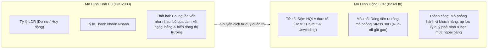
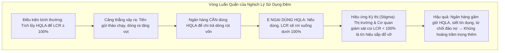
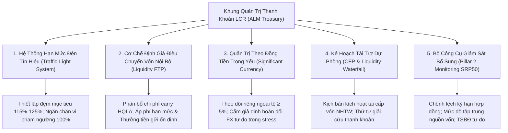
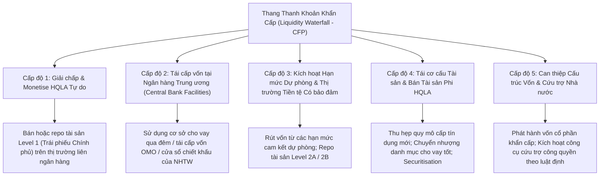

## Câu hỏi

1. **Ý nghĩa kinh tế và bản chất của chỉ số**: Tại sao chuẩn mực Basel III chuyển dịch từ mô hình quản trị thanh khoản tĩnh dựa trên bảng cân đối (Loan-to-Deposit Ratio, Liquid Asset Ratio) sang mô hình dòng tiền căng thẳng động (*stressed dynamic cash flow matching*)? Khái niệm "khung thời gian sinh tồn 30 ngày" (*survival horizon*) và vai trò của thanh khoản như một "hàng hóa công cộng" (*public good*) được định hình như thế nào [[src-bcbs-lcr#^lcr20-1]]?
2. **Nghịch lý Khả năng Sử dụng Đệm Thanh khoản (*Buffer Usability Paradox*)**: Tại sao chuẩn mực Basel LCR20.5 khẳng định trong điều kiện căng thẳng, việc ngân hàng sử dụng đệm [[hqla]] và để LCR rơi xuống dưới 100% là "hoàn toàn phù hợp", nhưng trên thực tế các ngân hàng lại ngần ngại sử dụng do hiệu ứng kỳ thị (*stigma effect*)? Cơ quan giám sát điều hành chính sách thế nào theo LCR20.6 để ngăn chặn vòng xoáy suy thoái mang tính chu kỳ thuận (*procyclicality*) [[src-bcbs-lcr#^lcr20-5]] [[src-bcbs-lcr#^lcr20-6]]?
3. **Quy trình Đánh giá Nội bộ (ILAAP) và Stress Testing Nâng cao**: Tại sao LCR chỉ được xem là "mức sàn tối thiểu của cơ quan quản lý" (*minimum supervisory requirement*) [[src-bcbs-lcr#^lcr20-3]]? Ngân hàng phải thiết kế các kịch bản stress nội bộ nhiều kỳ hạn và tích hợp các yếu tố phi tài chính (như rủi ro khí hậu) như thế nào?
4. **Hệ thống Vùng đệm Quản trị và Hạn mức Đèn tín hiệu (*Traffic-Light Limit System*)**: Tại sao ALM Treasury không bao giờ vận hành ở ngưỡng 100% sát sàn? Khung hạn mức nội bộ nhiều tầng (Operating Target, Early Warning, Recovery Trigger) được cấu trúc ra sao để bảo đảm nghĩa vụ thông báo tức thì theo LCR20.8 [[src-bcbs-lcr#^lcr20-8]]?
5. **Bộ Công cụ Điều hành Tác nghiệp của ALM Treasury**: Cơ chế định giá điều chuyển vốn nội bộ (Liquidity FTP), quản trị thanh khoản theo đồng tiền trọng yếu ([[src-bcbs-lcr#^lcr10-9]]), Kế hoạch tài trợ dự phòng (Contingency Funding Plan - CFP [[src-bcbs-lcr#^lcr20-6]]) và bộ công cụ giám sát Pillar 2 (SRP50) phối hợp như thế nào để tối ưu hóa đồng thời an toàn thanh khoản và hiệu quả sinh lời?

---

## Kết luận

- **Bản chất của LCR là "mua thời gian sinh tồn" (Buying Time)**: LCR không nhằm mục đích giúp ngân hàng tồn tại vô hạn trong một cuộc khủng hoảng kéo dài, mà được thiết kế để bảo đảm ngân hàng có đủ tài sản thanh khoản cao [[hqla]] tự thân nhằm vượt qua một kịch bản stress cấp tính kết hợp cú sốc riêng lẻ và cú sốc thị trường kéo dài đúng **30 ngày dương lịch** [[src-bcbs-lcr#^lcr20-1]] [[src-bcbs-lcr#^lcr20-2]]. Khoảng thời gian 30 ngày là "cửa sổ sinh tồn" tối thiểu để Ban Điều hành triển khai các biện pháp tái cơ cấu theo Kế hoạch tài trợ dự phòng (CFP) và để Cơ quan Giám sát / Ngân hàng Trung ương can thiệp có trật tự nhằm ngăn chặn đổ vỡ mang tính dây chuyền [[src-bcbs-lcr#^lcr20-6]].
- **Giải tỏa Nghịch lý Sử dụng Đệm HQLA (*Buffer Usability Paradox*)**: 
  - Về mặt quy định, LCR $\ge 100\%$ là yêu cầu trong điều kiện bình thường; khi xảy ra stress, ngân hàng được phép sử dụng HQLA và để LCR rơi xuống dưới 100% [[src-bcbs-lcr#^lcr20-5]]. 
  - Về mặt kinh tế, ngân hàng thường không dám dùng HQLA vì sợ thị trường diễn giải LCR $< 100\%$ là dấu hiệu mất khả năng thanh toán (*stigma effect*).
  - Chuẩn mực LCR20.6 giải quyết xung đột này bằng cách bắt buộc cơ quan giám sát phải đưa ra phản ứng có phân biệt (*differentiated response*), tương xứng với nguyên nhân và thời gian thiếu hụt, tránh các biện pháp trừng phạt cứng nhắc mang tính chu kỳ thuận (*procyclical actions*) làm đóng băng thanh khoản toàn hệ thống [[src-bcbs-lcr#^lcr20-6]].
- **LCR là Sàn Giám sát Tối thiểu, không phải Trần Quản trị**: Chuẩn mực Basel LCR20.3 chỉ rõ LCR là chuẩn tối thiểu; ngân hàng bắt buộc phải triển khai quy trình ILAAP với các kịch bản stress kiểm định nội bộ trên các chân trời thời gian dài hơn (60 ngày, 90 ngày, 1 năm) và tính đến rủi ro đặc thù, bao gồm cả rủi ro tài chính liên quan đến biến đổi khí hậu [[src-bcbs-lcr#^lcr20-3]].
- **Chiến lược Quản trị ALM Treasury Chủ động**:
  - *Hệ thống Hạn mức Đèn tín hiệu 4 tầng*: Thiết lập đệm mục tiêu vận hành (Operating Target Green: 115%–125%), đệm cảnh báo sớm (Early Warning Amber: 108%–112%), đệm phục hồi khẩn cấp (Recovery Red: 102%–105%) để không bao giờ vi phạm ngưỡng pháp định 100% [[src-bcbs-lcr#^lcr20-8]].
  - *Liquidity FTP (L-FTP)*: Truyền dẫn chi phí thanh khoản LCR vào bảng cân đối bằng cách áp phí thanh khoản (liquidity haircut fee) lên các tài sản yêu cầu HQLA dự phòng hoặc tạo ra dòng ra tiềm tàng (phái sinh, hạn mức cam kết), đồng thời trả thưởng thanh khoản (liquidity credit) cho nguồn tiền gửi ổn định [[retail-deposit-stability]] và [[operational-deposits]].
  - *Quản trị Đồng tiền Trọng yếu*: Tính toán và theo dõi LCR riêng cho từng đồng tiền chiếm $\ge 5\%$ tổng nợ; nghiêm cấm giả định các đồng tiền có thể tự do chuyển đổi trong khủng hoảng [[src-bcbs-lcr#^lcr10-9]].
  - *Kế hoạch Tài trợ Dự phòng (CFP)*: Xây dựng thang kích hoạt thanh khoản khẩn cấp (Liquidity Waterfall) kết nối trực tiếp với các chương trình tái cấp vốn và yêu cầu tài sản thế chấp của Ngân hàng Trung ương [[src-bcbs-lcr#^lcr20-6]].

---

## Phân tích Chuyên sâu 1: Ý nghĩa Kinh tế và Sự Chuyển dịch Mô hình Quản trị Thanh khoản

### 1. Sự Sụp đổ của Mô hình Quản trị Thanh khoản Tĩnh Truyền thống
Trước Khủng hoảng Tài chính Toàn cầu 2007–2008, ngành ngân hàng chủ yếu quản trị thanh khoản thông qua các chỉ số cân đối tĩnh trên bảng cân đối kế toán:
- **Tỷ lệ Dư nợ trên Huy động (Loan-to-Deposit Ratio - LDR)**: Giả định ngầm định rằng miễn là dư nợ cho vay không vượt quá 80%–90% tổng tiền gửi, ngân hàng sẽ an toàn về thanh khoản.
- **Tỷ lệ Dự trữ Thanh khoản Nhanh (Liquid Asset Ratio)**: Đo lường tỷ lệ tài sản có thanh khoản trên tổng tài sản.

*Diễn giải thực tiễn thất bại:*
Trong cuộc khủng hoảng 2008, nhiều ngân hàng có tỷ lệ LDR dưới 80% (ví dụ Northern Rock, Bear Stearns, Lehman Brothers) vẫn sụp đổ chỉ sau vài ngày. Nguyên nhân là các tỷ lệ tĩnh này mắc phải ba sai lầm bản chất:
1. **Bỏ qua cấu trúc vi mô của nguồn vốn**: LDR coi 1 đồng tiền gửi bán buôn qua đêm của một quỹ phòng hộ (có thể rút ngay 100% sau 24 giờ) hoàn toàn bình đẳng với 1 đồng tiền gửi tiết kiệm bán lẻ có bảo hiểm (có tính ổn định cao).
2. **Bỏ qua rủi ro ngoại bảng**: Các tỷ lệ tĩnh không đo lường được nghĩa vụ rút vốn phát sinh từ các hạn mức cam kết tín dụng chưa giải ngân (*committed facilities*), các yêu cầu nộp tài sản bảo đảm bổ sung do hợp đồng phái sinh bị hạ bậc tín nhiệm (*downgrade triggers*), hoặc nghĩa vụ mua lại thương phiếu cấu trúc (ABCP).
3. **Giả định thị trường tài sản luôn thanh khoản**: Cho rằng mọi chứng khoán nợ có xếp hạng AAA đều có thể bán lấy tiền mặt trong 24 giờ mà không bị chiết khấu giá (*haircut*).

### 2. Sự Chuyển dịch sang Mô hình Dòng tiền Căng thẳng Động (Stressed Dynamic Cash Flow)
Basel III thay thế hoàn toàn tư duy quản trị thanh khoản tĩnh bằng chỉ số LCR — một mô hình mô phỏng dòng tiền căng thẳng động trong tương lai:
$$\text{LCR} = \frac{\text{Stock of HQLA}}{\text{Total Net Cash Outflows}_{30d}} \ge 100\%$$

*Ý nghĩa kinh tế của sự chuyển dịch:*
- **Phân định rõ dòng tiền theo bản chất hành vi**: Thay vì nhìn vào số dư danh nghĩa, LCR định giá nguồn vốn theo mức độ nhạy cảm của người gửi tiền trong stress (run-off từ 3%–5% đối với bán lẻ được bảo hiểm, lên đến 40% đối với doanh nghiệp và 100% đối với định chế tài chính) [[src-bcbs-lcr#^lcr40-7]] [[src-bcbs-lcr#^lcr40-42]].
- **Ngoại bảng hóa toàn diện**: Toàn bộ rủi ro tiềm tàng từ hạn mức tín dụng, tài trợ thương mại, bảo lãnh, tài trợ cấu trúc ABCP và phái sinh đều bị quy đổi thành dòng tiền mặt ra cụ thể ở mẫu số [[src-bcbs-lcr#^lcr40-58]] [[src-bcbs-lcr#^lcr40-64]].

### 3. Khái niệm "Khung Thời gian Sinh tồn 30 Ngày" (Survival Horizon)
- Chuẩn mực LCR20.1 xác lập một chân trời căng thẳng chuẩn hóa là **30 ngày dương lịch** (*30 calendar days*) [[src-bcbs-lcr#^lcr20-1]].
- *Ý nghĩa kinh tế*: Tại sao lại là 30 ngày?
  - Trong khủng hoảng tài chính, cú sốc thanh khoản ban đầu diễn ra với tốc độ cực nhanh và mang tính hủy diệt. Không một ngân hàng thương mại nào có thể tự duy trì đủ tài sản thanh khoản chi phí thấp để tự phòng thủ trước một cuộc rút tiền hàng loạt kéo dài nhiều năm mà không phá sản vì chi phí cơ hội lợi suất (negative carry).
  - 30 ngày là khoảng thời gian tối ưu mang tính cân bằng: Đủ dài để tách biệt giữa cú sốc thanh khoản tạm thời và tình trạng mất khả năng thanh toán cơ cấu; đồng thời là "khoảng thời gian sinh tồn" vừa đủ để:
    1. Ban Điều hành ngân hàng nhận diện đầy đủ quy mô rút vốn và kích hoạt các phương án khẩn cấp trong Kế hoạch tài trợ dự phòng (CFP) [[src-bcbs-lcr#^lcr20-6]].
    2. Cơ quan quản lý, Ngân hàng Trung ương và Chính phủ kịp thời đánh giá tình hình toàn hệ thống, cung ứng thanh khoản cứu trợ khẩn cấp (Người cho vay cuối cùng - LOLR) hoặc tổ chức sáp nhập/tái cơ cấu ngân hàng một cách có trật tự, ngăn chặn làn sóng hoảng loạn lây lan.

### 4. Thanh khoản như một "Hàng hóa Công cộng" và Phòng chống Vòng xoáy Bán tháo (Fire-Sale Spirals)
- **Tính ngoại tác tiêu cực của rủi ro thanh khoản**: Khi một ngân hàng thiếu hụt thanh khoản, hành vi cá nhân hợp lý của ngân hàng đó là ồ ạt bán tháo tài sản ra thị trường để thu hồi tiền mặt.
- **Vòng xoáy thanh khoản (Liquidity Spiral - Brunnermeier & Pedersen)**: Việc bán tháo tài sản làm giá thị trường sụt giảm mạnh $\rightarrow$ các ngân hàng khác nắm giữ cùng loại tài sản phải ghi nhận lỗ định giá theo thị trường (*mark-to-market losses*) $\rightarrow$ vốn tự có bị xói mòn và các hợp đồng repo/phái sinh bị yêu cầu nộp thêm tài sản bảo đảm (*margin calls*) $\rightarrow$ kích hoạt thêm các đợt bán tháo mới.
- **Vai trò của LCR**: Bằng cách bắt buộc mọi ngân hàng hoạt động quốc tế phải duy trì một lượng đệm [[hqla]] tự thân không bị cầm cố [[src-bcbs-lcr#^lcr10-1]] [[src-bcbs-lcr#^lcr30-1]], LCR biến thanh khoản từ một chi phí tư nhân thuần túy thành một "hàng rào an toàn công cộng". Ngân hàng có sẵn tài sản chất lượng cao để thanh toán dòng tiền rút ròng trong 30 ngày mà không cần phải thực hiện bán tháo các tài sản kém thanh khoản (như danh mục cho vay khách hàng), từ đó chặt đứt vòng xoáy bán tháo đe dọa toàn bộ hệ thống tài chính.

---

## Phân tích Chuyên sâu 2: Nghịch lý Sử dụng Đệm HQLA (Buffer Usability Paradox) & Hướng dẫn Giám sát

### 1. Bản chất của Nghịch lý Sử dụng Đệm HQLA
Một trong những thách thức lớn nhất trong kinh tế học quản lý thanh khoản của Basel III là **Nghịch lý Khả năng Sử dụng Đệm** (*The Buffer Usability Paradox*):

- **Mâu thuẫn giữa Quy tắc và Hành vi**:
  - *Mục đích ban đầu của nhà lập quy*: Đệm HQLA sinh ra là để được sử dụng khi có giông bão. Nếu đệm thanh khoản không được phép vơi đi trong khủng hoảng thì nó không phải là một "vùng đệm", mà trở thành một "khoản vốn chết" bị phong tỏa vĩnh viễn!
  - *Hành vi né tránh của ngân hàng*: Trong thực tế khủng hoảng (như đợt căng thẳng thị trường tháng 3/2020 khi đại dịch bùng phát), các ngân hàng có xu hướng găm giữ HQLA và thắt chặt thanh khoản cho nền kinh tế, cố gắng giữ LCR trên 100% bằng mọi giá thay vì rút đệm HQLA ra sử dụng.
  - *Lý do*: Hiệu ứng kỳ thị (*stigma effect*). Ngân hàng lo ngại rằng nếu để LCR xuống dưới 100%, thị trường liên ngân hàng sẽ cắt hạn mức tín dụng, các tổ chức xếp hạng sẽ hạ bậc tín nhiệm, khách hàng doanh nghiệp sẽ tháo chạy tiền gửi nhanh hơn và cơ quan thanh tra sẽ áp dụng các biện pháp trừng phạt can thiệp sớm.

### 2. Chuẩn mực Basel LCR20.5 & LCR20.6: Khung Tháo gỡ Nghịch lý
Nhận thức sâu sắc nghịch lý này, Ủy ban Basel đã đưa ra các nguyên tắc rõ ràng tại điều LCR20.5 và LCR20.6 để hướng dẫn hành vi của ngân hàng và cơ quan giám sát:

#### Quy định về tính khả dụng của đệm (LCR20.5)
- Chuẩn mực quy định rằng trong điều kiện bình thường, tỷ lệ LCR không được thấp hơn 100% trên cơ sở liên tục [[src-bcbs-lcr#^lcr20-5]].
- **Tuy nhiên, trong các thời kỳ căng thẳng (*periods of stress*), việc các ngân hàng sử dụng lượng HQLA của mình, qua đó để tỷ lệ LCR rơi xuống dưới mức tối thiểu 100%, là HOÀN TOÀN PHÙ HỢP (*entirely appropriate*)** [[src-bcbs-lcr#^lcr20-5]].

#### Khung phản ứng phân biệt và chống chu kỳ của Cơ quan Giám sát (LCR20.6)
Basel yêu cầu cơ quan giám sát quốc gia không được phản ứng máy móc hoặc trừng phạt tự động khi ngân hàng báo cáo LCR $< 100\%$:
1. **Phản ứng có phân biệt và tương xứng (*Differentiated & Proportionate Response*)**: Phản ứng của supervisor phải tương xứng với nguyên nhân gốc rễ, quy mô, tần suất và thời gian kéo dài của tình trạng thiếu hụt [[src-bcbs-lcr#^lcr20-6]].
2. **Phân biệt giữa sốc riêng lẻ (*Idiosyncratic*) và sốc toàn hệ thống (*Systemic*)**:
   - *Nếu do sốc riêng lẻ của ngân hàng*: Cơ quan giám sát yêu cầu ngân hàng trình bày báo cáo đánh giá thực trạng thanh khoản, xác định nguyên nhân LCR $< 100\%$, đề xuất các biện pháp khắc phục cụ thể và lộ trình dự kiến để khôi phục chỉ số; đồng thời tăng cường tần suất báo cáo giám sát lên hàng tuần hoặc hàng ngày [[src-bcbs-lcr#^lcr20-6]] [[src-bcbs-lcr#^lcr20-7]].
   - *Nếu do sốc toàn hệ thống nghiêm trọng (*severe system-wide stress*)*: Cơ quan giám sát phải cân nhắc tác động lan truyền đến toàn bộ hệ thống tài chính. Các biện pháp tái lập thanh khoản phải được thảo luận và thực thi trong một khoảng thời gian thích hợp (*over a period of time considered appropriate*), nhằm ngăn chặn tình trạng ngân hàng siết chặt tín dụng hoặc bán tháo tài sản gây thêm căng thẳng cho nền kinh tế [[src-bcbs-lcr#^lcr20-6]].
3. **Ngăn chặn hành vi mang tính chu kỳ thuận (*Anti-Procyclicality*)**: Supervisor phải nhận thức rõ rằng việc ép buộc một ngân hàng khôi phục LCR về 100% quá gấp gáp trong bối cảnh thị trường đang căng thẳng sẽ tạo ra hiệu ứng chu kỳ thuận tai hại: buộc ngân hàng phải thu hồi nợ, từ chối tái cấp vốn cho doanh nghiệp hoặc bán tháo tài sản, trực tiếp làm khô kiệt thanh khoản của thị trường và đẩy khủng hoảng leo thang [[src-bcbs-lcr#^lcr20-6]].

---

## Phân tích Chuyên sâu 3: Phương pháp ILAAP và Kiểm định Sức chịu đựng Thanh khoản Nội bộ

### 1. Giới hạn của LCR và Vai trò của ILAAP (LCR20.3)
Theo [[src-bcbs-lcr#^lcr20-3]], kịch bản stress của LCR được định nghĩa là **yêu cầu giám sát tối thiểu** (*minimum supervisory requirement*). Chuẩn mực LCR có các giới hạn thiết kế cố hữu:
- Chỉ đo lường một chân trời thời gian duy nhất là 30 ngày.
- Giả định một kịch bản sốc đồng nhất cho tất cả các ngân hàng (một bộ hệ số run-off và drawdown cố định).
- Không phản ánh được đặc thù riêng về mô hình kinh doanh, cấu trúc sản phẩm ngách hoặc mức độ tập trung khách hàng cục bộ của từng ngân hàng.

Do đó, các ngân hàng bắt buộc phải vận hành **Quy trình Đánh giá Nội bộ về Mức độ Đủ vốn và Thanh khoản (Internal Liquidity Adequacy Assessment Process - ILAAP)**:
- Ngân hàng phải tự xây dựng các kịch bản kiểm định sức chịu đựng thanh khoản (*Internal Liquidity Stress Testing*) để xác định lượng thanh khoản cần nắm giữ **vượt trên mức tối thiểu của LCR** [[src-bcbs-lcr#^lcr20-3]].
- Các kịch bản nội bộ phải tích hợp các chân trời thời gian đa dạng:
  - *Intraday (Thanh khoản trong ngày)*: Đo lường rủi ro thanh toán bù trừ thời gian thực qua hệ thống RTGS.
  - *Short-term (1 tuần đến 30 ngày)*: Đối chiếu trực tiếp với LCR.
  - *Medium-term (60 ngày, 90 ngày, 180 ngày)*: Đánh giá khả năng chống chịu khi căng thẳng kéo dài vượt quá khung 30 ngày của LCR.
  - *Structural (1 năm)*: Kết nối với tỷ lệ nguồn vốn ổn định thuần NSFR.

### 2. Tích hợp Rủi ro Tài chính Liên quan đến Biến đổi Khí hậu (FAQ1 LCR20.3)
Theo hướng dẫn bổ sung của BCBS (tháng 12/2022), ngân hàng và cơ quan giám sát phải đưa các rủi ro tài chính liên quan đến biến đổi khí hậu (*climate-related financial risks*) vào quy trình quản trị thanh khoản:
- **Tác động vật lý (*Physical risks*)**: Các biến cố thời tiết cực đoan (bão lũ, hạn hán) có thể làm tê liệt hoạt động của các chi nhánh ngân hàng, gián đoạn hệ thống thanh toán cục bộ hoặc kích hoạt làn sóng rút tiền mặt khẩn cấp từ người dân và doanh nghiệp tại vùng bị ảnh hưởng (làm tăng dòng ra thực tế).
- **Tác động chuyển dịch (*Transition risks*)**: Sự thay đổi chính sách kinh tế xanh có thể làm suy giảm giá trị thị trường của các tài sản bảo đảm liên quan đến các ngành phát thải cao (ví dụ trái phiếu của doanh nghiệp năng lượng hóa thạch), làm tăng tỷ lệ chiết khấu (haircut) hoặc loại bỏ tài sản khỏi danh mục HQLA đủ điều kiện.
- **Yêu cầu triển khai**: Ngân hàng phải tích hợp dần các rủi ro khí hậu trọng yếu vào quy trình ILAAP và stress test nội bộ một cách lũy tiến và lặp lại khi năng lực dữ liệu và mô hình phân tích hoàn thiện dần theo thời gian (FAQ1 LCR20.3).

---

## Phân tích Chuyên sâu 4: Khung Quản trị Tác nghiệp của ALM Treasury

Để điều hành LCR tuân thủ liên tục mà vẫn bảo đảm tối ưu hóa lợi nhuận kinh doanh, Khối ALM Treasury tại các ngân hàng thương mại triển khai 5 trụ cột quản trị tác nghiệp:

### 1. Hệ thống Vùng đệm Quản trị & Hạn mức Đèn tín hiệu (Traffic-Light Limit System)
Tại sao ALM Treasury không bao giờ lập kế hoạch điều hành LCR ở mức 100%?
- Trong thực tế vận hành hàng ngày, tỷ lệ LCR biến động liên tục do:
  1. Các giao dịch thanh toán liên ngân hàng lớn bất thường vào cuối ngày.
  2. Biến động thị trường làm thay đổi giá trị danh mục HQLA hoặc kích hoạt nộp thêm ký quỹ phái sinh theo phương pháp hồi cứu 24 tháng (*look-back approach* [[src-bcbs-lcr#^lcr40-56]]).
  3. Khách hàng doanh nghiệp rút vốn đột xuất từ các hạn mức tín dụng cam kết.
- Nếu Treasury đặt mục tiêu vận hành đúng 100%, một biến động ngẫu nhiên nhỏ cũng sẽ đẩy LCR xuống dưới 100%, kích hoạt nghĩa vụ pháp lý bắt buộc phải **báo cáo khẩn cấp ngay lập tức cho Cơ quan Giám sát** theo điều LCR20.8 [[src-bcbs-lcr#^lcr20-8]].
- Do đó, Ủy ban Quản lý Tài sản - Nợ (ALCO) luôn phê duyệt một **Hệ thống Hạn mức Đèn tín hiệu 4 Tầng (*Four-tiered Traffic-Light Limits*)**:

| Tầng Hạn Mức | Ngưỡng Tỷ Lệ LCR | Trạng Thái Vận Hành | Hành Động Quản Trị Của ALCO & Treasury |
|---|---|---|---|
| **Green (Vùng An toàn / Target)** | **$\ge 115\%$ – $125\%$** | Hoạt động bình thường (*Normal Operations*) | Tối ưu hóa lợi suất danh mục HQLA; cân đối NIM; duy trì cơ cấu bảng cân đối kế toán ổn định. |
| **Amber (Vùng Cảnh báo Sớm / Early Warning)** | **$108\%$ – $114\%$** | Cảnh báo nội bộ (*Internal Alert*) | ALM Treasury tạm dừng mở rộng các khoản cho vay liên ngân hàng kỳ hạn $< 30$ ngày; rà soát tốc độ giải ngân hạn mức tín dụng lớn; tăng cường thu hút tiền gửi bán lẻ. |
| **Red (Vùng Phục hồi Khẩn cấp / Recovery)** | **$101\%$ – $107\%$** | Căng thẳng cấp tính (*Stress / Recovery Activation*) | Triệu tập cuộc họp bất thường của ALCO; kích hoạt giai đoạn 1 của Kế hoạch tài trợ dự phòng (CFP); đình chỉ các cam kết tín dụng mới; chuyển nhượng hoặc repo tài sản Level 2 để tái tạo thanh khoản tiền mặt Level 1. |
| **Breach (Vi phạm Ngưỡng Pháp định)** | **$< 100\%$** | Vi phạm quy chuẩn (*Regulatory Breach*) | **Lập tức thông báo cho Cơ quan Giám sát (NHNN/Supervisor)** theo LCR20.8 [[src-bcbs-lcr#^lcr20-8]]; kích hoạt toàn diện CFP; đệ trình kế hoạch khắc phục thanh khoản cho cơ quan giám sát theo LCR20.6 [[src-bcbs-lcr#^lcr20-6]]. |

### 2. Cơ chế Định giá Điều chuyển Vốn Nội bộ (Liquidity Funds Transfer Pricing - L-FTP)
Để các khối kinh doanh (Khối Bán lẻ, Khối Khách hàng Doanh nghiệp, Khối Nguồn vốn) tự giác hành xử phù hợp với mục tiêu LCR của toàn ngân hàng, Khối ALM Treasury sử dụng công cụ **Liquidity FTP**:

$$\text{FTP Rate} = \text{Base Interest Rate} + \text{Term Liquidity Premium} + \text{LCR Regulatory Charge/Credit}$$

Cơ chế phân bổ chi phí LCR trong hệ thống L-FTP:
1. **Phân bổ Chi phí Duy trì Đệm HQLA (*HQLA Carry Cost Allocation*)**:
   - Việc nắm giữ trái phiếu chính phủ hoặc dự trữ tiền mặt tại NHTW thường tạo ra mức lợi suất thấp hơn chi phí huy động bình quân (chi phí cơ hội lợi suất âm - *negative carry*).
   - Treasury tính toán tổng chi phí duy trì đệm HQLA bắt buộc và phân bổ ngược lại dưới dạng "phí bảo hiểm thanh khoản" (*liquidity charge*) đánh vào các tài sản sinh lời có rủi ro cao (như các khoản vay trung dài hạn).
2. **Phí Phạt Rủi ro Dòng ra Tiềm tàng (*Contingent Outflow Surcharges*)**:
   - Khi Khối Doanh nghiệp cấp một hạn mức tín dụng hoặc hạn mức thanh khoản cam kết cho khách hàng, dù khách hàng chưa giải ngân (chưa tạo ra dư nợ để thu lãi), hạn mức này đã lập tức làm tăng mẫu số LCR với tỷ lệ drawdown từ 10% đến 100% [[src-bcbs-lcr#^lcr40-64]].
   - L-FTP sẽ thu một khoản phí thanh khoản định kỳ (*undrawn facility liquidity fee*) đối với khối kinh doanh dựa trên quy mô hạn mức cam kết chưa rút, buộc các cán bộ quan hệ khách hàng (RM) phải đàm phán giảm hạn mức ảo hoặc thu phí cam kết đủ bù đắp chi phí LCR từ khách hàng.
3. **Thưởng Thanh khoản Nguồn vốn Ổn định (*Stable Funding Credits*)**:
   - Tiền gửi bán lẻ ổn định (run-off 5%) và tiền gửi vận hành operational (run-off 25%) được nhận mức thưởng thanh khoản (*liquidity credit*) cao trong biểu lãi suất FTP nội bộ [[src-bcbs-lcr#^lcr40-7]] [[src-bcbs-lcr#^lcr40-26]].
   - Ngược lại, các khoản tiền gửi bán buôn kỳ hạn ngắn từ các định chế tài chính (run-off 100%) bị trừ phí thanh khoản rất nặng, triệt tiêu động lực huy động nguồn vốn ảo, không bền vững của các chi nhánh.

### 3. Quản trị Thanh khoản theo Đồng tiền Trọng yếu (Significant Currency Management)
Theo chuẩn mực LCR10.9, dù LCR hợp nhất được báo cáo bằng một đồng tiền chung (ví dụ USD hoặc VND), ngân hàng và cơ quan giám sát bắt buộc phải theo dõi sát sao tình trạng thanh khoản theo từng **đồng tiền trọng yếu** (*significant currency*) [[src-bcbs-lcr#^lcr10-9]]:
- **Tiêu chuẩn xác định**: Một đồng tiền được coi là trọng yếu nếu tổng nợ phải trả bằng đồng tiền đó chiếm **từ 5% trở lên** trong tổng nợ phải trả của toàn ngân hàng.
- **Nguyên tắc "Cấm Giả định Chuyển đổi Tự do"**:
  - *Căn cứ chuẩn mực*: Ngân hàng và cơ quan giám sát **không được giả định rằng các đồng tiền sẽ duy trì khả năng chuyển giao và chuyển đổi tự do trong thời kỳ căng thẳng** (*cannot assume that currencies will remain transferable and convertible in a stress period*) [[src-bcbs-lcr#^lcr10-9]].
  - *Ý nghĩa thực tiễn*: Trong khủng hoảng thanh khoản toàn cầu (như cuộc khủng hoảng năm 2008), thị trường hoán đổi tiền tệ chéo (*cross-currency basis swap*) có thể đóng băng hoàn toàn, dẫn đến tình trạng khan hiếm USD trầm trọng. Một ngân hàng có thặng dư HQLA bằng đồng nội tệ không thể chuyển đổi số tài sản đó thành USD để thanh toán các nghĩa vụ nợ USD đến hạn.
  - *Yêu cầu đối với ALM Treasury*: Treasury phải tính toán chỉ số LCR riêng rẽ cho từng đồng tiền trọng yếu và bảo đảm cơ cấu đồng tiền của đệm HQLA phải tương thích với cơ cấu đồng tiền của dòng tiền ra ròng dự kiến [[src-bcbs-lcr#^lcr10-9]].

### 4. Kế hoạch Tài trợ Dự phòng (Contingency Funding Plan - CFP & Liquidity Waterfall)
Theo ghi chú tại Footnote p9-0 LCR20.6, chuẩn mực Basel yêu cầu ngân hàng phải xây dựng một Kế hoạch tài trợ dự phòng (CFP) hoàn chỉnh, vạch rõ các chiến lược xử lý thâm hụt thanh khoản trong cả kịch bản sốc riêng lẻ và sốc toàn thị trường [[src-bcbs-lcr#^lcr20-6]].

Trọng tâm của CFP là thiết lập **Thang Thanh khoản Khẩn cấp (*Liquidity Waterfall*)** xác định thứ tự ưu tiên huy động vốn khi LCR suy giảm:

### 5. Bộ Công cụ Giám sát Thanh khoản Bổ sung (Pillar 2 / SRP50)
Bên cạnh chỉ số định lượng LCR cứng, chuẩn mực Basel thiết lập một bộ công cụ giám sát thanh khoản toàn diện trong Trụ cột 2 (Supervisory Review Process - SRP50) mà ALM Treasury phải theo dõi song song:
1. **Khế ước Chênh lệch Kỳ hạn (*Contractual Maturity Mismatch*)**:
   - Lập hồ sơ dòng tiền theo hợp đồng trên các dải kỳ hạn (Overnight, 7D, 14D, 1M, 2M, 3M, 6M, 1Y, > 1Y).
   - *Mục đích*: Nhận diện chính xác các "hố đen thanh khoản" (*liquidity gaps*) theo hợp đồng thực tế mà không bị làm mờ bởi các giả định hành vi của LCR.
2. **Mức độ Tập trung Nguồn vốn (*Concentration of Funding*)**:
   - Theo dõi tỷ trọng nguồn vốn huy động từ các khách hàng lớn nhất (ví dụ Top 10, Top 20 người gửi tiền lớn nhất) và từ các công cụ/sản phẩm nguồn vốn đơn lẻ.
   - *Mục đích*: Ngăn chặn rủi ro tháo chạy hàng loạt chỉ do hành vi rút vốn của một vài cá nhân hoặc doanh nghiệp chi phối.
3. **Khối Tài sản Chưa Cầm cố Khả dụng (*Available Unencumbered Assets*)**:
   - Giám sát toàn bộ lượng tài sản có thể sử dụng làm tài sản bảo đảm nhưng hiện chưa bị cầm cố (bao gồm cả tài sản không đủ điều kiện HQLA nhưng đủ điều kiện thế chấp tại NHTW).
   - *Mục đích*: Xác định năng lực dự phòng huy động thanh khoản thứ cấp khi đệm HQLA đã cạn kiệt.
4. **Các Công cụ Giám sát Gắn với Thị trường (*Market-Related Monitoring Tools*)**:
   - Theo dõi liên tục các chỉ báo thị trường: Chênh lệch hoán đổi rủi ro tín dụng (CDS spread) của chính ngân hàng, giá cổ phiếu ngân hàng, chênh lệch lợi suất trái phiếu thứ cấp và chênh lệch lãi suất liên ngân hàng (Libor/SOFR-OIS spread).
   - *Mục đích*: Cung cấp tín hiệu cảnh báo sớm về niềm tin thị trường trước khi các dòng rút tiền thực tế phản ánh vào báo cáo LCR.

---

## Bảng Đối chiếu Tổng hợp: Các Chiều Kích Quản trị Thanh khoản LCR

| Thành phần Quản trị | Nguyên tắc Basel III | Cơ chế Tác nghiệp tại ALM Treasury | Căn cứ Chuẩn mực |
|---|---|---|---|
| **Mục tiêu Sinh tồn** | Bảo đảm đủ HQLA tự thân để sống sót qua 30 ngày stress kết hợp | Mua thời gian để kích hoạt CFP và cho phép cơ quan quản lý can thiệp có trật tự | [[src-bcbs-lcr#^lcr20-1]] [[src-bcbs-lcr#^lcr20-2]] |
| **Sử dụng Đệm HQLA** | Cho phép LCR $< 100\%$ trong thời kỳ căng thẳng; supervisor phản ứng có phân biệt | Phá vỡ tâm lý găm giữ HQLA; tránh các phản ứng mang tính chu kỳ thuận | [[src-bcbs-lcr#^lcr20-5]] [[src-bcbs-lcr#^lcr20-6]] |
| **Stress Test Nội bộ** | LCR là mức sàn tối thiểu; ngân hàng phải tự stress test với horizon dài hơn | Vận hành ILAAP; kiểm định các kịch bản 60D, 90D, 1Y; tích hợp rủi ro khí hậu | [[src-bcbs-lcr#^lcr20-3]] |
| **Tần suất & Báo cáo** | Báo cáo tối thiểu hàng tháng; tăng lên hàng tuần/hàng ngày khi stress; báo ngay khi $< 100\%$ | Xây dựng hệ thống hạn mức 4 tầng (Green/Amber/Red/Breach) để kiểm soát chủ động | [[src-bcbs-lcr#^lcr20-7]] [[src-bcbs-lcr#^lcr20-8]] |
| **Đồng tiền Trọng yếu** | Theo dõi riêng từng đồng tiền $\ge 5\%$; cấm giả định hoán đổi FX tự do | Quản trị LCR theo từng ngoại tệ; phòng ngừa rủi ro đóng băng thị trường FX swap | [[src-bcbs-lcr#^lcr10-9]] |
| **Truyền dẫn Chi phí** | Phản ánh chi phí HQLA và dòng ra tiềm tàng vào hoạt động kinh doanh | Hệ thống Liquidity FTP: phân bổ chi phí carry HQLA, phạt hạn mức, thưởng tiền gửi ổn định | [[src-bcbs-lcr#^lcr40-7]] [[src-bcbs-lcr#^lcr40-64]] |
| **Tài trợ Dự phòng** | Thiết lập kế hoạch CFP gắn với cơ chế tái cấp vốn của Ngân hàng Trung ương | Xây dựng thang thanh khoản khẩn cấp (Liquidity Waterfall) từ HQLA đến LOLR | [[src-bcbs-lcr#^lcr20-6]] |
| **Giám sát Bổ sung** | Bộ công cụ Trụ cột 2 (SRP50) kiểm soát toàn diện hồ sơ thanh khoản | Theo dõi chênh lệch kỳ hạn hợp đồng, tập trung nguồn vốn, tài sản tự do và tín hiệu thị trường | SRP50 / Trụ cột 2 |
