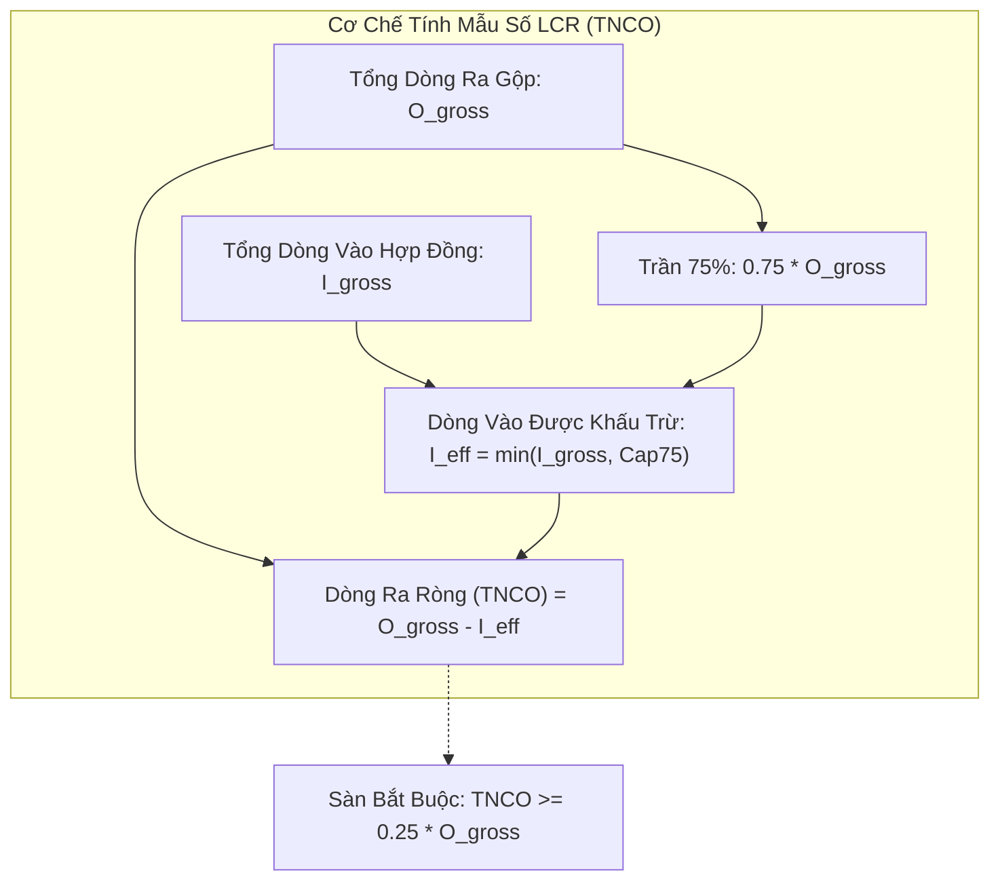
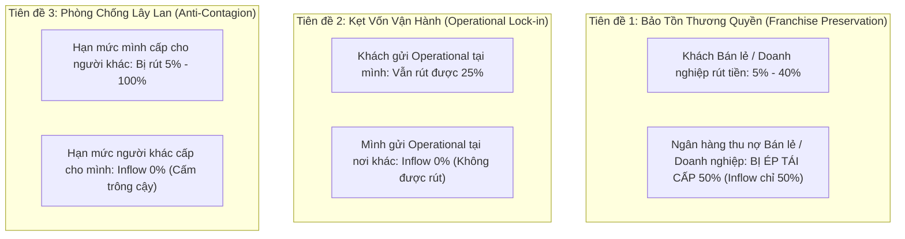
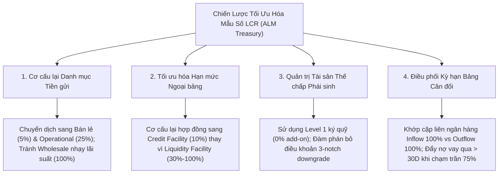

## Câu hỏi

1. Mẫu số của [[lcr]] ([[net-cash-outflows]]) được phân rã thành các trụ cột dòng tiền ra (Total Cash Outflows) và dòng tiền vào hợp đồng ([[cash-inflows]]) như thế nào trong kịch bản stress 30 ngày dương lịch của Basel III?
2. Cơ chế trần dòng vào 75% (*75% Inflow Cap*) và nguyên tắc sàn HQLA 25% vận hành toán học ra sao, và tại sao nó tạo ra hiện tượng "tổn thất thanh khoản biên" (*marginal inflow deadweight*) đối với các tài sản sinh lời ngắn hạn?
3. Khung LCR40 hàm chứa những giả định hành vi bất đối xứng (*asymmetric behavioral assumptions*) nào giữa dòng tiền ra và dòng tiền vào (bảo tồn thương quyền *franchise preservation*, kẹt vốn vận hành *operational lock-in*, và phòng chống lây lan chéo *anti-contagion*)?
4. Bộ phận Quản trị Nguồn vốn và Bảng cân đối (ALM Treasury) áp dụng các chiến lược nào để tối ưu hóa mẫu số TNCO (chuyển dịch cơ cấu tiền gửi, khớp cặp đối tác liên ngân hàng, quản trị phơi nhiễm phái sinh / downgrade triggers, và tái cấu trúc kỳ hạn cho vay)?

---

## Kết luận

- **TNCO là thước đo thâm hụt thanh khoản ròng trong stress 30 ngày**: Mẫu số của [[lcr]] không phải là dòng tiền kế toán thực tế, mà là một phép chiếu toán học giả định kết hợp đồng thời cú sốc riêng của ngân hàng (*idiosyncratic shock*, ví dụ bị hạ 3 bậc tín nhiệm) và cú sốc đóng băng thị trường (*market-wide shock*) [[src-bcbs-lcr#^lcr20-2]] [[src-bcbs-lcr#^lcr40-1]].
- **Công thức và Sàn thanh khoản tuyệt đối 25%**:
  $$
  \text{TNCO} = \text{Total Cash Outflows} - \min\Big(\text{Total Contractual Inflows},\; 0.75 \times \text{Total Cash Outflows}\Big)
  $$
  Cơ chế trần dòng vào 75% buộc ngân hàng phải luôn duy trì $\text{TNCO} \ge 0.25 \times \text{Total Cash Outflows}$, đồng nghĩa ngân hàng bắt buộc phải sở hữu một lượng [[hqla]] tự thân tương đương ít nhất **25% tổng dòng ra gộp**, triệt tiêu hoàn toàn khả năng dựa dẫm vào việc thu hồi nợ vay ngắn hạn để bù đắp rút vốn [[src-bcbs-lcr#^lcr40-77]].
- **Hệ thống phân tầng dòng ra 5 lớp**:
  1. *Bán lẻ & SME cá nhân* ([[retail-deposit-stability]]): Run-off 5% (hoặc 3%) đối với stable deposits [[src-bcbs-lcr#^lcr40-7]] [[src-bcbs-lcr#^lcr40-11]]; $\ge 10\%$ đối với less stable [[src-bcbs-lcr#^lcr40-13]]; 0% đối với kỳ hạn $> 30$ ngày nếu có điều khoản phạt nặng hơn mất lãi [[src-bcbs-lcr#^lcr40-16]]; kèm quy tắc lây lan vi phạm (*contagion rule*) tái phân loại toàn bộ danh mục thành không kỳ hạn nếu miễn phạt [[src-bcbs-lcr#^lcr40-17]].
  2. *Bán buôn không bảo đảm* ([[unsecured-wholesale-funding]]): SME $< 1$ triệu EUR xử lý như bán lẻ [[src-bcbs-lcr#^lcr40-22]]; operational deposits 25% (loại trừ excess balance, correspondent banking, prime brokerage) [[src-bcbs-lcr#^lcr40-26]] [[src-bcbs-lcr#^lcr40-29]] [[src-bcbs-lcr#^lcr40-32]]; doanh nghiệp phi tài chính 40% (20% nếu bảo hiểm) [[src-bcbs-lcr#^lcr40-40]] [[src-bcbs-lcr#^lcr40-41]]; định chế tài chính và trái phiếu ngân hàng tự phát hành 100% [[src-bcbs-lcr#^lcr40-42]] [[src-bcbs-lcr#^lcr40-43]].
  3. *Tài trợ có bảo đảm* ([[secured-funding]]): Dòng ra xác định hoàn toàn theo chất lượng tài sản thế chấp (Level 1 / NHTW 0%, Level 2A 15%, Sovereign/PSE trong nước 25%, Level 2B 25%–50%, Non-HQLA 100%) [[src-bcbs-lcr#^lcr40-47]] [[src-bcbs-lcr#^lcr40-48]].
  4. *Phái sinh & Nhu cầu bổ sung*: Bù trừ phái sinh ròng 100% (yêu cầu master netting agreement) [[src-bcbs-lcr#^lcr40-49]]; đệm ký quỹ dự phòng hạ 3 bậc tín nhiệm 100% [[src-bcbs-lcr#^lcr40-51]]; bổ sung 20% giá trị tài sản bảo đảm non-Level 1 đã ký quỹ [[src-bcbs-lcr#^lcr40-52]]; hồi quy biến động định giá 24 tháng (*look-back approach*) [[src-bcbs-lcr#^lcr40-56]]; nợ chứng khoán hóa ABCP/SIV đáo hạn hoặc quyền chọn thanh khoản (*liquidity puts*) 100% [[src-bcbs-lcr#^lcr40-57]] [[src-bcbs-lcr#^lcr40-58]].
  5. *Hạn mức cam kết* ([[committed-facilities]]): Drawdown 5% bán lẻ, 10% credit / 30% liquidity cho doanh nghiệp, 40% ngân hàng, 40% credit / 100% liquidity cho định chế tài chính khác, 100% cho SPEs/conduits [[src-bcbs-lcr#^lcr40-64]]; trade finance $\le 5\%$ [[src-bcbs-lcr#^lcr40-71]].
- **Hệ thống dòng vào và logic bất đối xứng sâu sắc**:
  - Dòng vào chỉ tính nợ hoạt động tốt (*fully performing*), loại bỏ 100% dòng vào tiềm tàng từ hạn mức được cấp [[src-bcbs-lcr#^lcr40-75]] [[src-bcbs-lcr#^lcr40-82]], và tính tại ngày muộn nhất theo hợp đồng [[src-bcbs-lcr#^lcr40-84]].
  - *Sự bất đối xứng kinh tế*: Ngân hàng thu hồi 100% từ định chế tài chính nhưng chỉ được tính 50% thu hồi từ bán lẻ và doanh nghiệp phi tài chính vì bắt buộc phải bảo tồn thương quyền (*franchise preservation*) bằng cách tái cấp 50% tín dụng [[src-bcbs-lcr#^lcr40-86]] [[src-bcbs-lcr#^lcr40-87]]. Tiền gửi operational gửi tại ngân hàng khác chịu inflow 0% do bị kẹt vận hành [[src-bcbs-lcr#^lcr40-89]].

---

## Phân tích Chuyên sâu 1: Kiến trúc Mẫu số LCR và Cơ chế Trần Bù trừ 75%

### 1. Phân rã Toán học và Cấu trúc Bảng Cân đối
Mẫu số của LCR là kết quả của hai vectơ dòng tiền đối lập:

$$\vec{B}^{\text{out}} = [B_1^{\text{out}}, B_2^{\text{out}}, \dots, B_m^{\text{out}}]^T \quad \text{và} \quad \vec{r}^{\text{out}} = [r_1^{\text{out}}, r_2^{\text{out}}, \dots, r_m^{\text{out}}]^T$$
$$\vec{B}^{\text{in}} = [B_1^{\text{in}}, B_2^{\text{in}}, \dots, B_n^{\text{in}}]^T \quad \text{và} \quad \vec{r}^{\text{in}} = [r_1^{\text{in}}, r_2^{\text{in}}, \dots, r_n^{\text{in}}]^T$$

Tổng dòng tiền ra gộp:
$$O_{\text{gross}} = \vec{B}^{\text{out}} \cdot \vec{r}^{\text{out}} = \sum_{i=1}^m B_i^{\text{out}} r_i^{\text{out}}$$

Tổng dòng tiền vào hợp đồng gộp:
$$I_{\text{gross}} = \vec{B}^{\text{in}} \cdot \vec{r}^{\text{in}} = \sum_{j=1}^n B_j^{\text{in}} r_j^{\text{in}}$$

Dòng tiền vào được khấu trừ thực tế:
$$I_{\text{eff}} = \min\big(I_{\text{gross}},\; 0.75 \times O_{\text{gross}}\big)$$

Mẫu số TNCO:
$$\text{TNCO} = O_{\text{gross}} - I_{\text{eff}} = \max\big(O_{\text{gross}} - I_{\text{gross}},\; 0.25 \times O_{\text{gross}}\big)$$

### 2. Ý nghĩa Kinh tế và "Tổn thất Thanh khoản Biên" (*Marginal Inflow Deadweight*)
Trần 75% giải quyết bài toán đạo đức (*moral hazard*) kinh điển trong quản trị thanh khoản:
- Nếu không có trần, một ngân hàng có thể tài trợ tài sản ngắn hạn bằng nợ ngắn hạn (ví dụ huy động 100 tỷ VND liên ngân hàng 1 tuần và cho vay lại 100 tỷ VND liên ngân hàng 1 tuần). Khi đó dòng ra 100 tỷ và dòng vào 100 tỷ sẽ triệt tiêu hoàn toàn ($\text{TNCO} = 0$), khiến ngân hàng có LCR vô cùng lớn mà không cần nắm giữ bất kỳ đồng [[level-1-assets]] nào!
- Khi có trần 75%, dù ngân hàng có dòng vào 100 tỷ, dòng vào tối đa được trừ chỉ là 75 tỷ. Mẫu số $\text{TNCO} \ge 25$ tỷ VND. Ngân hàng bắt buộc phải sở hữu ít nhất 25 tỷ VND HQLA thực tế [[src-bcbs-lcr#^lcr40-77]].

Hệ quả đối với ALM Treasury:
$$\frac{\partial \text{TNCO}}{\partial I_{\text{gross}}} = \begin{cases} -1 & \text{khi } I_{\text{gross}} < 0.75 \times O_{\text{gross}} \\ 0 & \text{khi } I_{\text{gross}} \ge 0.75 \times O_{\text{gross}} \end{cases}$$

Khi $I_{\text{gross}} \ge 0.75 \times O_{\text{gross}}$, giá trị biên của dòng vào bằng 0. Mọi nỗ lực thu hồi nợ hoặc giải ngân cho vay ngắn hạn đáo hạn trong 30 ngày không còn giúp ích gì cho việc hạ thấp mẫu số LCR!

---

## Phân tích Chuyên sâu 2: Ba Giả định Hành vi Bất đối xứng trong Khung Basel

Khung LCR40 không sử dụng các giả định trung lập hay đối xứng. Toàn bộ cấu trúc mẫu số được vận hành bởi ba tiên đề hành vi giám sát:

### 1. Tiên đề Bảo tồn Thương quyền (*Franchise Preservation*)
- **Phân tích**: Tại sao ngân hàng chỉ được tính dòng vào 50% từ các khoản vay bán lẻ và doanh nghiệp phi tài chính đang hoạt động tốt [[src-bcbs-lcr#^lcr40-86]] [[src-bcbs-lcr#^lcr40-87]]?
- Trong khủng hoảng, nếu một ngân hàng từ chối đảo nợ hoặc siết nợ 100% đối với khách hàng sản xuất kinh doanh và cá nhân, ngân hàng sẽ:
  1. Đẩy khách hàng vào tình trạng phá sản kỹ thuật, trực tiếp biến nợ nhóm 1 thành nợ xấu (NPL).
  2. Phá hủy vĩnh viễn mối quan hệ thương quyền (*franchise value*) mà ngân hàng đã tốn hàng chục năm xây dựng.
  3. Kích hoạt hiệu ứng tháo chạy tiền gửi ngược lại từ chính các doanh nghiệp đó.
- Do đó, Basel mặc định rằng để tồn tại lâu dài, ngân hàng bắt buộc phải duy trì tối thiểu 50% nguồn tín dụng quay vòng cho nền kinh tế thực. Ngược lại, đối với các đối thủ tài chính, thị trường liên ngân hàng bị coi là đóng băng hoàn toàn: ngân hàng thu hồi 100% nợ từ tổ chức tài chính khác và bị tổ chức tài chính khác rút sạch 100% vốn [[src-bcbs-lcr#^lcr40-42]] [[src-bcbs-lcr#^lcr40-87]].

### 2. Tiên đề Kẹt vốn Vận hành (*Operational Lock-in*)
- **Phân tích**: Tiền gửi operational (clearing, custody, cash management) của khách hàng gửi tại ngân hàng chịu run-off **25%** [[src-bcbs-lcr#^lcr40-26]], nhưng khi ngân hàng gửi operational tại định chế khác thì nhận inflow **0%** [[src-bcbs-lcr#^lcr40-31]] [[src-bcbs-lcr#^lcr40-89]].
- Sự chênh lệch 25% vs 0% phản ánh tính bất đối xứng của vị thế phụ thuộc:
  - Khách hàng có thể thu hẹp quy mô hoạt động hoặc chuyển một phần thanh toán sang ngân hàng khác trong 30 ngày (run-off 25%).
  - Ngân hàng thì không thể rút số dư tài khoản nostro/vostro hoặc tài khoản thanh toán bù trừ mà mình đang duy trì tại ngân hàng đại lý, bởi vì việc rút số dư này đồng nghĩa với việc tự nguyện cắt đứt khả năng xử lý giao dịch ngoại hối và thanh toán quốc tế của toàn hệ thống ngân hàng mình.

### 3. Tiên đề Phòng chống Lây lan (*Anti-Contagion Rule*)
- **Phân tích**: Ngân hàng cấp hạn mức cam kết cho đối tác bị tính dòng ra từ 5% đến 100% [[src-bcbs-lcr#^lcr40-64]]. Nhưng hạn mức mà ngân hàng được cấp bởi đối tác khác nhận dòng vào **0%** [[src-bcbs-lcr#^lcr40-82]].
- Nếu cho phép ghi nhận dòng vào từ hạn mức được cấp, hệ thống ngân hàng sẽ tạo ra một mạng lưới "thanh khoản ảo dạng vòng tròn": Ngân hàng A cấp hạn mức cho B, B cấp cho C, C cấp lại cho A. Cả 3 ngân hàng đều báo cáo LCR $> 100\%$ dựa trên cam kết của nhau, nhưng khi khủng hoảng xảy ra, không có bất kỳ đồng tiền mặt hay trái phiếu chính phủ thực tế nào tồn tại để giải cứu hệ thống.

---

## Phân tích Chuyên sâu 3: Các Rủi ro Tiềm ẩn và Cạm bẫy Pháp lý trong Mẫu số LCR

### 1. Cạm bẫy Quy tắc Lây lan Tiền gửi có Kỳ hạn (*Contagion Rule*)
- Theo [[src-bcbs-lcr#^lcr40-16]], tiền gửi có kỳ hạn còn lại $> 30$ ngày được hưởng run-off **0%** (loại khỏi dòng ra) nếu khách hàng không có quyền rút trước hạn hoặc việc rút trước hạn đi kèm mức phạt "lớn hơn rõ rệt so với mất lãi" (*significant penalty materially greater than loss of interest*).
- **Cạm bẫy thực tiễn**: Tại nhiều thị trường, ngân hàng có thông lệ "chiều khách hàng VIP" bằng cách cho phép tất toán trước hạn sổ tiết kiệm mà chỉ áp dụng mức phạt nhẹ (ví dụ chỉ hạ lãi suất về mức không kỳ hạn). Theo [[src-bcbs-lcr#^lcr40-17]], nếu ngân hàng cho phép dù chỉ một trường hợp rút trước hạn không bị phạt nghiêm ngặt:
  $$\text{Toàn bộ danh mục tiền gửi có kỳ hạn} \xrightarrow{\text{reclassified}} \text{Tiền gửi không kỳ hạn (Demand Deposits)}$$
  Hành vi này ngay lập tức kích hoạt run-off 5%, 10% hoặc cao hơn trên toàn bộ hàng nghìn tỷ đồng tiền gửi có kỳ hạn, có thể làm sụp đổ hoàn toàn tỷ lệ LCR chỉ sau một đêm.

### 2. Cạm bẫy Bù trừ (*Illegal Netting*)
- Nhiều cán bộ ALM có xu hướng tính bù trừ phơi nhiễm tài sản có và tài sản nợ của cùng một khách hàng doanh nghiệp lớn (ví dụ doanh nghiệp có tiền gửi 500 tỷ và dư nợ vay 300 tỷ đáo hạn trong 15 ngày, cán bộ ALM tự ý tính dòng ra ròng là $500 - 300 = 200$ tỷ).
- **Quy tắc chuẩn mực**: Chuẩn mực LCR nghiêm cấm tuyệt đối mọi hình thức netting đơn phương trên bảng cân đối kế toán. 
  - Tiền gửi 500 tỷ phải tính dòng ra riêng theo tỷ lệ 40% (dòng ra = 200 tỷ) [[src-bcbs-lcr#^lcr40-40]].
  - Khoản vay 300 tỷ đáo hạn chỉ được tính dòng vào 50% (dòng vào = 150 tỷ) [[src-bcbs-lcr#^lcr40-87]].
  - Bù trừ dòng tiền chỉ được công nhận duy nhất đối với các hợp đồng phái sinh có thỏa thuận bù trừ song phương (*valid bilateral master netting agreement*) [[src-bcbs-lcr#^lcr40-49]].

### 3. Phơi nhiễm Ký quỹ Phái sinh và Rủi ro Hạ bậc Tín nhiệm (*Downgrade Triggers*)
- Các hợp đồng phái sinh song phương (ISDA/Credit Support Annex - CSA) thường chứa điều khoản kích hoạt khi ngân hàng bị hạ bậc tín nhiệm (*rating downgrade triggers*). (Xem phân tích toàn diện tại [[derivatives-and-contingent-outflows]]).
- Chuẩn mực LCR40.51 yêu cầu ngân hàng phải tính dòng ra bằng **100% lượng tiền mặt hoặc tài sản bảo đảm bổ sung** phải ký quỹ trong kịch bản ngân hàng bị hạ tới **3 bậc tín nhiệm dài hạn** (ví dụ từ A xuống BBB).
- Đồng thời, nếu ngân hàng sử dụng tài sản bảo đảm non-Level 1 để ký quỹ phái sinh, ngân hàng bị phạt thêm một khoản dòng ra tương đương **20% giá trị thị trường của tài sản đó** để dự phòng rủi ro sụt giá tài sản bảo đảm [[src-bcbs-lcr#^lcr40-52]].

---

## Phân tích Chuyên sâu 4: Chiến lược Tối ưu hóa Mẫu số của ALM Treasury

Để tối ưu hóa mẫu số TNCO mà không làm suy giảm hiệu quả sinh lời, Khối ALM Treasury triển khai 4 nhóm giải pháp cấu trúc:

### 1. Chuyển dịch cơ cấu huy động (*Funding Liability Engineering*)
- Chuyển dịch từ tiền gửi bán buôn của các định chế tài chính (run-off 100%) hoặc doanh nghiệp lớn (run-off 40%) sang tiền gửi bán lẻ gắn tài khoản thanh toán lương (*payroll accounts*, run-off 5%) hoặc tiền gửi thanh toán vận hành (*cash management operational deposits*, run-off 25%).
- Xây dựng hệ thống định lượng Granular Excess Balance để tách bạch chính xác phần số dư vận hành hợp lệ, bảo vệ mức run-off 25% trước cơ quan thanh tra [[src-bcbs-lcr#^lcr40-30]].

### 2. Tái cấu trúc hợp đồng hạn mức tín dụng (*Credit vs Liquidity Facility Optimization*)
- Khi cấp hạn mức cho doanh nghiệp lớn, Treasury và Khối Tín dụng cần kiểm soát chặt chẽ điều khoản mục đích sử dụng vốn:
  - Nếu hợp đồng được viết dưới dạng bảo lãnh thanh toán hoặc hỗ trợ thanh khoản cho chương trình phát hành thương phiếu của khách hàng, hạn mức sẽ bị phân loại là *Liquidity Facility* và chịu drawdown **30%** (hoặc **100%** nếu khách hàng là định chế tài chính) [[src-bcbs-lcr#^lcr40-61]] [[src-bcbs-lcr#^lcr40-64]].
  - Nếu hợp đồng được định nghĩa là hạn mức tài trợ vốn lưu động thông thường (*general working capital*), hạn mức được xếp vào *Credit Facility* và chỉ chịu drawdown **10%** (hoặc **40%** đối với định chế tài chính) [[src-bcbs-lcr#^lcr40-61]] [[src-bcbs-lcr#^lcr40-64]].
  - Việc tái cấu trúc hợp đồng giúp giảm tới **66%** lượng dòng ra dự phòng thanh khoản cho cùng một quy mô hạn mức cam kết!

### 3. Tối ưu hóa tài sản thế chấp phái sinh (*Collateral & CSA Engineering*)
- **Tránh dùng non-L1 ký quỹ**: Bố trí danh mục tài sản bảo đảm trong hợp đồng CSA sao cho luôn sử dụng tiền mặt nội tệ hoặc trái phiếu chính phủ Level 1 để ký quỹ phái sinh, triệt tiêu khoản phạt bổ sung 20% yêu cầu HQLA theo LCR40.52.
- **Rà soát ngưỡng hạ bậc tín nhiệm**: Đàm phán nâng ngưỡng kích hoạt downgrade triggers trong các hợp đồng song phương hoặc cơ cấu lại giao dịch phái sinh qua đối tác bù trừ trung tâm (CCP) để giảm thiểu dòng ra tiềm tàng theo LCR40.51.

### 4. Chiến lược điều phối kỳ hạn và vượt ngưỡng Trần 75% (*Cap Management*)
- Khi tổng dòng vào hợp đồng $I_{\text{gross}}$ tiệm cận hoặc vượt trần $0.75 \times O_{\text{gross}}$, Treasury không tiếp tục phân bổ vốn vào các khoản cho vay liên ngân hàng hay tín dụng ngắn hạn kỳ hạn $< 30$ ngày.
- Thay vào đó, Treasury sẽ:
  1. Kéo dài kỳ hạn cho vay khách hàng sang 60–90 ngày để hưởng lãi suất cao hơn (tăng NIM) mà không làm suy giảm tỷ lệ LCR.
  2. Hoặc dùng thanh khoản thặng dư để mua các tài sản [[level-1-assets]], vì mỗi đồng tài sản Level 1 sẽ làm tăng trực tiếp tử số HQLA theo tỷ lệ 1:1, trong khi nếu để ở dòng vào ngắn hạn thì giá trị biên đối với LCR bằng 0.

---

## Bảng Đối chiếu Tổng hợp: Toàn bộ Hệ số Dòng ra & Dòng vào LCR40

| Thành phần Mẫu số | Phân loại Danh mục | Hệ số Áp dụng | Căn cứ Basel |
|---|---|---|---|
| **DÒNG RA (Outflows)** | **Tiền gửi bán lẻ & SME cá nhân** | | |
| | - Stable deposits (chuẩn) | 5% | LCR40.7 |
| | - Stable deposits (quỹ BHTG prefunding, chi trả $\le 7$ ngày) | 3% | LCR40.11 |
| | - Less stable deposits (chưa bảo hiểm, số dư lớn, HNW, FX) | $\ge 10\%$ | LCR40.13 |
| | - Tiền gửi có kỳ hạn $> 30$ ngày (phạt nặng hơn mất lãi) | 0% | LCR40.16 |
| | **Vốn bán buôn không bảo đảm** | | |
| | - SME quản lý như bán lẻ ($< 1$ triệu EUR) | 5% / $\ge 10\%$ | LCR40.22 |
| | - Operational deposits (clearing, custody, cash management) | 25% | LCR40.26 |
| | - Operational deposits (bảo hiểm toàn bộ) | 5% (hoặc 3%) | LCR40.36 |
| | - Excess operational deposits (số dư thặng dư) | 40% hoặc 100% | LCR40.29 |
| | - Tiền gửi trong mạng lưới ngân hàng hợp tác xã | 25% | LCR40.37 |
| | - DN phi tài chính, Sovereign, CB, PSE, MDB | 40% | LCR40.40 |
| | - DN phi tài chính, Sovereign (bảo hiểm toàn bộ) | 20% | LCR40.41 |
| | - Tổ chức tài chính (Banks, Securities, Insurance, SPVs) | 100% | LCR40.42 |
| | - Giấy tờ nợ ngân hàng tự phát hành đáo hạn $\le 30$ ngày | 100% | LCR40.43 |
| | - Correspondent banking & Prime brokerage | 100% | LCR40.32 |
| | **Tài trợ có bảo đảm (Secured Funding - Repo)** | | |
| | - Bảo đảm bằng Level 1 hoặc đối tác là NHTW | 0% | LCR40.47 |
| | - Bảo đảm bằng Level 2A | 15% | LCR40.48 |
| | - Đối tác Sovereign, PSE (RW $\le 20\%$), MDB trong nước (TSBĐ khác) | 25% | LCR40.47 |
| | - Bảo đảm bằng Level 2B RMBS | 25% | LCR40.48 |
| | - Bảo đảm bằng Level 2B khác | 50% | LCR40.48 |
| | - Bảo đảm bằng tài sản khác (Non-HQLA) | 100% | LCR40.48 |
| | **Phái sinh & Nhu cầu Bổ sung** | | |
| | - Dòng ra phái sinh ròng (có master netting agreement) | 100% | LCR40.49 |
| | - Kích hoạt hạ bậc tín nhiệm tới 3 notch | 100% | LCR40.51 |
| | - Ký quỹ bằng tài sản non-Level 1 | +20% giá trị | LCR40.52 |
| | - Biến động định giá thị trường phái sinh (Look-back 24 tháng) | Dòng lớn nhất 30D | LCR40.56 |
| | - ABS, covered bond tự phát hành đáo hạn $\le 30$ ngày | 100% | LCR40.57 |
| | - ABCP, conduits, SIVs nợ đáo hạn & liquidity puts | 100% | LCR40.58 |
| | **Hạn mức Cam kết & Dòng ra Khác** | | |
| | - Hạn mức tín dụng / thanh khoản bán lẻ & SME | 5% / 5% | LCR40.64 |
| | - Hạn mức tín dụng / thanh khoản DN phi tài chính, Sovereign | 10% / 30% | LCR40.64 |
| | - Hạn mức tín dụng / thanh khoản ngân hàng chịu giám sát | 40% / 40% | LCR40.64 |
| | - Hạn mức tín dụng / thanh khoản định chế tài chính khác | 40% / 100% | LCR40.64 |
| | - Hạn mức cấp cho SPEs, Conduits, Hedge funds, MMFs | 100% / 100% | LCR40.62 |
| | - Cam kết cấp vốn cho FI & NHTW trong 30 ngày | 100% | LCR40.65 |
| | - Cam kết cấp vốn vượt 50% dòng vào từ bán lẻ & DN | 100% | LCR40.66 |
| | - Tài trợ thương mại (Trade finance) | $\le 5\%$ | LCR40.71 |
| | - Dòng ra hợp đồng khác (loại trừ operating costs) | 100% | LCR40.74 |
| **DÒNG VÀO (Inflows)** | **Các Nguyên tắc Bắt buộc** | | |
| | - Chỉ tính nợ hoạt động tốt (*fully performing*) | Loại trừ nợ xấu | LCR40.75 |
| | - Hạn mức cam kết nhận được từ tổ chức khác | 0% | LCR40.82 |
| | - Nguyên tắc tính tại ngày muộn nhất theo hợp đồng | Bắt buộc | LCR40.84 |
| | - Khoản vay không kỳ hạn xác định (*open maturity*) | 0% | LCR40.85 |
| | - Tài sản Level 1 / Level 2 đáo hạn trong 30 ngày | 0% (tính vào HQLA) | LCR40.88 |
| | **Cho vay có bảo đảm (Reverse Repo)** | | |
| | - Bảo đảm bằng Level 1 | 0% | LCR40.78 |
| | - Bảo đảm bằng Level 2A | 15% | LCR40.78 |
| | - Bảo đảm bằng Level 2B RMBS | 25% | LCR40.78 |
| | - Bảo đảm bằng Level 2B khác | 50% | LCR40.78 |
| | - Margin loans bảo đảm bằng non-HQLA | 50% | LCR40.78 |
| | - Bảo đảm bằng tài sản khác (Non-HQLA) | 100% | LCR40.78 |
| | - TSBĐ nhận về dùng bù vị thế bán khống | 0% | LCR40.79 |
| | **Thu hồi nợ theo Đối tác** | | |
| | - Thu nợ từ khách hàng Bán lẻ & SME | 50% | LCR40.86 |
| | - Thu nợ từ DN phi tài chính, Sovereign, PSE, MDB | 50% | LCR40.87 |
| | - Thu nợ / tiền gửi từ Tổ chức tài chính & NHTW | 100% | LCR40.87 |
| | - Tiền gửi operational gửi tại ngân hàng khác | 0% | LCR40.89 |
| | - Chứng khoán đáo hạn $\le 30$ ngày ngoài HQLA | 100% | LCR40.88 |
| | - Dòng vào phái sinh ròng (có master netting agreement) | 100% | LCR40.91 |
| | **TRẦN BÙ TRỪ DÒNG VÀO** | **Tối đa 75% Dòng ra** | LCR40.77 |
