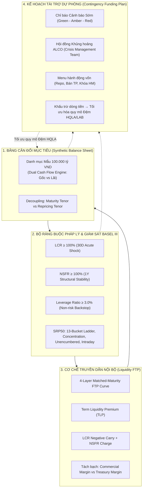

## 1. Tóm Tắt Quản Trị Cấp Cao (Executive Summary)

Một sai lầm kinh điển tại nhiều ngân hàng thương mại là coi các chỉ tiêu quản trị rủi ro thanh khoản như những "bài tập tuân thủ cơ học" (compliance checkboxes) tách rời khỏi hoạt động kinh doanh thường nhật. Phòng Quản lý Rủi ro chỉ lo tính toán báo cáo các tỷ lệ pháp định ([[lcr|LCR]], [[nsfr|NSFR]], [[leverage-ratio|Leverage Ratio]]), trong khi các Khối Kinh doanh (KHDN, KHCN) chỉ tập trung chạy đua doanh số tín dụng và huy động vốn, còn Treasury lại đơn độc xoay xở giải bài toán cân đối nguồn và chi phí vốn.

Khoảng trống quản trị này là nguyên nhân trực tiếp dẫn tới sự sụp đổ của hàng loạt định chế tài chính (từ Northern Rock, Lehman Brothers đến Silicon Valley Bank và Credit Suisse).

Để giải quyết triệt để vấn đề này, kho tri thức ALM kiến tạo một **Khung Điều Hành Quản Trị Thanh Khoản Thực Chiến Toàn Diện (Practical ALM Liquidity Governance Architecture)**. Khung này hợp nhất 4 cỗ máy vận hành thành một thể thống nhất hữu cơ:
1. **Bảng Cân đối Kế toán Mục tiêu ([[synthetic-balance-sheet-liquidity-risk]])**: Thiết kế cấu trúc tài sản - nợ tối ưu trên nền tảng Cỗ máy Dòng tiền Kép (Dual Cash Flow Engine) phân tách rạch ròi Kỳ hạn Gốc và Kỳ hạn Lãi.
2. **Hệ Thống Ràng Buộc Đa Tầng Basel III**: Kiểm soát đồng bộ Lực căng cấp tính 30 ngày ([[lcr|LCR $\ge 100\%$]]), Cấu trúc nguồn vốn ổn định 1 năm ([[nsfr|NSFR $\ge 100\%$]]), Chốt chặn đòn bẩy phi rủi ro ([[leverage-ratio|LR $\ge 3\%$]]), và Bộ 5 công cụ giám sát dòng tiền liên tục ([[liquidity-monitoring-metrics|BCBS SRP50]]).
3. **Cơ Chế Truyền Dẫn Hành Vi Nội Bộ ([[liquidity-transfer-pricing|Liquidity FTP]])**: Áp dụng nguyên tắc Trùng khớp kỳ hạn (Matched-Maturity) và Chi phí cận biên (Marginality) với cấu trúc giá 4 tầng, buộc đơn vị kinh doanh trả phí thanh khoản có kỳ hạn (TLP) và phí gánh đệm HQLA.
4. **Lá Chắn Sinh Tồn Khủng Hoảng ([[contingency-funding-plan|CFP]])**: Kích hoạt cẩm nang tác chiến khủng hoảng qua 3 cấp độ EWIs, mở khóa danh mục hành động vốn khẩn cấp và khấu trừ dòng tiền để tối ưu hóa quy mô đệm tài sản thanh khoản (LAB).

---

## 2. Kiến Trúc 4 Cỗ Máy Tác Chiến Của Khung Điều Hành ALM Thực Chiến

---

## 3. Ma Trận Tích Hợp: Chức Năng, Đơn Vị Phụ Trách và Cơ Chế Tác Chiến

| Cỗ máy Quản trị | Mục tiêu Cốt lõi | Chỉ số Đo lường / Công cụ | Đơn vị Chịu trách nhiệm | Tần suất Vận hành |
| :--- | :--- | :--- | :--- | :---: |
| **Bảng Cân đối Mục tiêu** [[synthetic-balance-sheet-liquidity-risk]] | Định hình cấu trúc TSN - TSC tối ưu lợi nhuận (NIM) và bảo vệ giá trị vốn ([[economic-value-of-equity\|EVE]]) | Tỷ trọng danh mục, Phân kỳ Dòng tiền Gốc $\mathbf{CF}_t^{\text{Prin}}$ và Dòng tiền Lãi $\mathbf{CF}_t^{\text{Int}}$ | Hội đồng ALCO, Ban Giám đốc Khối Tài chính (CFO) | Hàng tháng / Dự phóng 3 năm |
| **Bộ Chỉ số Chuẩn mực Basel III** [[basel-liquidity-monitoring-framework]] | Bảo đảm khả năng chi trả và an toàn vốn trước các cú sốc pháp lệnh | [[lcr\|LCR $\ge 100\%$]], [[nsfr\|NSFR $\ge 100\%$]], [[leverage-ratio\|LR $\ge 3\%$]], [[contractual-maturity-mismatch\|Thang kỳ hạn 13 dải]] | Khối Quản trị Rủi ro (CRO), Phòng Quản trị Rủi ro ALM | Hàng ngày (LCR, LR, Intraday) / Hàng quý (NSFR) |
| **Hệ thống Liquidity FTP** [[liquidity-transfer-pricing]] | Phân bổ chính xác chi phí thanh khoản, triệt tiêu tài trợ chéo và bảo đảm biên thương mại cố định | Cấu trúc lãi suất 4 tầng: Base Rate, TLP, Buffer Carry Charge, NSFR Regulatory Charge | Ban Quản lý Vốn (Treasury / ALM Desk) | Thời gian thực (từng giao dịch phát sinh) |
| **Kế hoạch Tài trợ Dự phòng (CFP)** [[contingency-funding-plan]] | Kích hoạt kịch bản khẩn cấp để sinh tồn qua khủng hoảng thanh khoản cực đoan | EWIs (Tốc độ rút tiền, CDS spread, RTGS stress), Menu hành động vốn khẩn cấp | Crisis Management Team (CEO, CFO, CRO, Head of Treasury) | Theo dõi liên tục / Kích hoạt khi có biến cố |

---

## 4. Năm Nguyên Tắc Vàng Điều Hành ALCO Thực Chiến

Để vận hành thành công Khung Quản trị Thực chiến này, Hội đồng ALCO của ngân hàng phải triệt để thực thi 5 nguyên tắc tác chiến:

### Nguyên tắc 1: Cấm Tuyệt Đối Sử Dụng Lãi Suất Bình Quân Lịch Sử Trong Định Giá (Triệt để tuân thủ Marginality)
- Không bao giờ cho phép các đơn vị kinh doanh lấy lý do "ngân hàng đang thừa vốn tiền gửi giá rẻ bình quân 4%" để chào các gói tín dụng trung dài hạn lãi suất thấp [[src-choudhry-principles-banking#^choudhry-ftp-12]].
- Mọi tài sản tín dụng mới phải được định giá dựa trên **chi phí cơ hội cận biên (Marginal Opportunity Cost)** để huy động một khoản vốn có kỳ hạn tương ứng trên thị trường tài chính bán buôn, cộng thêm chi phí TLP và chi phí dự trữ đệm HQLA [[src-choudhry-principles-banking#^choudhry-ftp-15]].

### Nguyên tắc 2: Tách Rạch Ròi Rủi Ro Chuyển Đổi Kỳ Hạn Khỏi Khối Kinh Doanh (Centralised Risk Transfer)
- Khối Kinh doanh chỉ chịu trách nhiệm duy nhất về **Biên thương mại (Commercial Margin)** và rủi ro tín dụng đối tác.
- Toàn bộ rủi ro chênh lệch kỳ hạn (Maturity Transformation), rủi ro tái định giá lãi suất ([[gap-risk]]) và rủi ro thanh khoản nguồn vốn phải được chuyển giao nguyên vẹn về Treasury thông qua hệ thống FTP trùng khớp kỳ hạn [[src-choudhry-principles-banking#^choudhry-ftp-8]] [[src-choudhry-principles-banking#^choudhry-ftp-10]]. Treasury là đơn vị duy nhất được phép nắm giữ và phòng ngừa rủi ro tổng thể bằng các công cụ thị trường vốn và phái sinh [[interest-rate-swap]].

### Nguyên tắc 3: Hạch Toán Đầy Đủ Chi Phí "Lỗ Mang Vác" Của Kho HQLA Vào Giá Cho Vay (Buffer Carry Internalisation)
- Việc duy trì 17.000 tỷ VND Trái phiếu Chính phủ Level 1 để đạt [[lcr|LCR = 114.17%]] trong Bảng cân đối mẫu [[synthetic-balance-sheet-liquidity-risk]] tạo ra một khoản chi phí cơ hội rất lớn (lợi suất TPCP 3.5% thấp hơn chi phí huy động vốn bình quân 4.5%, tạo ra mức âm carry 1.0% mỗi năm).
- Khoản âm carry này bắt buộc phải được quy đổi thành **Phí Dự trữ Đệm Thanh khoản (Contingent Liquidity Charge)** tính trực tiếp vào lãi suất FTP của các khoản tín dụng doanh nghiệp và các cam kết thanh khoản ngoại bảng [[src-choudhry-principles-banking#^choudhry-ftp-15]]. Điều này ngăn chặn việc tăng trưởng tín dụng ảo làm xói mòn lợi nhuận thực của ngân hàng.

### Nguyên tắc 4: Kết Nối Chặt Chẽ Giữa Giới Hạn Tỷ Lệ Đòn Bẩy Và Kế Hoạch Tăng Trưởng Tài Sản
- Mỗi quyết định mở rộng danh mục tín dụng, tham gia giao dịch Repo hay phát hành cam kết ngoại bảng đều phải được kiểm tra ràng buộc chốt chặn [[leverage-ratio|Tỷ lệ Đòn bẩy $\ge 3\%$]] [[src-bcbs-lev#^lev20-7]].
- Ngân hàng phải áp dụng kỹ thuật tối ưu hóa phơi nhiễm: ưu tiên cam kết có thể hủy ngang vô điều kiện (UCC để hưởng $\text{CCF} = 10\%$), bù trừ song phương qua QCCP và thanh toán ký quỹ tiền mặt hàng ngày (Daily Cash Variation Margin) để triệt tiêu Chi phí thay thế RC về 0 [[leverage-exposure-measure]] [[src-bcbs-lev#^lev30-16]] [[src-bcbs-lev#^lev30-24]].

### Nguyên tắc 5: Thường Xuyên Diễn Tập Kế Hoạch Tài Trợ Dự Phòng Để Giải Phóng Năng Lực Vốn (CFP Stress Drill)
- Bản kế hoạch CFP không được phép là một tập tài liệu "nằm chết trên giá sách". ALCO phải tổ chức diễn tập ứng phó khủng hoảng (Crisis Simulation Drill) ít nhất hàng năm.
- Khi ngân hàng chứng minh được cho Cơ quan Giám sát và Đơn vị Kiểm toán độc lập rằng các hành động trong CFP (như huy động repo từ kho [[available-unencumbered-assets|tài sản unencumbered]], kích hoạt cửa sổ chiết khấu NHTW) có tính khả thi tuyệt đối trong vòng 24–48 giờ, ngân hàng được phép **khấu trừ dòng tiền này vào kịch bản stress**, từ đó hạ thấp quy mô bắt buộc của đệm tài sản HQLA, giải phóng hàng ngàn tỷ đồng vốn sang danh mục tín dụng sinh lời cao [[src-choudhry-principles-banking#^choudhry-cfp-7]] [[src-choudhry-principles-banking#^choudhry-cfp-8]].

## Đề xuất cập nhật
- [2026-10-19] ingest src-tt83-2025-nhnn C3-M5: đã có node [[liquidity-risk-management]] (thoát stub) và [[liquidity-stress-testing]] (mới); TT83/2025 Đ45–49 quy định chiến lược, hạn mức theo tỷ lệ pháp định VN [[src-tt83-2025-nhnn#^d45-3]], stress test tối thiểu 3 kịch bản [[src-tt83-2025-nhnn#^d48-2]], kế hoạch dự phòng 5 nội dung [[src-tt83-2025-nhnn#^d48-4]], báo cáo nội bộ hằng quý [[src-tt83-2025-nhnn#^d49-1]]; cần rà lại phần quy định pháp lệnh và Kế hoạch dự phòng (thêm góc nhìn NHNN).
- [2026-10-19] ingest src-tt83-2025-nhnn C3-M1: đã có node [[risk-limits]], [[stress-testing]]; bộ phận ALM kiểm soát hạn mức rủi ro thanh khoản [[src-tt83-2025-nhnn#^d25-3]]; stress test thanh khoản tối thiểu hằng quý [[src-tt83-2025-nhnn#^d23-5]]; cần rà lại phần phân vai và tần suất.
- [2026-10-19] ingest src-tt83-2025-nhnn C1: đã có node [[alco]] (TT83 Đ6.4.b: Hội đồng ALCO giúp việc Tổng giám đốc về nội dung Đ25.3, họp tối thiểu hằng quý [[src-tt83-2025-nhnn#^d6-4b]]); cần rà lại chỗ nhắc ALCO và góc nhìn NHNN.
- [2026-10-19] ingest src-tata-bank-alm u07: đã có node [[silicon-valley-bank]] có nguồn (số liệu bảng cân đối, phòng ngừa, duration gap 3 năm, giả định duration tiền gửi) [[src-tata-bank-alm#^tata-svb-5]] [[src-tata-bank-alm#^tata-svb-7]] [[src-tata-bank-alm#^tata-svb-9]]; cần rà lại chỗ nhắc SVB, đối chiếu số liệu và thay bằng citation.
- [2026-10-19] ingest src-choudhry-principles-banking u25: case study ALCO (gộp ba ALCO, ghi danh sách tham dự qua Audit) [[src-choudhry-principles-banking#^choudhry-cs-11]] và chiến lược tiền gửi theo chi phí đệm LCR, NII âm [[src-choudhry-principles-banking#^choudhry-cs-20]]; cần rà lại mục quản trị ALCO và chiến lược tiền gửi.
- [2026-10-19] ingest src-choudhry-principles-banking u10/u11/u14: [[alco]] thêm best practice FSA/PRA SS1/13 và ToR Choudhry (CFO chủ tịch, họp hằng tháng, báo cáo Board, pari passu với ExCo) đối chiếu TT83 (giúp việc TGĐ, tối thiểu hằng quý), MI pack có NII/NIM sensitivity và basis risk; cần rà lại phần quản trị ALCO.
- [2026-10-19] ingest src-choudhry-principles-banking u09/u15: [[liquidity-risk-management]] thêm 10 nguyên tắc thanh khoản của Choudhry, liquidity policy statement, mô hình LAB (funding trên 90 ngày, lý tưởng trên 1 năm; survival 2 tuần và 3 tháng; định kỳ bán/repo một phần); cần rà lại phần quản trị thanh khoản và buffer.
- [2026-10-19] ingest src-choudhry-principles-banking u21–u22: đã có node [[key-risk-indicators]]; cần rà lại sơ đồ EWI (Green-Amber-Red) theo khung 4 màu RAYG của Choudhry [[src-choudhry-principles-banking#^choudhry-kri-6]].
- [2026-10-19] ingest src-choudhry-principles-banking u23–u24: đã có node [[ilaap]], [[cash-flow-survival-period]]; [[liquidity-stress-testing]] có thêm góc nhìn UK (survival period, 3 kịch bản firm specific/market wide/combined); cần rà lại phần stress test thanh khoản.
- [2026-10-19] ingest src-choudhry-principles-banking u19: [[liquidity-risk-management]] thêm liquidity management strategy tích hợp với chiến lược vốn, chỉ tiêu ví dụ (buffer 115% stress 90 ngày, LDR 95%, LAB, trần wholesale; liq-13…15) và tiêu chí rating agency (Moody's BFSR, S&P, Fitch; peer-2…6); cần rà lại phần khung điều hành và hệ thống hạn mức.
- [2026-10-20] ingest src-bcbs-framework SRP30: [[liquidity-risk-management]] có bảng Basel SRP30.48–30.52 vs TT83 (liquidity risk tolerance do HĐQT đặt, chi phí thanh khoản trong định giá nội bộ và duyệt sản phẩm mới, stress test làm cơ sở CFP); cần rà lại phần khung quản trị.
- [2026-10-20] ingest src-bcbs-liquidity-principles-2008 p01, p10, p11: đã có node [[bcbs-liquidity-principles]]; [[ilaap]] có bảng thành phần ILAAP theo Basel (thay [cần nguồn]); [[liquidity-stress-testing]] có bảng Basel P10 vs TT83 Đ48 (trục ngắn hạn/kéo dài, phạm vi pháp nhân và trong ngày); cần rà lại phần stress test, ILAAP và CFP.
- [2026-10-20] ingest src-bcbs-liquidity-principles-2008 p02–p04: [[liquidity-risk-management]] thêm dòng Basel vs VN về chiến lược, cấu trúc tập đoàn, báo cáo HĐQT (BCBS 144 P3); [[risk-appetite]] thêm liquidity risk tolerance do HĐQT đặt (P2); cần rà lại phần khung quản trị và Liquidity FTP.
