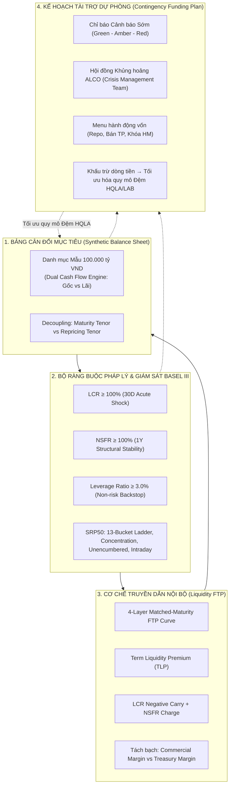

## 1. Tóm Tắt Quản Trị Cấp Cao (Executive Summary)

Một sai lầm kinh điển tại nhiều ngân hàng thương mại là coi các chỉ tiêu quản trị rủi ro thanh khoản như những "bài tập tuân thủ cơ học" (compliance checkboxes) tách rời khỏi hoạt động kinh doanh thường nhật. Phòng Quản lý Rủi ro chỉ lo tính toán báo cáo các tỷ lệ pháp định ([[lcr|LCR]], [[nsfr|NSFR]], [[leverage-ratio|Leverage Ratio]]), trong khi các Khối Kinh doanh (KHDN, KHCN) chỉ tập trung chạy đua doanh số tín dụng và huy động vốn, còn Treasury lại đơn độc xoay xở giải bài toán cân đối nguồn và chi phí vốn.

Ví dụ có nguồn trong wiki: [[silicon-valley-bank]] sụp đổ ngày 10/3/2023 [[src-tata-bank-alm#^tata-svb-1]], với tài sản duration dài được tài trợ bằng tiền gửi ngắn hạn, tập trung và không được bảo hiểm [[src-tata-bank-alm#^tata-svb-7]]. Duration gap khoảng 3 năm ngay cả khi giả định duration tiền gửi gửi tạm 1 năm [[src-tata-bank-alm#^tata-svb-7]]; tháng 4/2022 SVB tăng giả định duration tiền gửi [[src-tata-bank-alm#^tata-svb-9]]. Các trường hợp Northern Rock, Lehman Brothers, Credit Suisse: [cần nguồn].

Để giải quyết triệt để vấn đề này, kho tri thức ALM kiến tạo một **Khung Điều Hành Quản Trị Thanh Khoản Thực Chiến Toàn Diện (Practical ALM Liquidity Governance Architecture)**. Khung này hợp nhất 4 cỗ máy vận hành thành một thể thống nhất hữu cơ:
1. **Bảng Cân đối Kế toán Mục tiêu ([[synthetic-balance-sheet-liquidity-risk]])**: Thiết kế cấu trúc tài sản - nợ tối ưu trên nền tảng Cỗ máy Dòng tiền Kép (Dual Cash Flow Engine) phân tách rạch ròi Kỳ hạn Gốc và Kỳ hạn Lãi.
2. **Hệ Thống Ràng Buộc Đa Tầng Basel III**: Kiểm soát đồng bộ Lực căng cấp tính 30 ngày ([[lcr|LCR $\ge 100\%$]]), Cấu trúc nguồn vốn ổn định 1 năm ([[nsfr|NSFR $\ge 100\%$]]), Chốt chặn đòn bẩy phi rủi ro ([[leverage-ratio|LR $\ge 3\%$]]), và Bộ 5 công cụ giám sát dòng tiền liên tục ([[liquidity-monitoring-metrics|BCBS SRP50]]).
3. **Cơ Chế Truyền Dẫn Hành Vi Nội Bộ ([[liquidity-transfer-pricing|Liquidity FTP]])**: Áp dụng nguyên tắc Trùng khớp kỳ hạn (Matched-Maturity) và Chi phí cận biên (Marginality) với cấu trúc giá 4 tầng, buộc đơn vị kinh doanh trả phí thanh khoản có kỳ hạn (TLP) và phí gánh đệm HQLA.
4. **Lá Chắn Sinh Tồn Khủng Hoảng ([[contingency-funding-plan|CFP]])**: Kích hoạt cẩm nang tác chiến khủng hoảng qua 3 cấp độ EWIs, mở khóa danh mục hành động vốn khẩn cấp và khấu trừ dòng tiền để tối ưu hóa quy mô đệm tài sản thanh khoản (LAB).

---

## 2. Kiến Trúc 4 Cỗ Máy Tác Chiến Của Khung Điều Hành ALM Thực Chiến

---

## 3. Ma Trận Tích Hợp: Chức Năng, Đơn Vị Phụ Trách và Cơ Chế Tác Chiến

| Cỗ máy Quản trị | Mục tiêu Cốt lõi | Chỉ số Đo lường / Công cụ | Đơn vị Chịu trách nhiệm | Tần suất Vận hành |
| :--- | :--- | :--- | :--- | :---: |
| **Bảng Cân đối Mục tiêu** [[synthetic-balance-sheet-liquidity-risk]] | Định hình cấu trúc TSN - TSC tối ưu lợi nhuận (NIM) và bảo vệ giá trị vốn ([[economic-value-of-equity\|EVE]]) | Tỷ trọng danh mục, Phân kỳ Dòng tiền Gốc $\mathbf{CF}_t^{\text{Prin}}$ và Dòng tiền Lãi $\mathbf{CF}_t^{\text{Int}}$ | Hội đồng ALCO, Ban Giám đốc Khối Tài chính (CFO) | Hàng tháng / Dự phóng 3 năm |
| **Bộ Chỉ số Chuẩn mực Basel III** [[basel-liquidity-monitoring-framework]] | Bảo đảm khả năng chi trả và an toàn vốn trước các cú sốc pháp lệnh | [[lcr\|LCR $\ge 100\%$]], [[nsfr\|NSFR $\ge 100\%$]], [[leverage-ratio\|LR $\ge 3\%$]], [[contractual-maturity-mismatch\|Thang kỳ hạn 13 dải]] | Khối Quản trị Rủi ro (CRO), Phòng Quản trị Rủi ro ALM | Hàng ngày (LCR, LR, Intraday) / Hàng quý (NSFR) |
| **Hệ thống Liquidity FTP** [[liquidity-transfer-pricing]] | Phân bổ chính xác chi phí thanh khoản, triệt tiêu tài trợ chéo và bảo đảm biên thương mại cố định | Cấu trúc lãi suất 4 tầng: Base Rate, TLP, Buffer Carry Charge, NSFR Regulatory Charge | Ban Quản lý Vốn (Treasury / ALM Desk) | Thời gian thực (từng giao dịch phát sinh) |
| **Kế hoạch Tài trợ Dự phòng (CFP)** [[contingency-funding-plan]] | Kích hoạt kịch bản khẩn cấp để sinh tồn qua khủng hoảng thanh khoản cực đoan | EWIs (Tốc độ rút tiền, CDS spread, RTGS stress), Menu hành động vốn khẩn cấp | Crisis Management Team (CEO, CFO, CRO, Head of Treasury) | Theo dõi liên tục / Kích hoạt khi có biến cố |

---

## 4. Năm Nguyên Tắc Vàng Điều Hành ALCO Thực Chiến

Để vận hành thành công Khung Quản trị Thực chiến này, Hội đồng ALCO của ngân hàng phải triệt để thực thi 5 nguyên tắc tác chiến:

### Nguyên tắc 1: Cấm Tuyệt Đối Sử Dụng Lãi Suất Bình Quân Lịch Sử Trong Định Giá (Triệt để tuân thủ Marginality)
- Không bao giờ cho phép các đơn vị kinh doanh lấy lý do "ngân hàng đang thừa vốn tiền gửi giá rẻ bình quân 4%" để chào các gói tín dụng trung dài hạn lãi suất thấp [[src-choudhry-principles-banking#^choudhry-ftp-12]].
- Mọi tài sản tín dụng mới phải được định giá dựa trên **chi phí cơ hội cận biên (Marginal Opportunity Cost)** để huy động một khoản vốn có kỳ hạn tương ứng trên thị trường tài chính bán buôn, cộng thêm chi phí TLP và chi phí dự trữ đệm HQLA [[src-choudhry-principles-banking#^choudhry-ftp-15]].

### Nguyên tắc 2: Tách Rạch Ròi Rủi Ro Chuyển Đổi Kỳ Hạn Khỏi Khối Kinh Doanh (Centralised Risk Transfer)
- Khối Kinh doanh chỉ chịu trách nhiệm duy nhất về **Biên thương mại (Commercial Margin)** và rủi ro tín dụng đối tác.
- Toàn bộ rủi ro chênh lệch kỳ hạn (Maturity Transformation), rủi ro tái định giá lãi suất ([[gap-risk]]) và rủi ro thanh khoản nguồn vốn phải được chuyển giao nguyên vẹn về Treasury thông qua hệ thống FTP trùng khớp kỳ hạn [[src-choudhry-principles-banking#^choudhry-ftp-8]] [[src-choudhry-principles-banking#^choudhry-ftp-10]]. Treasury là đơn vị duy nhất được phép nắm giữ và phòng ngừa rủi ro tổng thể bằng các công cụ thị trường vốn và phái sinh [[interest-rate-swap]].

### Nguyên tắc 3: Hạch Toán Đầy Đủ Chi Phí "Lỗ Mang Vác" Của Kho HQLA Vào Giá Cho Vay (Buffer Carry Internalisation)
- Việc duy trì 17.000 tỷ VND Trái phiếu Chính phủ Level 1 để đạt [[lcr|LCR = 114.17%]] trong Bảng cân đối mẫu [[synthetic-balance-sheet-liquidity-risk]] tạo ra một khoản chi phí cơ hội rất lớn (lợi suất TPCP 3.5% thấp hơn chi phí huy động vốn bình quân 4.5%, tạo ra mức âm carry 1.0% mỗi năm).
- Khoản âm carry này bắt buộc phải được quy đổi thành **Phí Dự trữ Đệm Thanh khoản (Contingent Liquidity Charge)** tính trực tiếp vào lãi suất FTP của các khoản tín dụng doanh nghiệp và các cam kết thanh khoản ngoại bảng [[src-choudhry-principles-banking#^choudhry-ftp-15]]. Điều này ngăn chặn việc tăng trưởng tín dụng ảo làm xói mòn lợi nhuận thực của ngân hàng.

### Nguyên tắc 4: Kết Nối Chặt Chẽ Giữa Giới Hạn Tỷ Lệ Đòn Bẩy Và Kế Hoạch Tăng Trưởng Tài Sản
- Mỗi quyết định mở rộng danh mục tín dụng, tham gia giao dịch Repo hay phát hành cam kết ngoại bảng đều phải được kiểm tra ràng buộc chốt chặn [[leverage-ratio|Tỷ lệ Đòn bẩy $\ge 3\%$]] [[src-bcbs-lev#^lev20-7]].
- Ngân hàng phải áp dụng kỹ thuật tối ưu hóa phơi nhiễm: ưu tiên cam kết có thể hủy ngang vô điều kiện (UCC để hưởng $\text{CCF} = 10\%$), bù trừ song phương qua QCCP và thanh toán ký quỹ tiền mặt hàng ngày (Daily Cash Variation Margin) để triệt tiêu Chi phí thay thế RC về 0 [[leverage-exposure-measure]] [[src-bcbs-lev#^lev30-16]] [[src-bcbs-lev#^lev30-24]].

### Nguyên tắc 5: Thường Xuyên Diễn Tập Kế Hoạch Tài Trợ Dự Phòng Để Giải Phóng Năng Lực Vốn (CFP Stress Drill)
- Bản kế hoạch CFP không được phép là một tập tài liệu "nằm chết trên giá sách". ALCO phải tổ chức diễn tập ứng phó khủng hoảng (Crisis Simulation Drill) ít nhất hàng năm.
- Khi ngân hàng chứng minh được cho Cơ quan Giám sát và Đơn vị Kiểm toán độc lập rằng các hành động trong CFP (như huy động repo từ kho [[available-unencumbered-assets|tài sản unencumbered]], kích hoạt cửa sổ chiết khấu NHTW) có tính khả thi tuyệt đối trong vòng 24–48 giờ, ngân hàng được phép **khấu trừ dòng tiền này vào kịch bản stress**, từ đó hạ thấp quy mô bắt buộc của đệm tài sản HQLA, giải phóng hàng ngàn tỷ đồng vốn sang danh mục tín dụng sinh lời cao [[src-choudhry-principles-banking#^choudhry-cfp-7]] [[src-choudhry-principles-banking#^choudhry-cfp-8]].

## 5. Đối Chiếu NHNN và Basel Cho Khung Điều Hành

Với nghĩa vụ tại VN, TT83/2025 (hiệu lực 01/07/2026 [[src-tt83-2025-nhnn#^d74-1]]) là căn cứ; Basel và Choudhry là tham chiếu. Các tỷ lệ LCR/NSFR ở trên là chuẩn Basel. Tại VN, [[tt50-2026]] áp dụng LCR và NSFR từ 01/10/2028 [[src-tt50-2026-nhnn#^d13-1]]: LCR quy VNĐ riêng lẻ 50% năm đầu, tăng 10 điểm mỗi năm, 100% từ 01/10/2033 [[src-tt50-2026-nhnn#^d16-1c]]; NSFR riêng lẻ 90%, 95%, 100% từ 01/10/2030 [[src-tt50-2026-nhnn#^d22-2]]. Trước đó ngân hàng tuân thủ các tỷ lệ của TT22/2019 [[src-tt50-2026-nhnn#^d13-4]]. Hệ số HQLA, hệ số rút tiền và ASF/RSF của VN xem bảng Basel vs VN trong [[lcr]] và [[nsfr]].

**NHNN (TT83/2025):**
- Hội đồng [[alco|ALCO]] đề xuất, tham mưu Tổng giám đốc về quản lý tài sản/nợ; chủ tịch là Tổng giám đốc hoặc người điều hành khác tại trụ sở chính; họp định kỳ tối thiểu mỗi quý 01 lần [[src-tt83-2025-nhnn#^d6-4b]].
- Bộ phận ALM kiểm soát hoạt động kinh doanh tuân thủ hạn mức rủi ro thanh khoản và hạn mức IRRBB [[src-tt83-2025-nhnn#^d25-3]].
- Hạn mức rủi ro thanh khoản gồm tỷ lệ khả năng chi trả, tỷ lệ dư nợ cho vay so với tổng tiền gửi, tỷ lệ tối đa nguồn vốn ngắn hạn cho vay trung dài hạn (nếu áp dụng), tỷ lệ khác theo pháp luật và hạn mức nội bộ [[src-tt83-2025-nhnn#^d45-3]]. Xem [[risk-limits]], [[liquidity-risk-management]].
- Kiểm tra sức chịu đựng về thanh khoản định kỳ tối thiểu hằng quý và khi có sự kiện có thể tác động nghiêm trọng tới thanh khoản [[src-tt83-2025-nhnn#^d23-5]], với tối thiểu 3 kịch bản: đặc thù ngân hàng, toàn hệ thống, hỗn hợp [[src-tt83-2025-nhnn#^d48-2]]. Xem [[liquidity-stress-testing]], [[stress-testing]].
- Căn cứ kết quả kiểm tra sức chịu đựng, ngân hàng phải lập kế hoạch dự phòng tối thiểu gồm: nhận diện khủng hoảng và sự kiện kích hoạt; thẩm quyền kích hoạt và vai trò; nguồn dự phòng tài chính; báo cáo, trao đổi thông tin trong và ngoài ngân hàng (kể cả NHNN); rà soát định kỳ [[src-tt83-2025-nhnn#^d48-4]]. Xem [[contingency-funding-plan]].
- Báo cáo nội bộ về rủi ro thanh khoản lập định kỳ tối thiểu hằng quý hoặc đột xuất [[src-tt83-2025-nhnn#^d49-1]].

**Basel (tham chiếu):**
- HĐQT nên đặt liquidity risk tolerance [[src-bcbs-liquidity-principles-2008#^lrm-10]] [[src-bcbs-framework#^srp30-50]]; ban điều hành xây chiến lược thanh khoản, HĐQT phê duyệt và rà soát ít nhất hằng năm [[src-bcbs-liquidity-principles-2008#^lrm-11]]. Xem [[risk-appetite]].
- Ngân hàng nên đưa chi phí, lợi ích, rủi ro thanh khoản vào định giá nội bộ, đo lường hiệu quả và duyệt sản phẩm mới [[src-bcbs-framework#^srp30-50]] [[src-bcbs-liquidity-principles-2008#^lrm-p04]]. Xem [[liquidity-transfer-pricing]].
- Stress test định kỳ với kịch bản ngắn hạn và kéo dài, riêng ngân hàng và toàn thị trường, đơn lẻ và kết hợp [[src-bcbs-liquidity-principles-2008#^lrm-p10]]; kết quả định hình CFP [[src-bcbs-framework#^srp30-51]]. CFP gắn với kết quả stress test, rà soát ít nhất hằng năm [[src-bcbs-liquidity-principles-2008#^lrm-112]] [[src-bcbs-liquidity-principles-2008#^lrm-121]]. Các thành phần tương ứng ILAAP: xem [[ilaap]], [[bcbs-liquidity-principles]].
- Đo lường và hạn mức (P5): dự phóng dòng tiền theo bốn chiều: tài sản và nợ, nhu cầu tiềm tàng ngoại bảng, đồng tiền, đại lý/lưu ký/thanh toán [[src-bcbs-liquidity-principles-2008#^lrm-28]]; hạn mức rủi ro thanh khoản và thủ tục leo thang nên được đặt và rà soát định kỳ [[src-bcbs-liquidity-principles-2008#^lrm-50]]; bộ chỉ báo sớm kích hoạt đánh giá và phản ứng của ban điều hành [[src-bcbs-liquidity-principles-2008#^lrm-53]].
- MIS (P5): tính được vị thế thanh khoản theo mọi đồng tiền, từng công ty con/chi nhánh và hợp nhất; báo cáo thường xuyên, ví dụ hằng ngày cho bộ phận quản lý thanh khoản [[src-bcbs-liquidity-principles-2008#^lrm-56]].
- Pháp nhân, funding, trong ngày, tài sản bảo đảm (P6–P9) [[src-bcbs-liquidity-principles-2008#^lrm-p06]] [[src-bcbs-liquidity-principles-2008#^lrm-p07]] [[src-bcbs-liquidity-principles-2008#^lrm-p08]] [[src-bcbs-liquidity-principles-2008#^lrm-p09]]; đệm gắn với nhu cầu stress (P12) [[src-bcbs-liquidity-principles-2008#^lrm-123]].

*Diễn giải (đối chiếu P5 với TT83):* hạn mức trong TT83 Đ45.3 gồm tỷ lệ pháp định và hạn mức nội bộ [[src-tt83-2025-nhnn#^d45-3]], tương ứng ý "hạn mức và leo thang" của P5. TT83 Đ49.1 chỉ đặt tần suất tối thiểu hằng quý cho báo cáo nội bộ [[src-tt83-2025-nhnn#^d49-1]], thưa hơn nhiều so với MIS hằng ngày mà BCBS 144 nêu làm ví dụ.

**Thực hành UK (Choudhry, T4):**
- ToR ALCO theo FSA/PRA SS1/13: CFO làm chủ tịch [[src-choudhry-principles-banking#^choudhry-alco-7]] [[src-choudhry-principles-banking#^choudhry-alco-12]]. Case CS4: ba ALCO được gộp thành một, danh sách tham dự do Internal Audit theo dõi, một MI deck mỗi tháng [[src-choudhry-principles-banking#^choudhry-cs-11]]. Xem [[alco]].
- Chiến lược tiền gửi được ALCO phê duyệt theo chi phí đệm LCR và NII âm (CS6) [[src-choudhry-principles-banking#^choudhry-cs-20]].
- Chiến lược thanh khoản gắn với chiến lược vốn, gồm CFP, liquidity risk tolerance và kế hoạch đa dạng hoá nguồn vốn [[src-choudhry-principles-banking#^choudhry-liq-13]]. LAB tài trợ bằng nguồn trên 90 ngày, lý tưởng trên 1 năm [[src-choudhry-principles-banking#^choudhry-lab-2]]; quy mô đủ sống qua stress 2 tuần và stress toàn thị trường 3 tháng [[src-choudhry-principles-banking#^choudhry-lab-3]]; định kỳ bán hoặc repo một phần để chứng minh thanh khoản [[src-choudhry-principles-banking#^choudhry-lab-4]].
- Liquidity stress test nằm trong ILAAP; output chính là [[cash-flow-survival-period]] [[src-choudhry-principles-banking#^choudhry-ilaap-5]].
- KRI hiệu chỉnh bốn mức màu RAYG, thêm "yellow" giữa green và amber [[src-choudhry-principles-banking#^choudhry-kri-6]]. Xem [[key-risk-indicators]].

*Diễn giải:*
- Sơ đồ mục 2 dùng EWI ba màu (Green, Amber, Red); khung RAYG của Choudhry có bốn mức.
- Bảng mục 3 ghi tần suất hằng tháng cho dòng Bảng Cân đối Mục tiêu do Hội đồng ALCO phụ trách; TT83 chỉ đặt mức họp tối thiểu hằng quý, nên hằng tháng là lựa chọn nội bộ.
- Mục 4 đặt ALCO là nơi thực thi nguyên tắc; theo TT83, ALCO tham mưu và Tổng giám đốc quyết định.

## Bất định
- [2026-10-20] ingest src-tt50-2026-nhnn C2-M5: [[lcr]], [[nsfr]], [[hqla]] có giá trị VN theo [[tt50-2026]] (LCR/NSFR áp dụng từ 01/10/2028, LCR quy VNĐ 50% → 100% tới 01/10/2033, NSFR 90% → 100% tới 01/10/2030; trước đó vẫn tuân thủ tỷ lệ TT22/2019); cần rà lại các câu về nghĩa vụ LCR/NSFR tại VN và chỗ dẫn TT22. → R2 đã rà [2026-10-20]: câu về nghĩa vụ LCR/NSFR tại VN đã dẫn TT50 Đ13.1, Đ16.1.c, Đ22.2.
- [2026-10-20] ingest src-tt50-2026-nhnn C2-M2, C2-M4: [[leverage-ratio]] VN chưa có ngưỡng cố định (Thống đốc quyết định khi cần thiết); [[loan-to-deposit-ratio]] VN tối đa 95% từ khi áp dụng LCR/NSFR; cần rà lại câu về ngưỡng LR/LDR tại VN.
- [2026-10-20] ingest src-tt50-2026-nhnn PL2: [[available-stable-funding]], [[required-stable-funding]], [[nsfr]] có hệ số ASF/RSF của VN (khác Basel: tiền gửi bán lẻ ≥ 1 năm được rút trước hạn chỉ 95%/90%; phải đòi Chính phủ/KBNN RSF 50–65%; add-on nợ phái sinh 10%); cần rà lại các ví dụ tính NSFR và bảng hệ số.
- [2026-10-20] ingest src-tt50-2026-nhnn PL1: [[lcr]], [[hqla]], [[cash-outflows]], [[retail-deposit-stability]], [[level-1-assets]], [[level-2-assets]] có hệ số VN (HQLA cấp 1/2A/2B 100/85/75–50%, run-off bán lẻ 5%/10%, tiền gửi ngoại tệ luôn kém ổn định, DNNVV ≤ 30 tỷ đồng, cổ phiếu VN30 vào cấp 2B); cần rà lại ví dụ tính LCR và bảng hệ số.
- [2026-10-21] ingest src-tt50-2026-nhnn PL3: [[leverage-exposure-measure]], [[leverage-ratio]] có giá trị VN thay [cần nguồn]: EM theo TT50 PL3 tính mọi tài sản nội bảng (kể cả TPCP), nhưng repo, reverse repo tính bằng RWA đối tác chia hệ số rủi ro (khác Basel: SFT gộp + E*); LEV VN chưa có ngưỡng cố định; cần rà lại các câu về xung đột HQLA–LR và chi phí đòn bẩy của repo.
- [2026-10-21] ingest src-tt50-2026-nhnn C2-M6: đã có node [[government-bond-holding-ratio]]: TT50 Đ28 giới hạn số dư TPCP, trái phiếu được Chính phủ bảo lãnh tối đa 30% Tổng Nợ phải trả bình quân tháng liền kề trước; cần rà lại đoạn chi phí cơ hội của 17.000 tỷ TPCP Level 1 (kiểm tra trần 30%).

## Đề xuất cập nhật
*Chưa có nội dung cần cập nhật.*
